# SAE top-feature heatmaps

Discovery examples only. No training or suppression. Labels come from prompts.

Original SDXL-Unbox style: blocky jet blue–green–yellow–red colors at 60% opacity. Each image is scaled to its own map minimum/maximum; compare CSV values for absolute magnitudes.

## black man

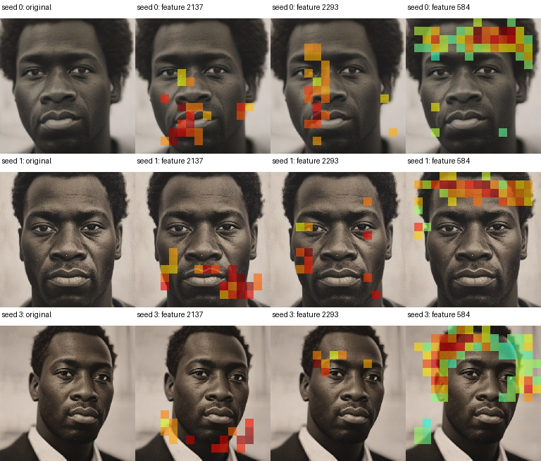

## white man

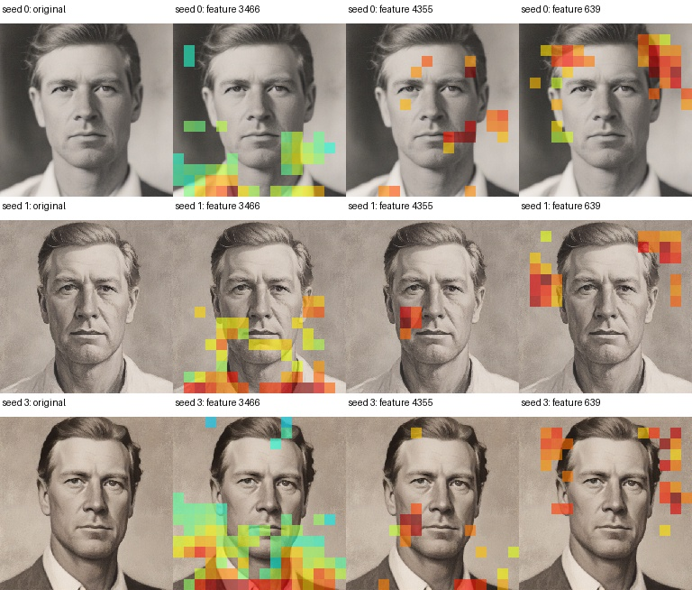

## east asian man

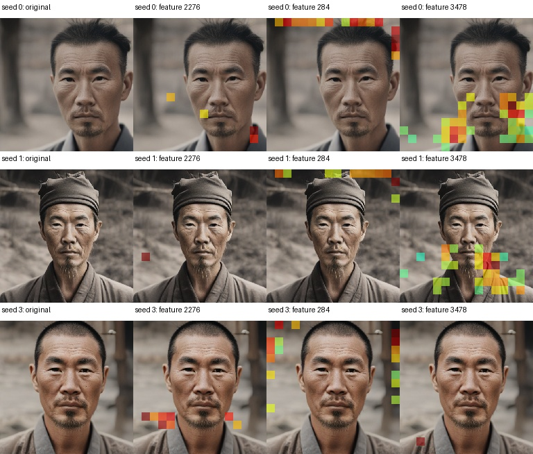

## middle eastern man

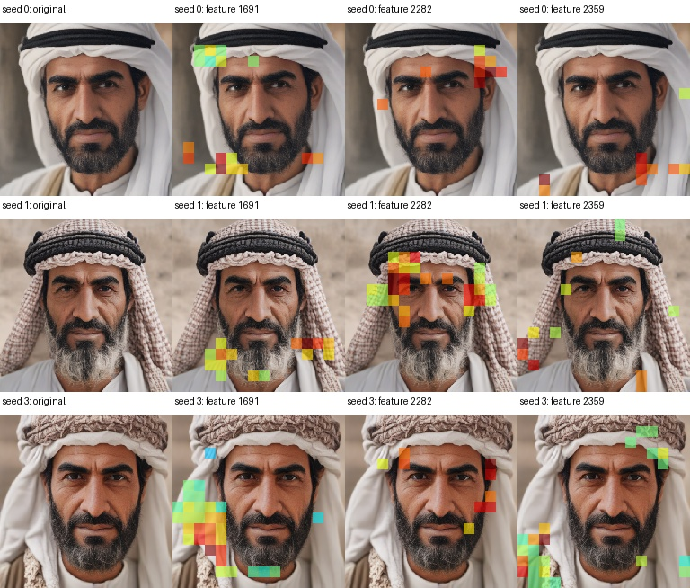

## indian man

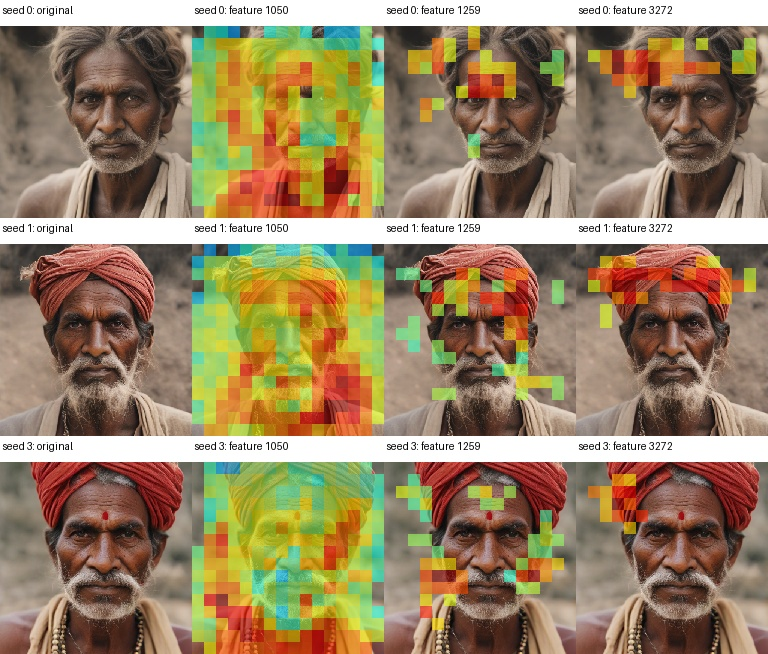

## hispanic man

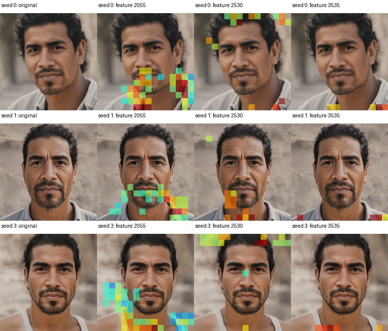

## black woman

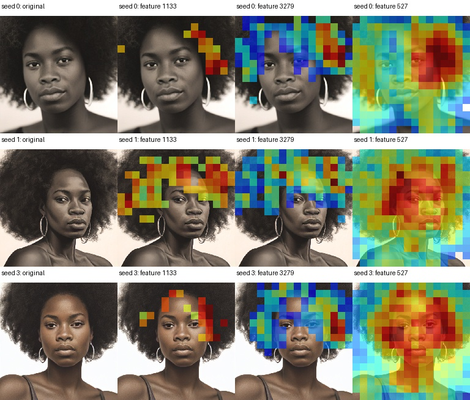

## white woman

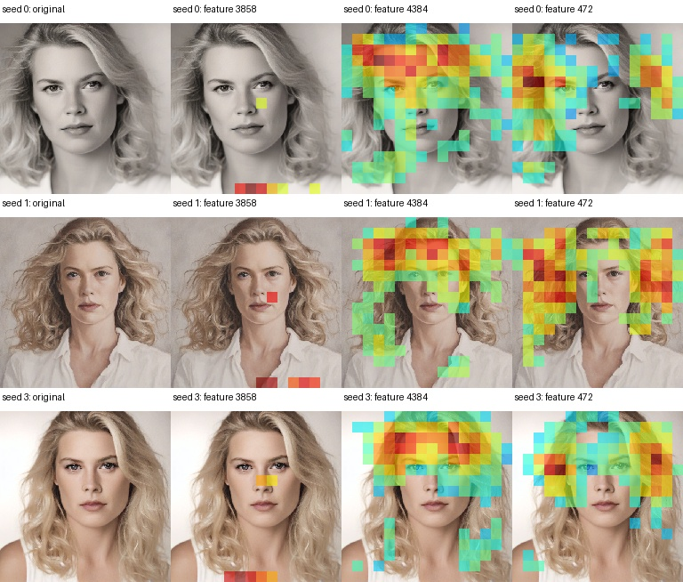

## east asian woman

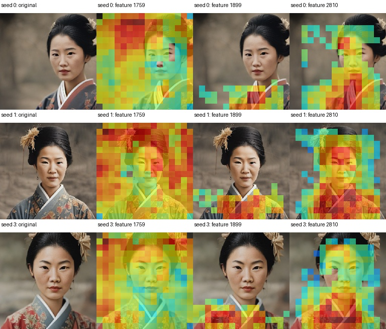

## middle eastern woman

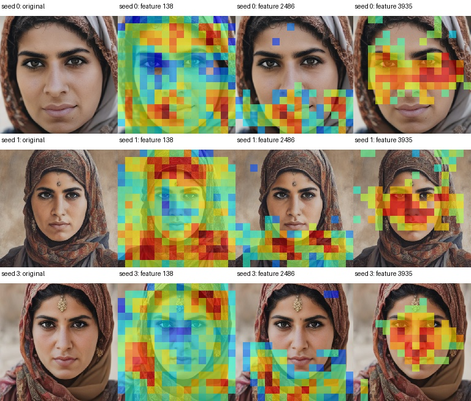

## indian woman

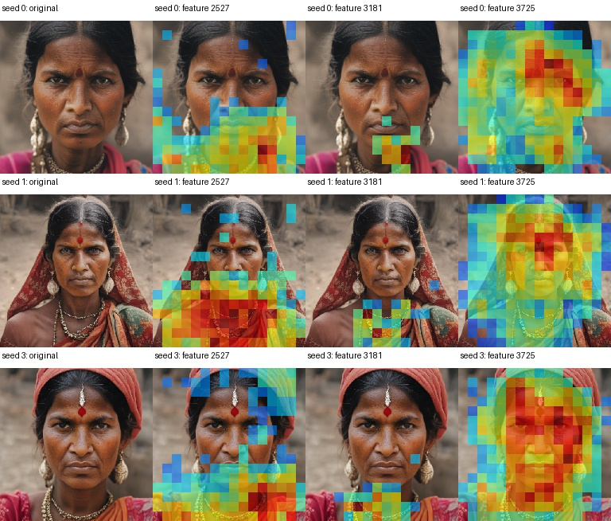

## hispanic woman

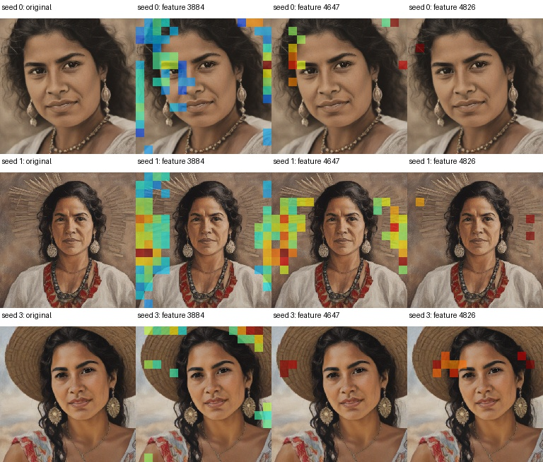
