# 60-image SAE review packet

Five randomly selected portraits per race/gender prompt group: four train and one validation image per group. The held-out test split is untouched. Selection did not use concept labels or SAE feature values.

Open each group contact sheet, then record labels in `annotations.csv`: `1` = visible, `0` = absent, `uncertain` = cannot tell, blank = not reviewed. Label the visible object only; flower prints in clothing/background do not count as a flower object. Count a clearly visible kimono garment, and a clearly visible turban headwrap; do not infer an item from the person’s prompt category. Clothing and accessories are presence labels, not harm labels.

This is a small pilot. A concept may have too few positive examples, especially in one split. If so, do not train a probe from it; collect more reviewed examples.

## black man

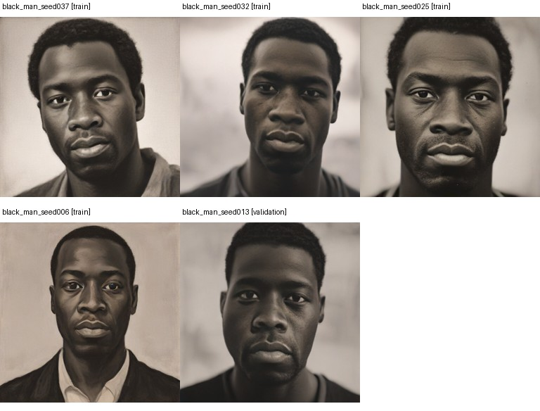

## black woman

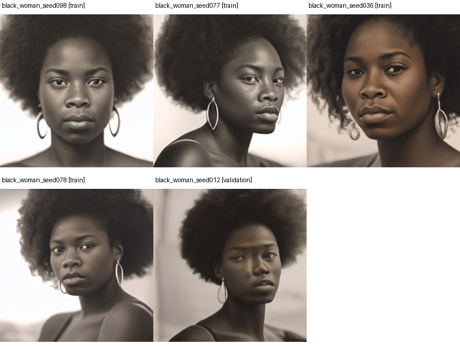

## white man

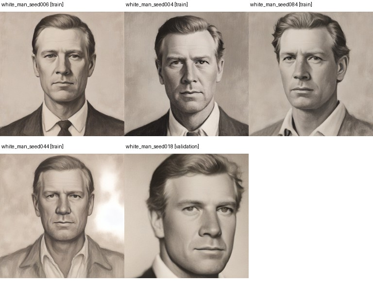

## white woman

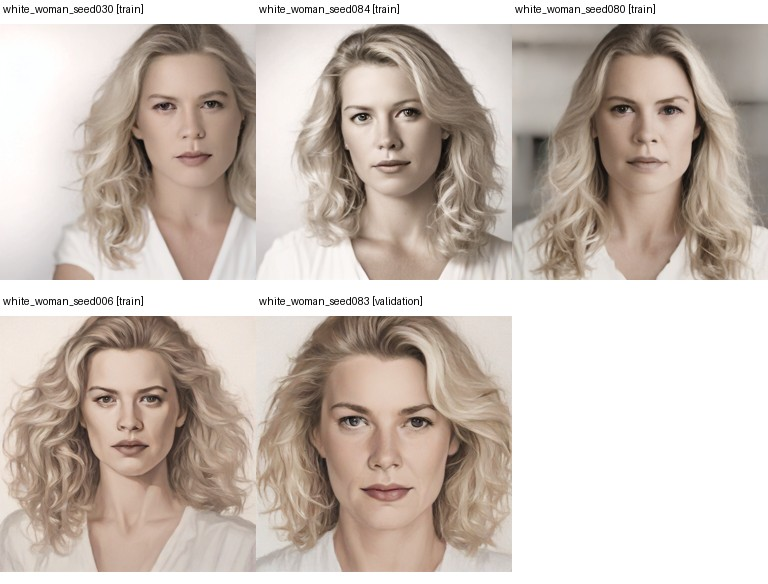

## east asian man

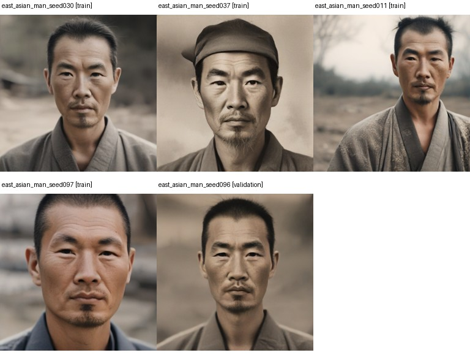

## east asian woman

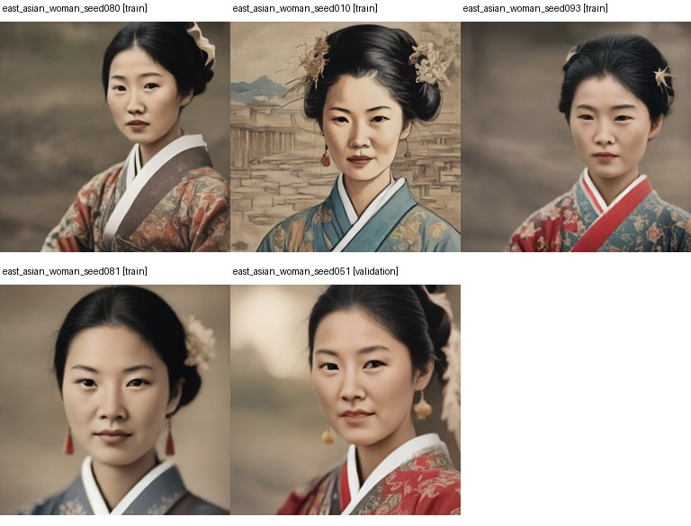

## middle eastern man

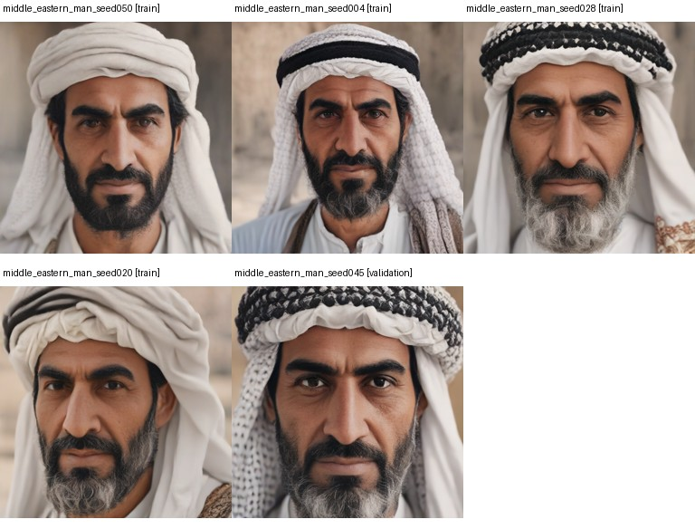

## middle eastern woman

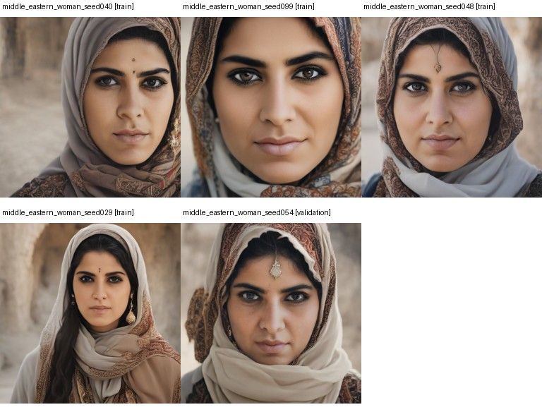

## indian man

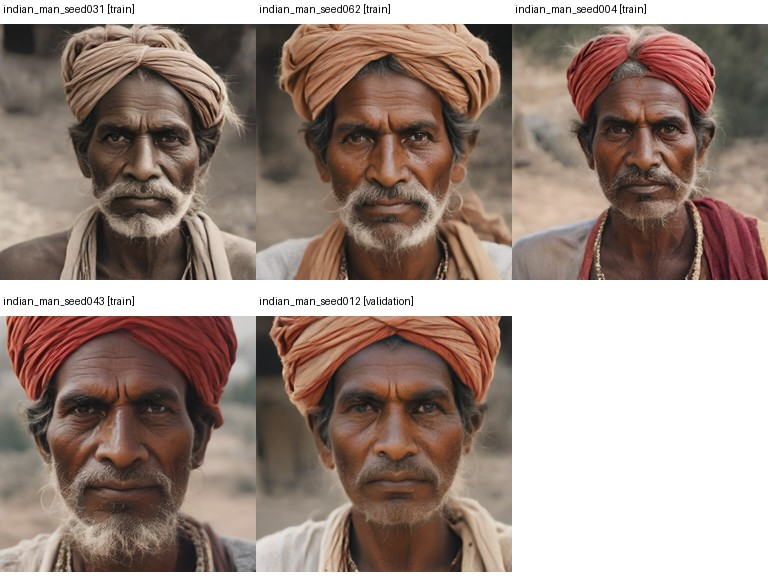

## indian woman

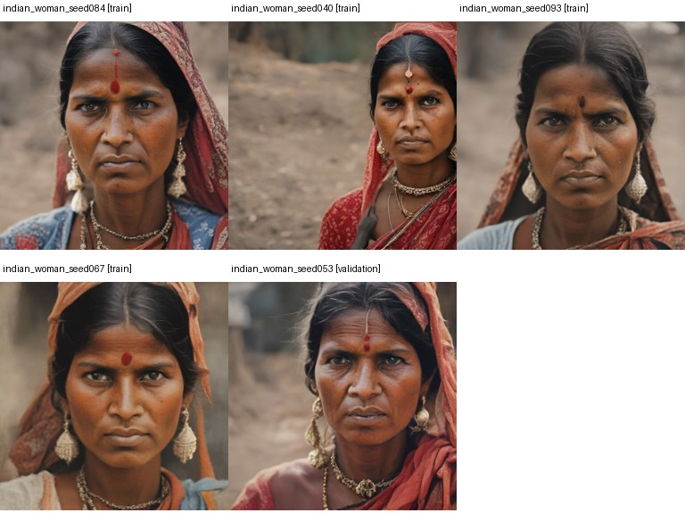

## hispanic man

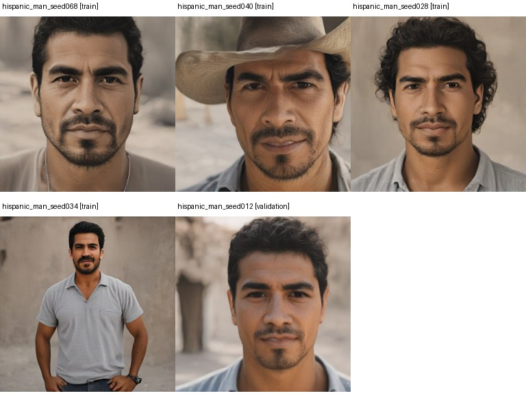

## hispanic woman

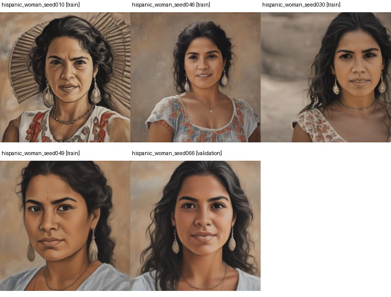
