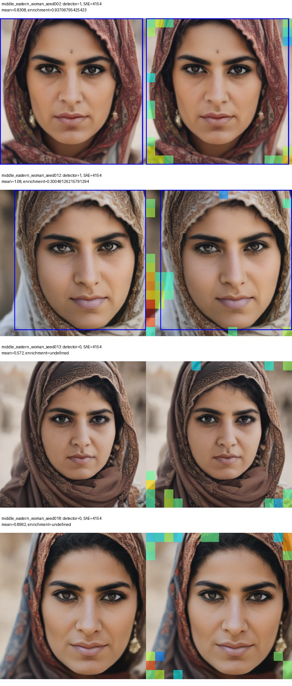
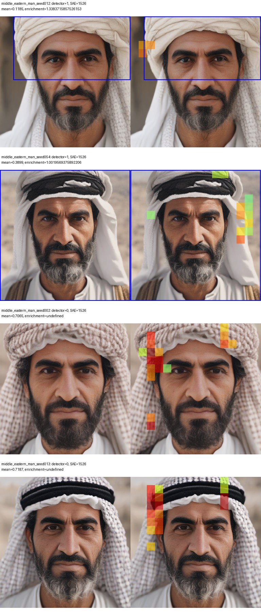
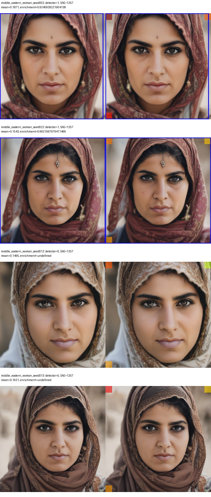
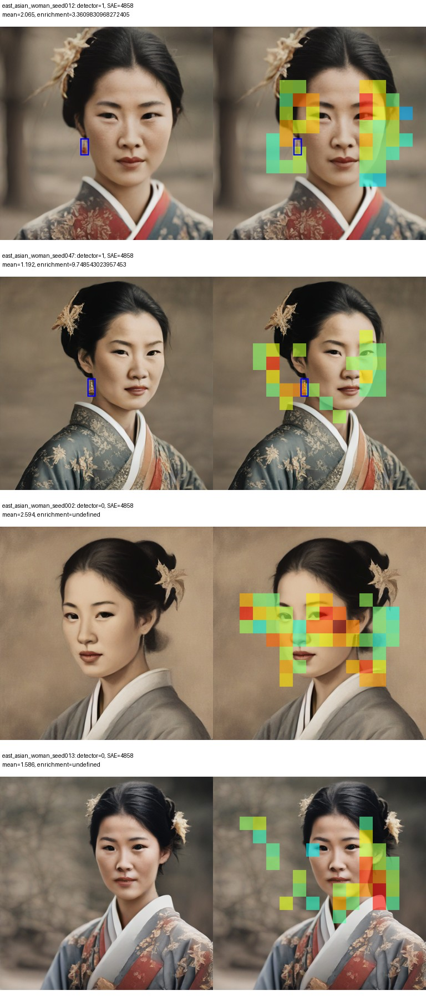
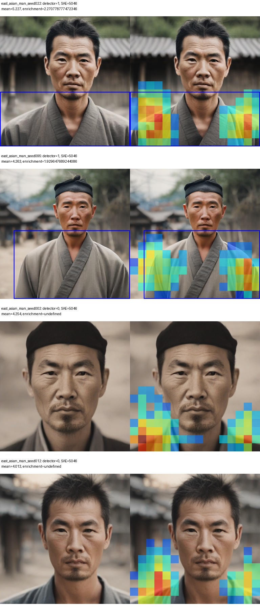
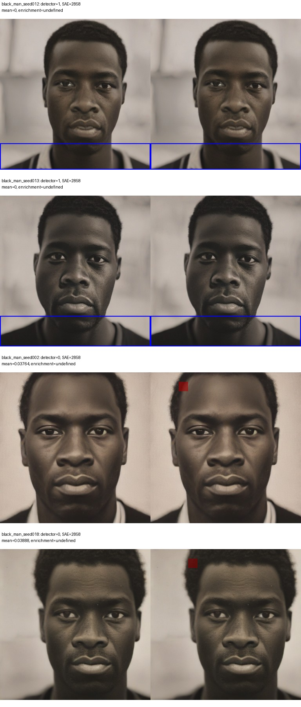
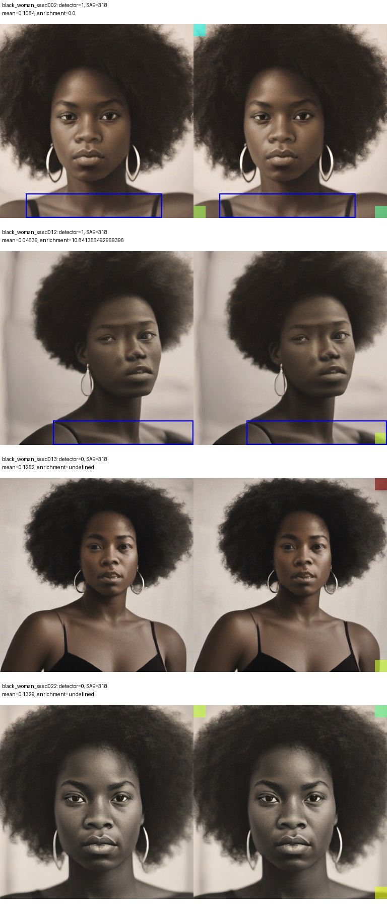
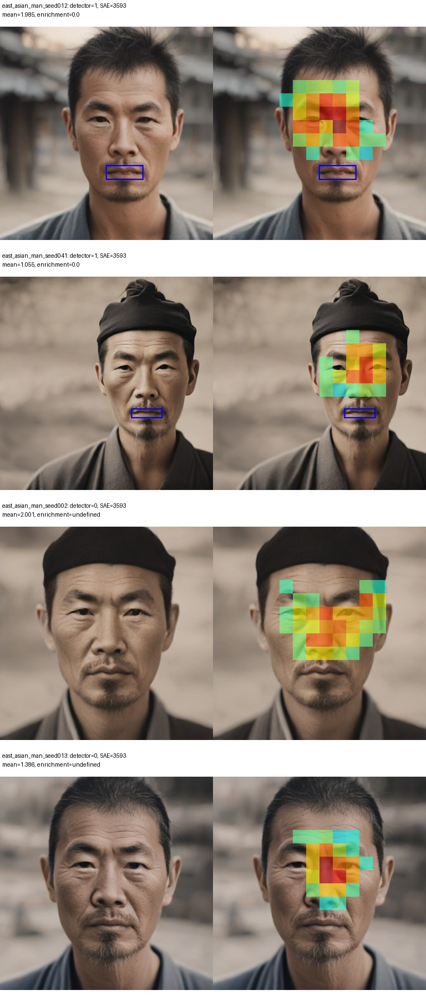
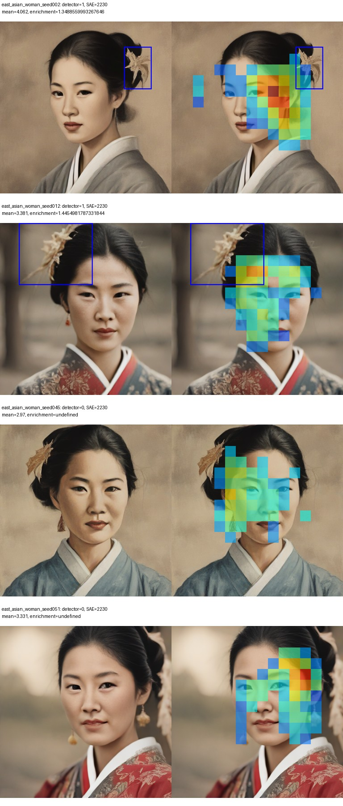
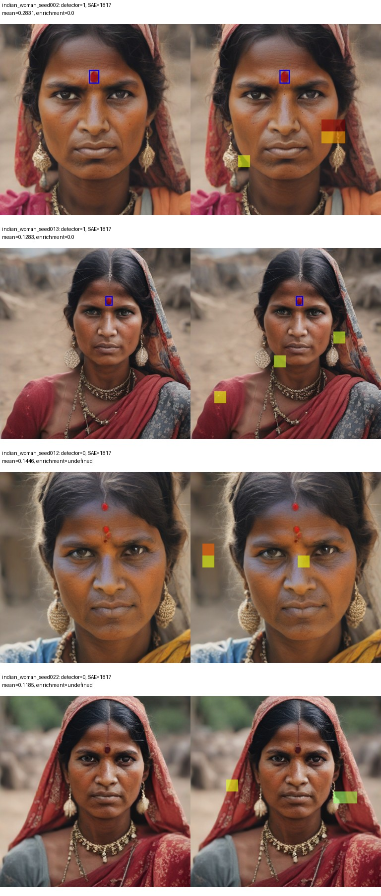

# C2C–SAE candidate intersections

All 240 validation images were replayed with exact pixel identity. No SAE or diffusion training or suppression. Feature IDs were fixed by the earlier train-only ranking. Detector labels and boxes remain unreviewed.

Spatial enrichment = fraction of feature activation inside matching boxes / fraction of image covered by those boxes. Uniform spatial activation has enrichment 1. Zero-activation maps are excluded from localization ratios and counted separately. Box coverage accounts for coarse SAE cells. Circular map translations provide an exploratory spatial reference, not a significance test.

| Concept | Feature | Within-group validation AUC | Detector positives | Active positives | Pooled spatial enrichment | Controlled spatial enrichment | Status |
|---|---:|---:|---:|---:|---:|---:|---|
| head_covering | 4154 | 0.627 | 51 | 50 | 0.692 | 0.688 | not supported by current checks |
| turban | 1526 | 0.357 | 24 | 14 | 1.587 | 1.397 | not supported by current checks |
| headscarf | 1257 | 0.405 | 15 | 15 | 0.924 | 0.924 | not supported by current checks |
| earrings | 4858 | 0.495 | 67 | 67 | 2.809 | 2.259 | not supported by current checks |
| necklace | 3985 | 0.742 | 52 | 48 | 4.240 | 0.813 | not supported by current checks |
| beard | 5085 | 0.422 | 60 | 56 | 3.537 | 3.580 | detector-negative controls need human review |
| afro | 1500 | 0.667 | 17 | 17 | 1.574 | 1.574 | detector-negative controls need human review |
| kimono | 5046 |  | 22 | 22 | 2.414 |  | insufficient matched validation controls |
| shirt | 2858 | 0.527 | 89 | 32 | 0.000 | 0.000 | not supported by current checks |
| tank_top | 318 | 0.500 | 14 | 13 | 0.000 | 0.000 | not supported by current checks |
| smile | 3593 | 0.596 | 32 | 31 | 0.293 | 0.291 | not supported by current checks |
| flower | 2230 | 0.548 | 15 | 15 | 0.549 | 0.458 | not supported by current checks |
| red_dot | 1817 | 0.636 | 10 | 10 | 0.000 | 0.000 | not supported by current checks |

The status is a descriptive screen: within-group validation AUC above 0.5 and median spatial enrichment above 1 inside the same qualifying validation groups (at least three detector positives and three negatives). Pooled enrichment from other groups cannot validate that intersection. It is not semantic ground truth or causal evidence. A concept with one qualifying group has limited controls. Many features/concepts are inspected, and validation has been used iteratively; confirmatory conclusions need new independent examples.

## Matched visual examples

Each figure uses one race/gender prompt group containing both detector-positive and detector-negative validation images. Choose the group with the most balanced classes, then the first two examples per class in manifest order. This selection does not use SAE activation or overlap. Blue boxes are detector regions; the right panel combines boxes and the SAE map. Maps share one scale across the four examples for a concept. Negatives can be detector misses.

### head_covering, feature 4154 — middle eastern woman

### turban, feature 1526 — middle eastern man

### headscarf, feature 1257 — middle eastern woman

### earrings, feature 4858 — east asian woman

### necklace, feature 3985 — indian man

### beard, feature 5085 — east asian man

### afro, feature 1500 — black woman

### kimono, feature 5046 — east asian man

### shirt, feature 2858 — black man

### tank_top, feature 318 — black woman

### smile, feature 3593 — east asian man

### flower, feature 2230 — east asian woman

### red_dot, feature 1817 — indian woman

## Visual review findings

The top-one necklace feature 3985 activated around the mouth in the inspected matched Indian-man examples, rather than the necklace. The two inspected detector-negative afro examples (black_woman_seed042 and black_woman_seed051) visibly contain the hairstyle. The two inspected detector-negative beard examples (east_asian_man_seed002 and east_asian_man_seed012) visibly contain facial hair. These are spot checks, not a complete annotation pass; raw detector labels are preserved. Afro and beard controls cannot support a confirmed semantic distinction until corrected. numeric_screen_pass records the quantitative screen separately from these observed detector-quality issues.

## What remains

Review/correct boxes and labels, inspect whether features localize consistently across prompt groups, collect independent controls, then test attenuation with random-feature controls. Spatial overlap alone can result from nearby or correlated content and does not establish that a feature exclusively represents the concept.
