# Feature-strength tuning pilot

Sixteen fresh necklace-control images, fixed target feature and activity-matched random control. Both model and SAE weights stay frozen.

Target: 3181; control: 2808; strengths: [0, 0.5, 1, 1.5].

Alpha 1 is unchanged, 0.5 retains half the feature contribution, 0 removes it, and 1.5 amplifies it. The edit preserves the SAE reconstruction residual. All sixteen original replays and every alpha-1 hook output must match exactly.

Pixel differences measure edits, not concept removal or reduced racism. Face and clothing changes must be reviewed. The detector audit is a proxy with known label errors; choose strengths after visual review rather than declaring the lowest detector score optimal.

## Comparison grids

### indian man, requested_present, seed 1000

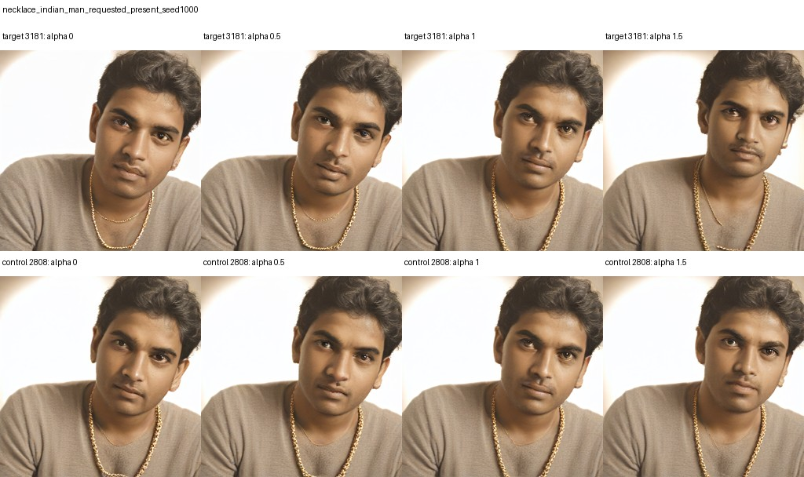

### indian man, requested_absent, seed 1000

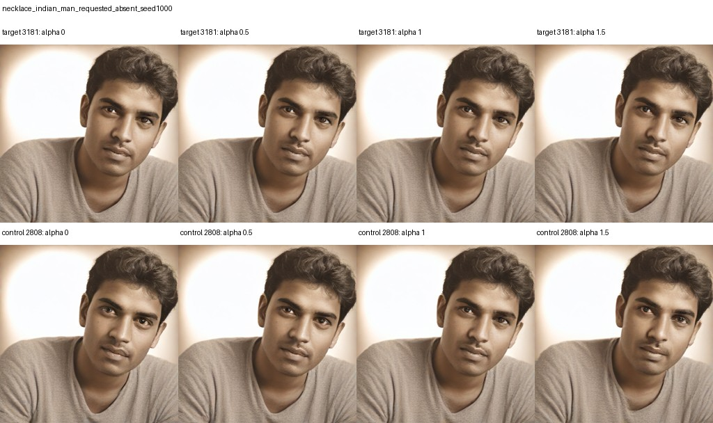

### indian man, requested_present, seed 1001

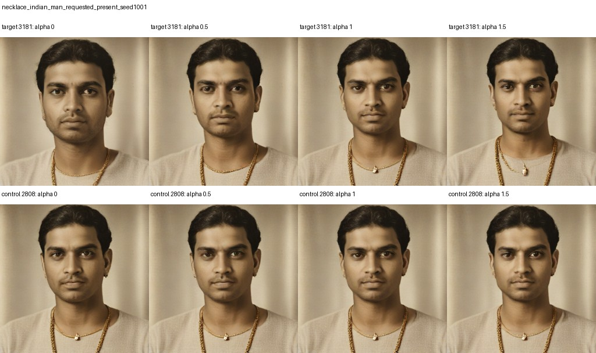

### indian man, requested_absent, seed 1001

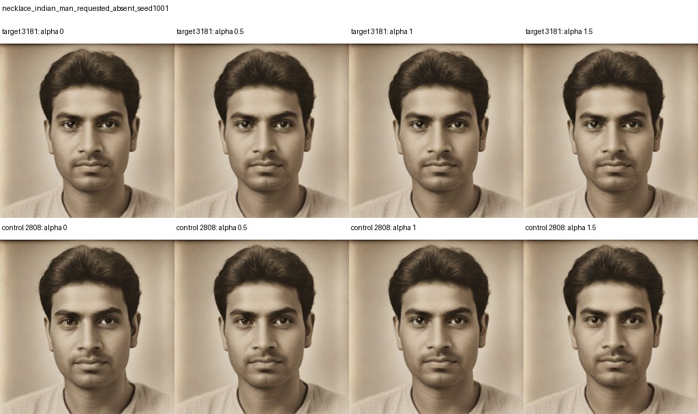

### indian man, requested_present, seed 1002

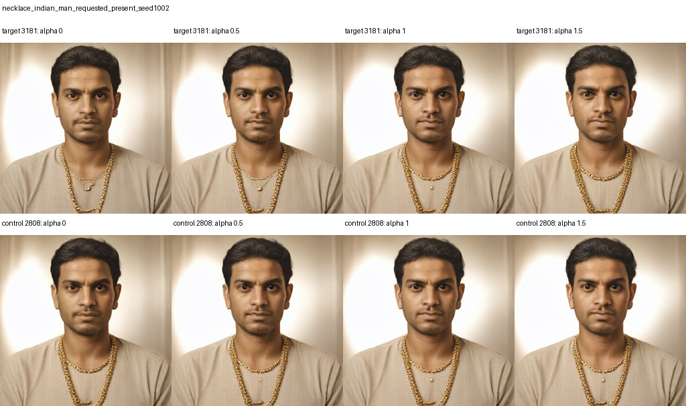

### indian man, requested_absent, seed 1002

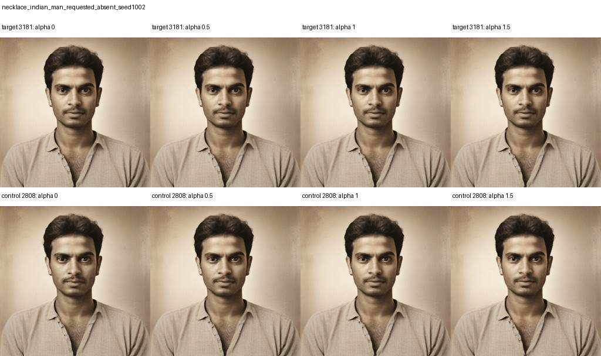

### indian man, requested_present, seed 1003

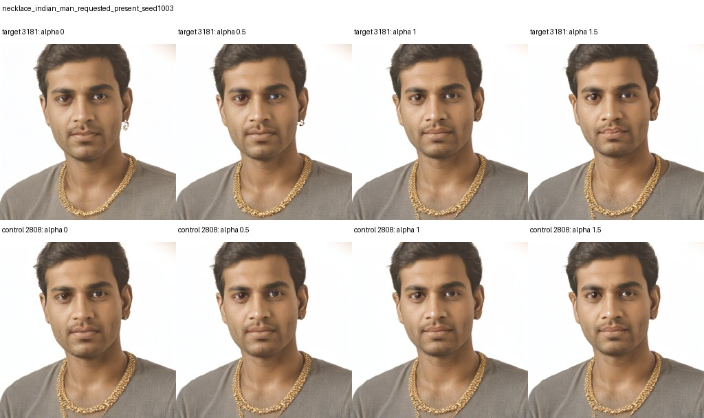

### indian man, requested_absent, seed 1003

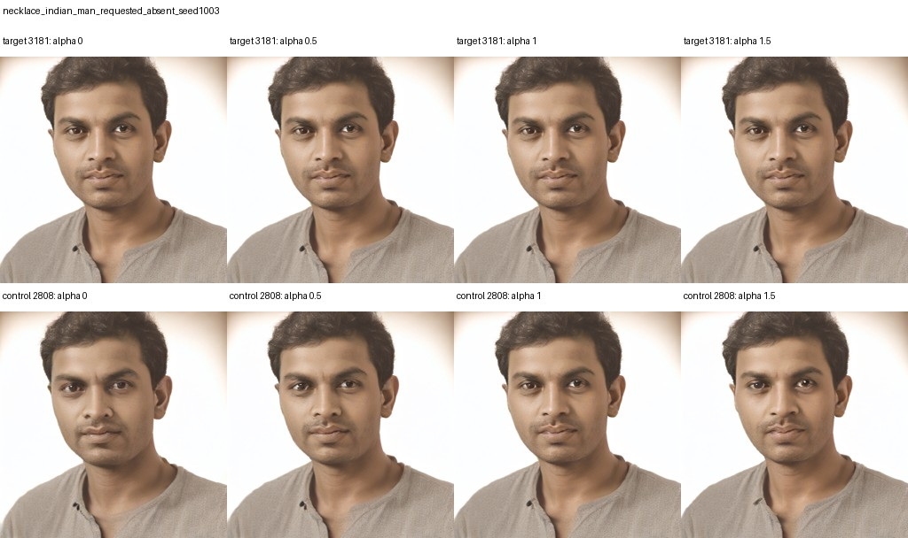

### hispanic woman, requested_present, seed 1000

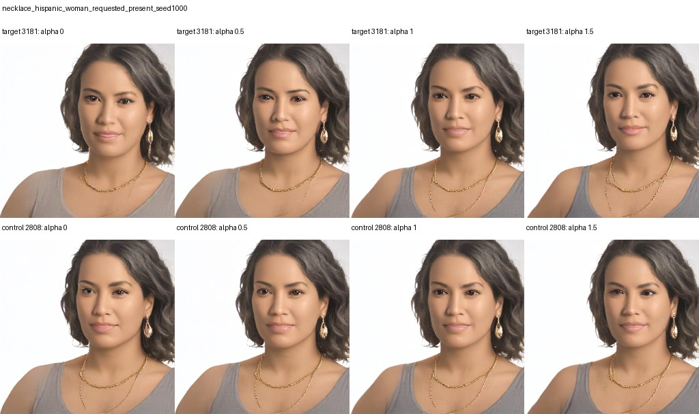

### hispanic woman, requested_absent, seed 1000

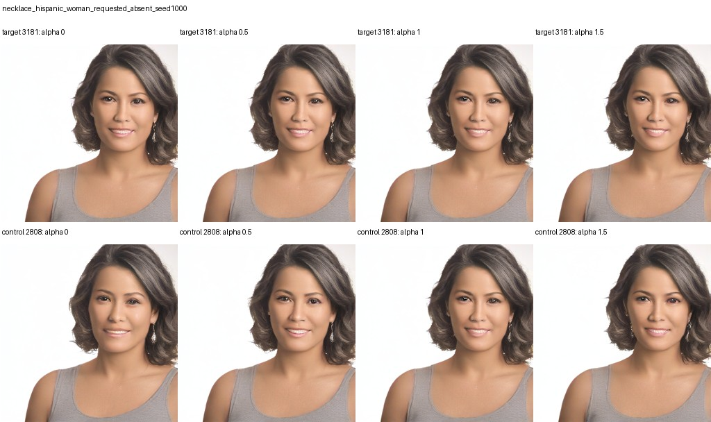

### hispanic woman, requested_present, seed 1001

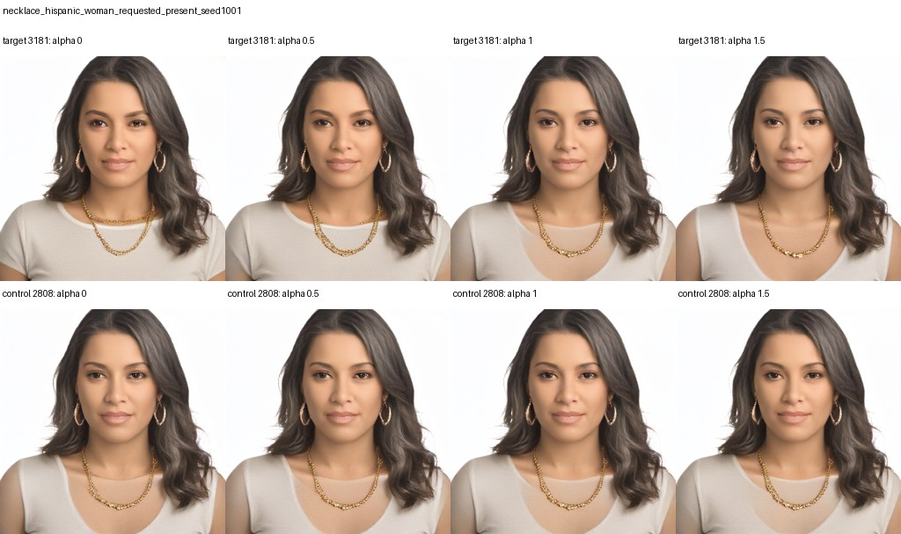

### hispanic woman, requested_absent, seed 1001

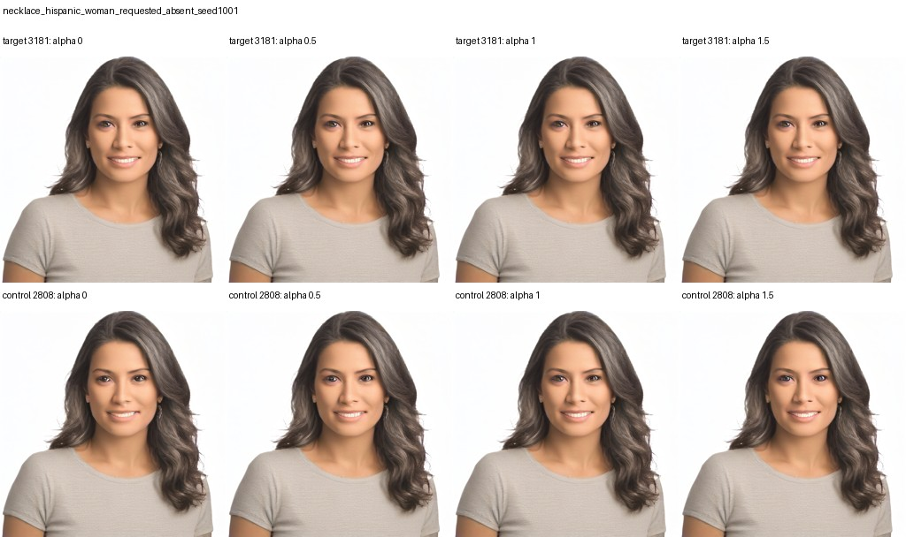

### hispanic woman, requested_present, seed 1002

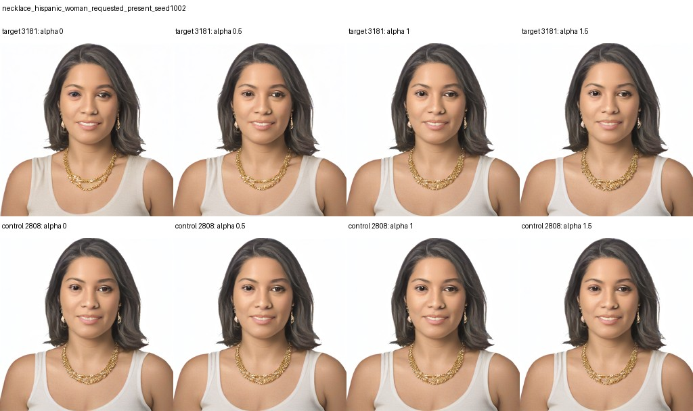

### hispanic woman, requested_absent, seed 1002

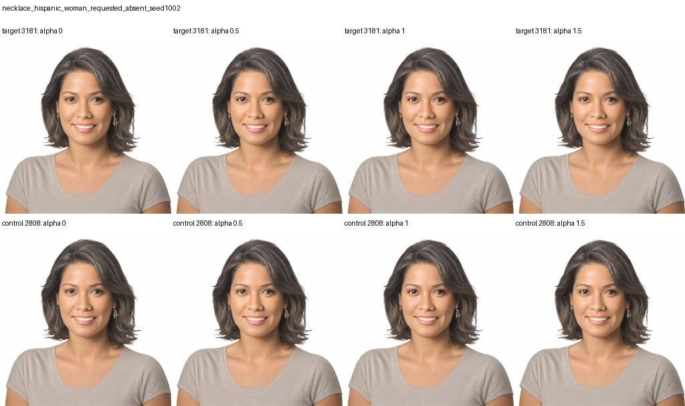

### hispanic woman, requested_present, seed 1003

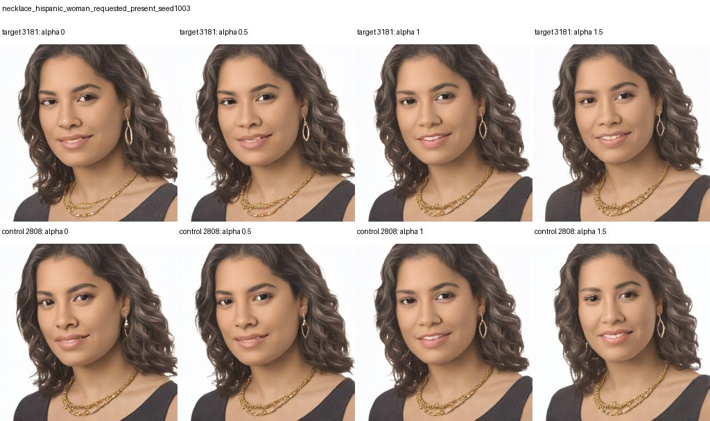

### hispanic woman, requested_absent, seed 1003

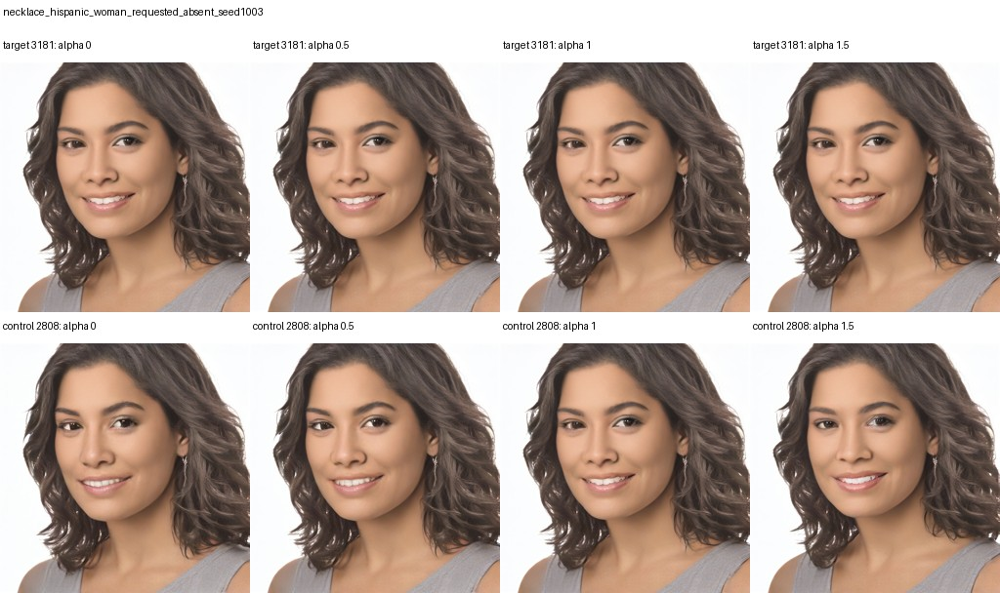
