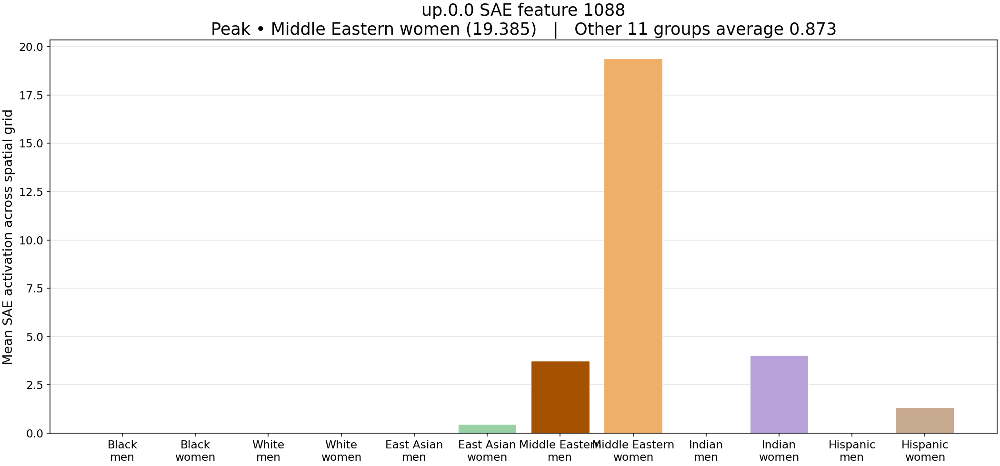
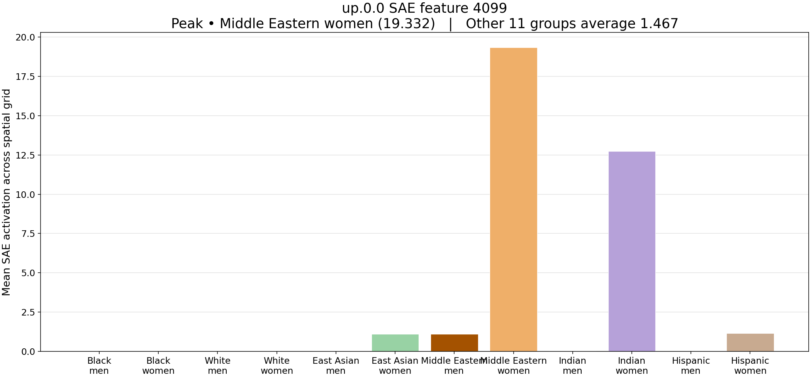
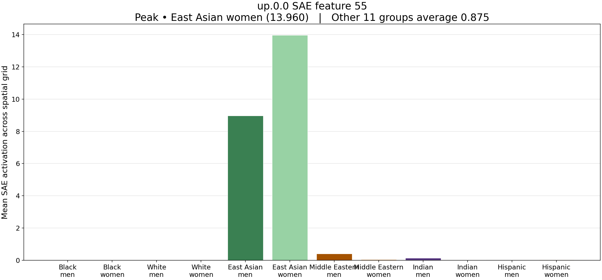
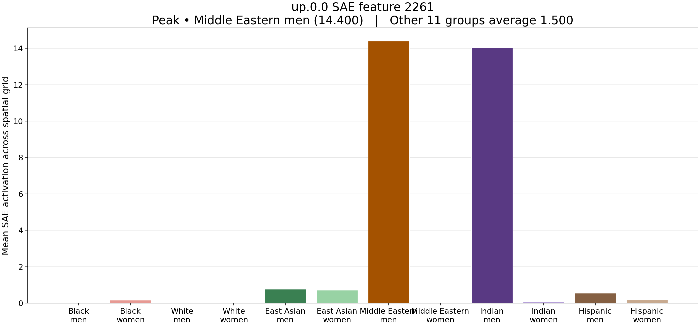
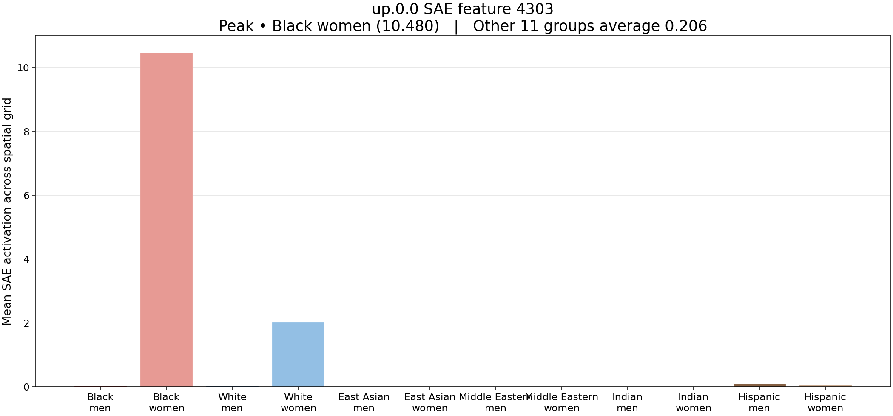
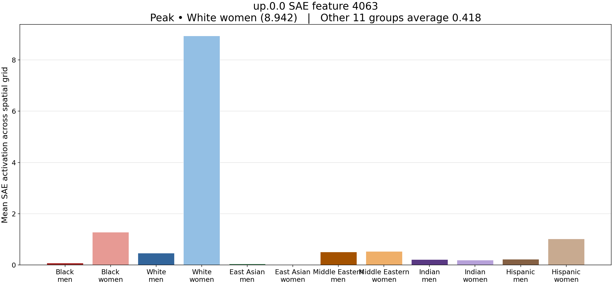
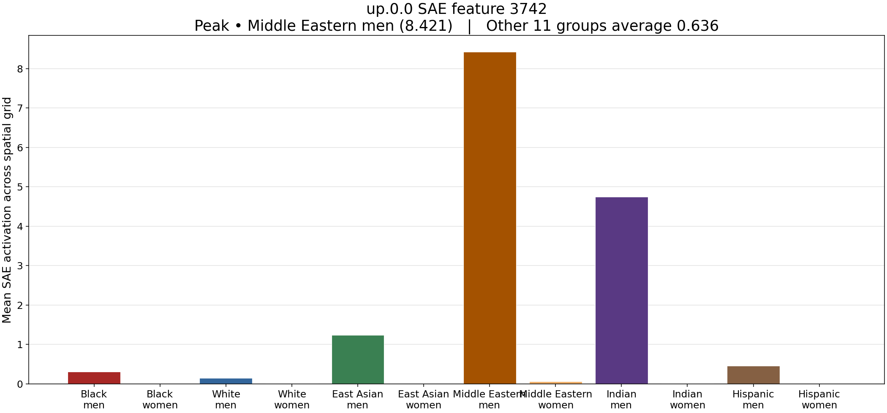
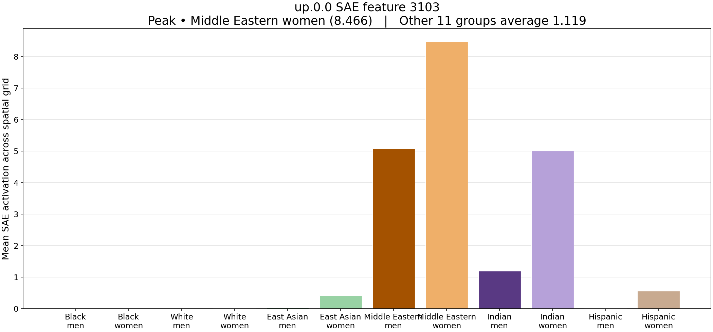
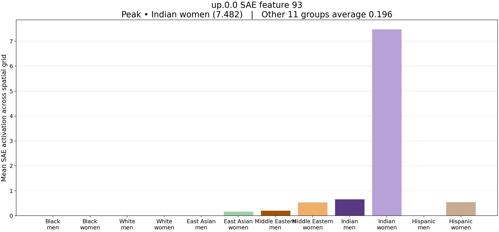
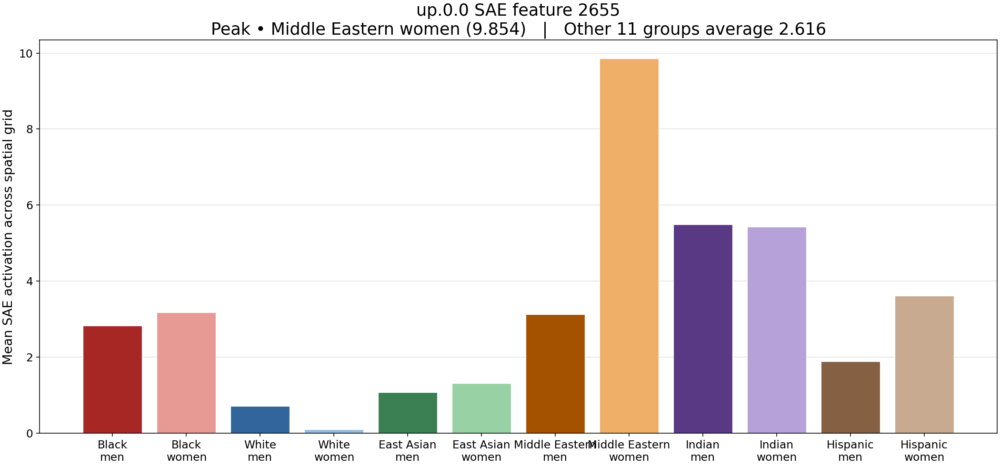

# up.0.0 mean SAE activation by prompt group

Each chart shows mean SAE activation across the 16 × 16 grid, averaged over 100 images per prompt group (seeds 100–199). Every chart follows the same group order as the mid.0 reference. The header gives the peak group mean and the mean of the other eleven groups.

## Rank 1 · Feature 1088

## Rank 2 · Feature 4099

## Rank 3 · Feature 55

## Rank 4 · Feature 2261

## Rank 5 · Feature 4303

## Rank 6 · Feature 4063

## Rank 7 · Feature 3742

## Rank 8 · Feature 3103

## Rank 9 · Feature 93

## Rank 10 · Feature 2655

