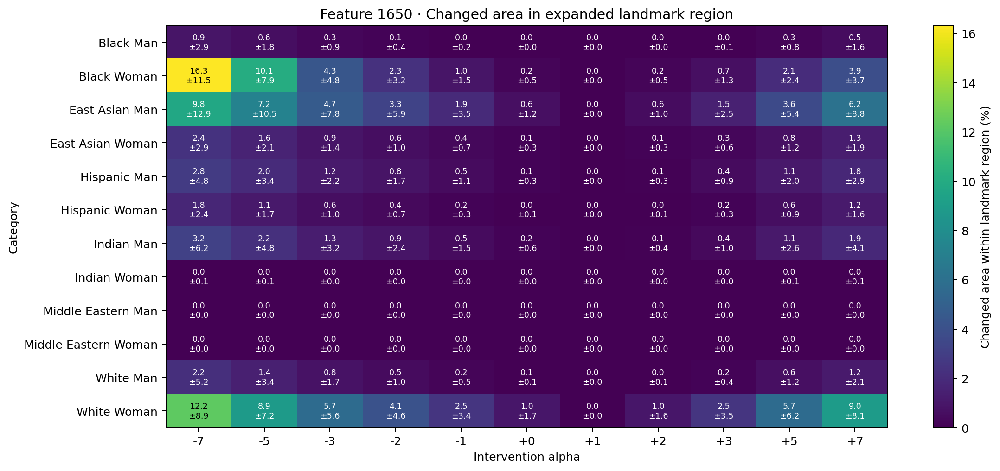

# Feature 1650 landmark-anchored head-covering-region analysis

Face Landmarker anchors a soft region that extends above the forehead and beyond the temples, down to the eyebrow line. It includes surrounding head context where a covering may sit. This is a geometric ROI, not hijab or semantic covering detection.

Jet maps show the fraction of seeds whose pixel changes from baseline by RGB MAE ≥ 12.0, within each image's landmark-anchored region. The cyan contour marks the mean region boundary. Blurred maps show mean pixel change inside the same region.

## Changed area by alpha

| Group | Alpha | Mean area % ± SD | Mean RGB MAE |
|---|---:|---:|---:|
| black_man | -7 | 0.9% ± 2.9 | 0.54 |
| black_man | -5 | 0.6% ± 1.8 | 0.40 |
| black_man | -3 | 0.3% ± 0.9 | 0.28 |
| black_man | -2 | 0.1% ± 0.4 | 0.23 |
| black_man | -1 | 0.0% ± 0.2 | 0.18 |
| black_man | +0 | 0.0% ± 0.0 | 0.13 |
| black_man | +1 | 0.0% ± 0.0 | 0.00 |
| black_man | +2 | 0.0% ± 0.0 | 0.13 |
| black_man | +3 | 0.0% ± 0.1 | 0.18 |
| black_man | +5 | 0.3% ± 0.8 | 0.28 |
| black_man | +7 | 0.5% ± 1.6 | 0.38 |
| black_woman | -7 | 16.3% ± 11.5 | 9.08 |
| black_woman | -5 | 10.1% ± 7.9 | 6.57 |
| black_woman | -3 | 4.3% ± 4.8 | 3.93 |
| black_woman | -2 | 2.3% ± 3.2 | 2.72 |
| black_woman | -1 | 1.0% ± 1.5 | 1.66 |
| black_woman | +0 | 0.2% ± 0.5 | 0.97 |
| black_woman | +1 | 0.0% ± 0.0 | 0.00 |
| black_woman | +2 | 0.2% ± 0.5 | 0.94 |
| black_woman | +3 | 0.7% ± 1.3 | 1.51 |
| black_woman | +5 | 2.1% ± 2.4 | 2.54 |
| black_woman | +7 | 3.9% ± 3.7 | 3.48 |
| east_asian_man | -7 | 9.8% ± 12.9 | 5.22 |
| east_asian_man | -5 | 7.2% ± 10.5 | 4.08 |
| east_asian_man | -3 | 4.7% ± 7.8 | 2.92 |
| east_asian_man | -2 | 3.3% ± 5.9 | 2.28 |
| east_asian_man | -1 | 1.9% ± 3.5 | 1.59 |
| east_asian_man | +0 | 0.6% ± 1.2 | 0.94 |
| east_asian_man | +1 | 0.0% ± 0.0 | 0.00 |
| east_asian_man | +2 | 0.6% ± 1.0 | 0.90 |
| east_asian_man | +3 | 1.5% ± 2.5 | 1.45 |
| east_asian_man | +5 | 3.6% ± 5.4 | 2.49 |
| east_asian_man | +7 | 6.2% ± 8.8 | 3.52 |
| east_asian_woman | -7 | 2.4% ± 2.9 | 1.70 |
| east_asian_woman | -5 | 1.6% ± 2.1 | 1.34 |
| east_asian_woman | -3 | 0.9% ± 1.4 | 1.00 |
| east_asian_woman | -2 | 0.6% ± 1.0 | 0.82 |
| east_asian_woman | -1 | 0.4% ± 0.7 | 0.64 |
| east_asian_woman | +0 | 0.1% ± 0.3 | 0.46 |
| east_asian_woman | +1 | 0.0% ± 0.0 | 0.00 |
| east_asian_woman | +2 | 0.1% ± 0.3 | 0.45 |
| east_asian_woman | +3 | 0.3% ± 0.6 | 0.62 |
| east_asian_woman | +5 | 0.8% ± 1.2 | 0.94 |
| east_asian_woman | +7 | 1.3% ± 1.9 | 1.25 |
| hispanic_man | -7 | 2.8% ± 4.8 | 1.90 |
| hispanic_man | -5 | 2.0% ± 3.4 | 1.50 |
| hispanic_man | -3 | 1.2% ± 2.2 | 1.08 |
| hispanic_man | -2 | 0.8% ± 1.7 | 0.87 |
| hispanic_man | -1 | 0.5% ± 1.1 | 0.65 |
| hispanic_man | +0 | 0.1% ± 0.3 | 0.43 |
| hispanic_man | +1 | 0.0% ± 0.0 | 0.00 |
| hispanic_man | +2 | 0.1% ± 0.3 | 0.43 |
| hispanic_man | +3 | 0.4% ± 0.9 | 0.64 |
| hispanic_man | +5 | 1.1% ± 2.0 | 1.05 |
| hispanic_man | +7 | 1.8% ± 2.9 | 1.41 |
| hispanic_woman | -7 | 1.8% ± 2.4 | 1.62 |
| hispanic_woman | -5 | 1.1% ± 1.7 | 1.29 |
| hispanic_woman | -3 | 0.6% ± 1.0 | 0.97 |
| hispanic_woman | -2 | 0.4% ± 0.7 | 0.82 |
| hispanic_woman | -1 | 0.2% ± 0.3 | 0.65 |
| hispanic_woman | +0 | 0.0% ± 0.1 | 0.48 |
| hispanic_woman | +1 | 0.0% ± 0.0 | 0.00 |
| hispanic_woman | +2 | 0.0% ± 0.1 | 0.47 |
| hispanic_woman | +3 | 0.2% ± 0.3 | 0.65 |
| hispanic_woman | +5 | 0.6% ± 0.9 | 0.98 |
| hispanic_woman | +7 | 1.2% ± 1.6 | 1.31 |
| indian_man | -7 | 3.2% ± 6.2 | 1.81 |
| indian_man | -5 | 2.2% ± 4.8 | 1.47 |
| indian_man | -3 | 1.3% ± 3.2 | 1.09 |
| indian_man | -2 | 0.9% ± 2.4 | 0.89 |
| indian_man | -1 | 0.5% ± 1.5 | 0.69 |
| indian_man | +0 | 0.2% ± 0.6 | 0.47 |
| indian_man | +1 | 0.0% ± 0.0 | 0.00 |
| indian_man | +2 | 0.1% ± 0.4 | 0.46 |
| indian_man | +3 | 0.4% ± 1.0 | 0.65 |
| indian_man | +5 | 1.1% ± 2.6 | 0.98 |
| indian_man | +7 | 1.9% ± 4.1 | 1.29 |
| indian_woman | -7 | 0.0% ± 0.1 | 0.08 |
| indian_woman | -5 | 0.0% ± 0.1 | 0.07 |
| indian_woman | -3 | 0.0% ± 0.0 | 0.06 |
| indian_woman | -2 | 0.0% ± 0.0 | 0.05 |
| indian_woman | -1 | 0.0% ± 0.0 | 0.05 |
| indian_woman | +0 | 0.0% ± 0.0 | 0.04 |
| indian_woman | +1 | 0.0% ± 0.0 | 0.00 |
| indian_woman | +2 | 0.0% ± 0.0 | 0.05 |
| indian_woman | +3 | 0.0% ± 0.0 | 0.05 |
| indian_woman | +5 | 0.0% ± 0.1 | 0.06 |
| indian_woman | +7 | 0.0% ± 0.1 | 0.07 |
| middle_eastern_man | -7 | 0.0% ± 0.0 | 0.00 |
| middle_eastern_man | -5 | 0.0% ± 0.0 | 0.00 |
| middle_eastern_man | -3 | 0.0% ± 0.0 | 0.00 |
| middle_eastern_man | -2 | 0.0% ± 0.0 | 0.00 |
| middle_eastern_man | -1 | 0.0% ± 0.0 | 0.00 |
| middle_eastern_man | +0 | 0.0% ± 0.0 | 0.00 |
| middle_eastern_man | +1 | 0.0% ± 0.0 | 0.00 |
| middle_eastern_man | +2 | 0.0% ± 0.0 | 0.00 |
| middle_eastern_man | +3 | 0.0% ± 0.0 | 0.00 |
| middle_eastern_man | +5 | 0.0% ± 0.0 | 0.00 |
| middle_eastern_man | +7 | 0.0% ± 0.0 | 0.00 |
| middle_eastern_woman | -7 | 0.0% ± 0.0 | 0.00 |
| middle_eastern_woman | -5 | 0.0% ± 0.0 | 0.00 |
| middle_eastern_woman | -3 | 0.0% ± 0.0 | 0.00 |
| middle_eastern_woman | -2 | 0.0% ± 0.0 | 0.00 |
| middle_eastern_woman | -1 | 0.0% ± 0.0 | 0.00 |
| middle_eastern_woman | +0 | 0.0% ± 0.0 | 0.00 |
| middle_eastern_woman | +1 | 0.0% ± 0.0 | 0.00 |
| middle_eastern_woman | +2 | 0.0% ± 0.0 | 0.00 |
| middle_eastern_woman | +3 | 0.0% ± 0.0 | 0.00 |
| middle_eastern_woman | +5 | 0.0% ± 0.0 | 0.00 |
| middle_eastern_woman | +7 | 0.0% ± 0.0 | 0.00 |
| white_man | -7 | 2.2% ± 5.2 | 1.57 |
| white_man | -5 | 1.4% ± 3.4 | 1.23 |
| white_man | -3 | 0.8% ± 1.7 | 0.89 |
| white_man | -2 | 0.5% ± 1.0 | 0.74 |
| white_man | -1 | 0.2% ± 0.5 | 0.57 |
| white_man | +0 | 0.1% ± 0.1 | 0.42 |
| white_man | +1 | 0.0% ± 0.0 | 0.00 |
| white_man | +2 | 0.0% ± 0.1 | 0.42 |
| white_man | +3 | 0.2% ± 0.4 | 0.57 |
| white_man | +5 | 0.6% ± 1.2 | 0.86 |
| white_man | +7 | 1.2% ± 2.1 | 1.14 |
| white_woman | -7 | 12.2% ± 8.9 | 5.56 |
| white_woman | -5 | 8.9% ± 7.2 | 4.47 |
| white_woman | -3 | 5.7% ± 5.6 | 3.32 |
| white_woman | -2 | 4.1% ± 4.6 | 2.71 |
| white_woman | -1 | 2.5% ± 3.4 | 2.04 |
| white_woman | +0 | 1.0% ± 1.7 | 1.29 |
| white_woman | +1 | 0.0% ± 0.0 | 0.00 |
| white_woman | +2 | 1.0% ± 1.6 | 1.27 |
| white_woman | +3 | 2.5% ± 3.5 | 2.01 |
| white_woman | +5 | 5.7% ± 6.2 | 3.29 |
| white_woman | +7 | 9.0% ± 8.1 | 4.42 |
