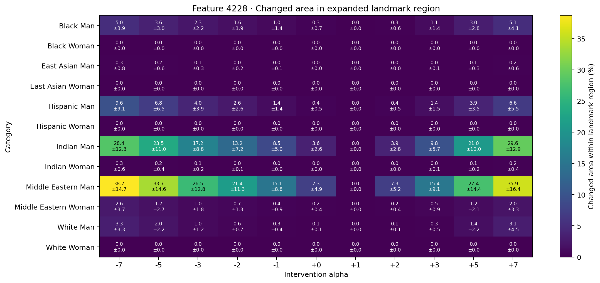

# Feature 4228 landmark-anchored head-covering-region analysis

Face Landmarker anchors a soft region that extends above the forehead and beyond the temples, down to the eyebrow line. It includes surrounding head context where a covering may sit. This is a geometric ROI, not hijab or semantic covering detection.

Jet maps show the fraction of seeds whose pixel changes from baseline by RGB MAE ≥ 12.0, within each image's landmark-anchored region. The cyan contour marks the mean region boundary. Blurred maps show mean pixel change inside the same region.

## Changed area by alpha

| Group | Alpha | Mean area % ± SD | Mean RGB MAE |
|---|---:|---:|---:|
| black_man | -7 | 5.0% ± 3.9 | 3.42 |
| black_man | -5 | 3.6% ± 3.0 | 2.72 |
| black_man | -3 | 2.3% ± 2.2 | 2.00 |
| black_man | -2 | 1.6% ± 1.9 | 1.63 |
| black_man | -1 | 1.0% ± 1.4 | 1.24 |
| black_man | +0 | 0.3% ± 0.7 | 0.84 |
| black_man | +1 | 0.0% ± 0.0 | 0.00 |
| black_man | +2 | 0.3% ± 0.6 | 0.85 |
| black_man | +3 | 1.1% ± 1.4 | 1.32 |
| black_man | +5 | 3.0% ± 2.8 | 2.34 |
| black_man | +7 | 5.1% ± 4.1 | 3.38 |
| black_woman | -7 | 0.0% ± 0.0 | 0.03 |
| black_woman | -5 | 0.0% ± 0.0 | 0.03 |
| black_woman | -3 | 0.0% ± 0.0 | 0.03 |
| black_woman | -2 | 0.0% ± 0.0 | 0.03 |
| black_woman | -1 | 0.0% ± 0.0 | 0.03 |
| black_woman | +0 | 0.0% ± 0.0 | 0.03 |
| black_woman | +1 | 0.0% ± 0.0 | 0.00 |
| black_woman | +2 | 0.0% ± 0.0 | 0.03 |
| black_woman | +3 | 0.0% ± 0.0 | 0.03 |
| black_woman | +5 | 0.0% ± 0.0 | 0.03 |
| black_woman | +7 | 0.0% ± 0.0 | 0.03 |
| east_asian_man | -7 | 0.3% ± 0.8 | 0.53 |
| east_asian_man | -5 | 0.2% ± 0.6 | 0.45 |
| east_asian_man | -3 | 0.1% ± 0.3 | 0.36 |
| east_asian_man | -2 | 0.0% ± 0.2 | 0.33 |
| east_asian_man | -1 | 0.0% ± 0.1 | 0.28 |
| east_asian_man | +0 | 0.0% ± 0.0 | 0.24 |
| east_asian_man | +1 | 0.0% ± 0.0 | 0.00 |
| east_asian_man | +2 | 0.0% ± 0.0 | 0.24 |
| east_asian_man | +3 | 0.0% ± 0.1 | 0.28 |
| east_asian_man | +5 | 0.1% ± 0.3 | 0.37 |
| east_asian_man | +7 | 0.2% ± 0.6 | 0.46 |
| east_asian_woman | -7 | 0.0% ± 0.0 | 0.00 |
| east_asian_woman | -5 | 0.0% ± 0.0 | 0.00 |
| east_asian_woman | -3 | 0.0% ± 0.0 | 0.00 |
| east_asian_woman | -2 | 0.0% ± 0.0 | 0.00 |
| east_asian_woman | -1 | 0.0% ± 0.0 | 0.00 |
| east_asian_woman | +0 | 0.0% ± 0.0 | 0.00 |
| east_asian_woman | +1 | 0.0% ± 0.0 | 0.00 |
| east_asian_woman | +2 | 0.0% ± 0.0 | 0.00 |
| east_asian_woman | +3 | 0.0% ± 0.0 | 0.00 |
| east_asian_woman | +5 | 0.0% ± 0.0 | 0.00 |
| east_asian_woman | +7 | 0.0% ± 0.0 | 0.00 |
| hispanic_man | -7 | 9.6% ± 9.1 | 4.99 |
| hispanic_man | -5 | 6.8% ± 6.5 | 3.88 |
| hispanic_man | -3 | 4.0% ± 3.9 | 2.76 |
| hispanic_man | -2 | 2.6% ± 2.6 | 2.19 |
| hispanic_man | -1 | 1.4% ± 1.4 | 1.61 |
| hispanic_man | +0 | 0.4% ± 0.5 | 1.02 |
| hispanic_man | +1 | 0.0% ± 0.0 | 0.00 |
| hispanic_man | +2 | 0.4% ± 0.5 | 1.02 |
| hispanic_man | +3 | 1.4% ± 1.5 | 1.62 |
| hispanic_man | +5 | 3.9% ± 3.5 | 2.80 |
| hispanic_man | +7 | 6.6% ± 5.5 | 3.94 |
| hispanic_woman | -7 | 0.0% ± 0.0 | 0.02 |
| hispanic_woman | -5 | 0.0% ± 0.0 | 0.02 |
| hispanic_woman | -3 | 0.0% ± 0.0 | 0.02 |
| hispanic_woman | -2 | 0.0% ± 0.0 | 0.02 |
| hispanic_woman | -1 | 0.0% ± 0.0 | 0.02 |
| hispanic_woman | +0 | 0.0% ± 0.0 | 0.02 |
| hispanic_woman | +1 | 0.0% ± 0.0 | 0.00 |
| hispanic_woman | +2 | 0.0% ± 0.0 | 0.02 |
| hispanic_woman | +3 | 0.0% ± 0.0 | 0.01 |
| hispanic_woman | +5 | 0.0% ± 0.0 | 0.02 |
| hispanic_woman | +7 | 0.0% ± 0.0 | 0.02 |
| indian_man | -7 | 28.4% ± 12.3 | 10.60 |
| indian_man | -5 | 23.5% ± 11.0 | 9.26 |
| indian_man | -3 | 17.2% ± 8.8 | 7.41 |
| indian_man | -2 | 13.2% ± 7.2 | 6.22 |
| indian_man | -1 | 8.5% ± 5.0 | 4.78 |
| indian_man | +0 | 3.6% ± 2.6 | 2.99 |
| indian_man | +1 | 0.0% ± 0.0 | 0.00 |
| indian_man | +2 | 3.9% ± 2.8 | 3.12 |
| indian_man | +3 | 9.8% ± 5.7 | 5.20 |
| indian_man | +5 | 21.0% ± 10.0 | 8.54 |
| indian_man | +7 | 29.6% ± 12.9 | 11.06 |
| indian_woman | -7 | 0.3% ± 0.6 | 0.47 |
| indian_woman | -5 | 0.2% ± 0.4 | 0.40 |
| indian_woman | -3 | 0.1% ± 0.2 | 0.34 |
| indian_woman | -2 | 0.0% ± 0.1 | 0.31 |
| indian_woman | -1 | 0.0% ± 0.0 | 0.27 |
| indian_woman | +0 | 0.0% ± 0.0 | 0.24 |
| indian_woman | +1 | 0.0% ± 0.0 | 0.00 |
| indian_woman | +2 | 0.0% ± 0.0 | 0.25 |
| indian_woman | +3 | 0.0% ± 0.1 | 0.27 |
| indian_woman | +5 | 0.1% ± 0.2 | 0.35 |
| indian_woman | +7 | 0.2% ± 0.4 | 0.42 |
| middle_eastern_man | -7 | 38.7% ± 14.7 | 19.77 |
| middle_eastern_man | -5 | 33.7% ± 14.6 | 17.12 |
| middle_eastern_man | -3 | 26.5% ± 12.8 | 13.14 |
| middle_eastern_man | -2 | 21.4% ± 11.3 | 10.42 |
| middle_eastern_man | -1 | 15.1% ± 8.8 | 7.33 |
| middle_eastern_man | +0 | 7.3% ± 4.9 | 4.03 |
| middle_eastern_man | +1 | 0.0% ± 0.0 | 0.00 |
| middle_eastern_man | +2 | 7.3% ± 5.2 | 4.01 |
| middle_eastern_man | +3 | 15.4% ± 9.1 | 7.31 |
| middle_eastern_man | +5 | 27.4% ± 14.4 | 13.18 |
| middle_eastern_man | +7 | 35.9% ± 16.4 | 17.83 |
| middle_eastern_woman | -7 | 2.6% ± 3.7 | 2.03 |
| middle_eastern_woman | -5 | 1.7% ± 2.7 | 1.67 |
| middle_eastern_woman | -3 | 1.0% ± 1.8 | 1.31 |
| middle_eastern_woman | -2 | 0.7% ± 1.3 | 1.14 |
| middle_eastern_woman | -1 | 0.4% ± 0.9 | 0.94 |
| middle_eastern_woman | +0 | 0.2% ± 0.4 | 0.77 |
| middle_eastern_woman | +1 | 0.0% ± 0.0 | 0.00 |
| middle_eastern_woman | +2 | 0.2% ± 0.4 | 0.78 |
| middle_eastern_woman | +3 | 0.5% ± 0.9 | 0.98 |
| middle_eastern_woman | +5 | 1.2% ± 2.1 | 1.39 |
| middle_eastern_woman | +7 | 2.0% ± 3.3 | 1.80 |
| white_man | -7 | 3.3% ± 3.3 | 2.64 |
| white_man | -5 | 2.0% ± 2.2 | 2.12 |
| white_man | -3 | 1.0% ± 1.2 | 1.60 |
| white_man | -2 | 0.6% ± 0.7 | 1.33 |
| white_man | -1 | 0.3% ± 0.4 | 1.04 |
| white_man | +0 | 0.1% ± 0.1 | 0.73 |
| white_man | +1 | 0.0% ± 0.0 | 0.00 |
| white_man | +2 | 0.1% ± 0.1 | 0.75 |
| white_man | +3 | 0.3% ± 0.5 | 1.08 |
| white_man | +5 | 1.4% ± 2.2 | 1.77 |
| white_man | +7 | 3.1% ± 4.5 | 2.48 |
| white_woman | -7 | 0.0% ± 0.0 | 0.00 |
| white_woman | -5 | 0.0% ± 0.0 | 0.00 |
| white_woman | -3 | 0.0% ± 0.0 | 0.00 |
| white_woman | -2 | 0.0% ± 0.0 | 0.00 |
| white_woman | -1 | 0.0% ± 0.0 | 0.00 |
| white_woman | +0 | 0.0% ± 0.0 | 0.00 |
| white_woman | +1 | 0.0% ± 0.0 | 0.00 |
| white_woman | +2 | 0.0% ± 0.0 | 0.00 |
| white_woman | +3 | 0.0% ± 0.0 | 0.00 |
| white_woman | +5 | 0.0% ± 0.0 | 0.00 |
| white_woman | +7 | 0.0% ± 0.0 | 0.00 |
