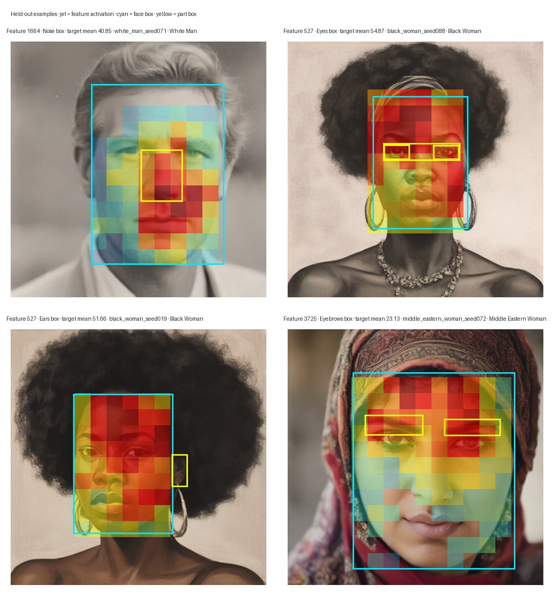

# Held-out localization for generated-intervention features

## Setup

The tuning folders contain 19 distinct feature IDs with complete 20-image-per-category runs (feature 138 has a second, older 100-image run; the complete run was used to identify the feature). I fixed those IDs before evaluation and measured their activations using the original pretrained SAE on the separate held-out portrait split. For eyes, eyebrows, and nose, each score is mean activation inside the automatic part box minus activation elsewhere inside the detected face. For ears, the reference is the rest of the image. Intervals are 95% stratified image-bootstrap intervals, macro-averaged over the race/gender categories.

## Strongest held-out associations

| Region | Leading feature | Test contrast (95% interval) | Other regions for that feature |
|---|---:|---:|---|
| Eyes | 527 | +1.75 [1.40, 2.11] | Eyebrows +2.66; ears +5.60 |
| Eyebrows | 527 | +2.66 [2.25, 3.04] | Eyes +1.75; ears +5.60 |
| Nose | 1664 | +12.04 [11.48, 12.56] | Eyes +1.65; eyebrows −1.51 [−2.84, −0.20]; ears +1.45 |
| Ears | 527 | +5.60 [4.70, 6.49] | Eyes +1.75; eyebrows +2.66 |

Feature 1664 has the clearest part-specific pattern in this test: strong positive nose contrast and negative eyebrow contrast. Feature 527 is associated with several annotated regions, so it is not eye-specific. Feature 3725 also has positive contrasts across multiple regions. Full estimates for all 76 feature-region pairs are in `heldout_feature_validation.csv`.

## Qualitative held-out examples

The panels show the original SAE feature maps on held-out portraits. Cyan outlines mark the detected face box; yellow outlines mark the target part box. These examples were selected from test images with the highest target-box mean activation for each shown feature/part pair, so they are illustrative rather than representative. The quantitative table above uses all eligible held-out images.

## Interpretation and limits

This supports spatial association for a few features, especially feature 1664 with the annotated nose region. It does not establish a semantic label or causal editing behavior. The nose estimate is based on 13 test portraits, and the ear estimate on 18. Automatic boxes are unreviewed; low coverage for small facial parts makes the comparisons noisy. The 95% intervals are unadjusted across 76 comparisons, so treat the rankings as exploratory rather than confirmatory. Several features also have near-zero activations or negative contrasts.

The feature-steered image grids are useful qualitative examples, but they were generated by intervening on those features. This quantitative check uses their fixed feature IDs on an independent held-out portrait split and uses each portrait's automatic part boxes; it does not treat the edited variants as independent validation samples.
