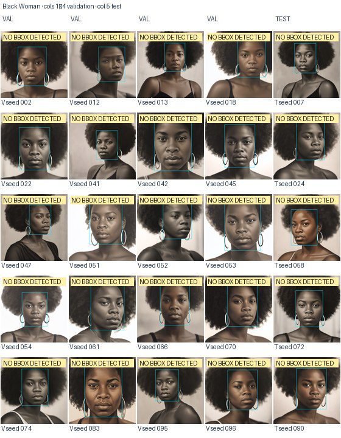
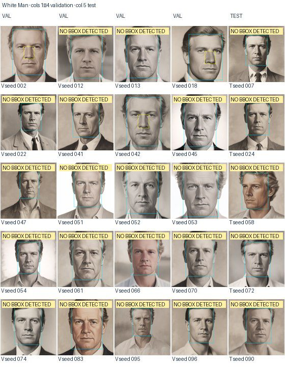
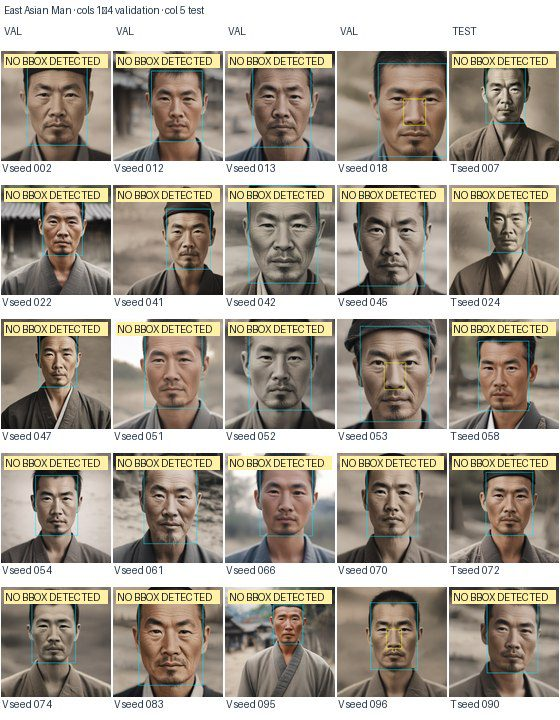
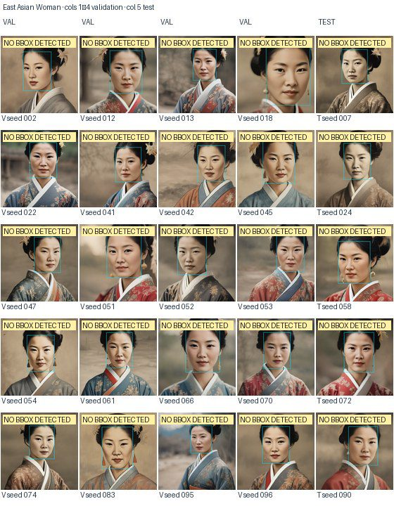
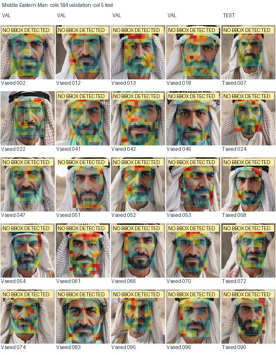
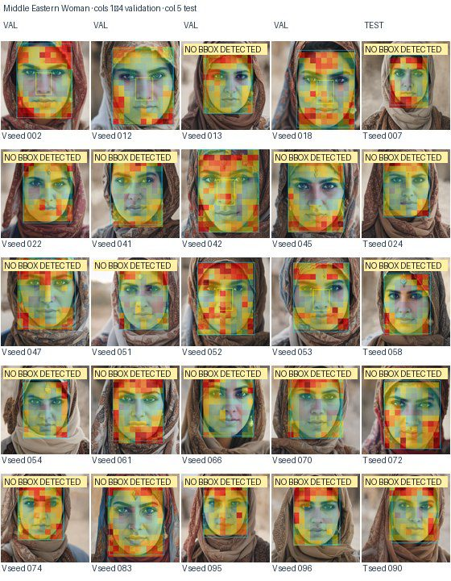
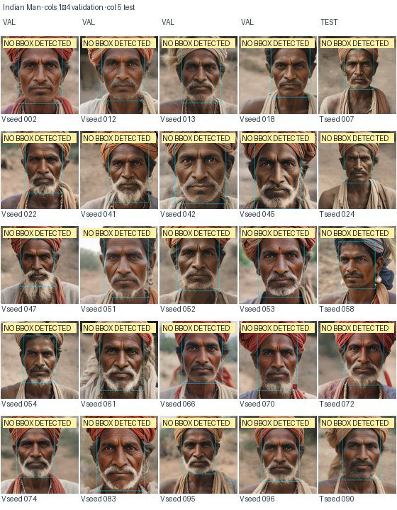
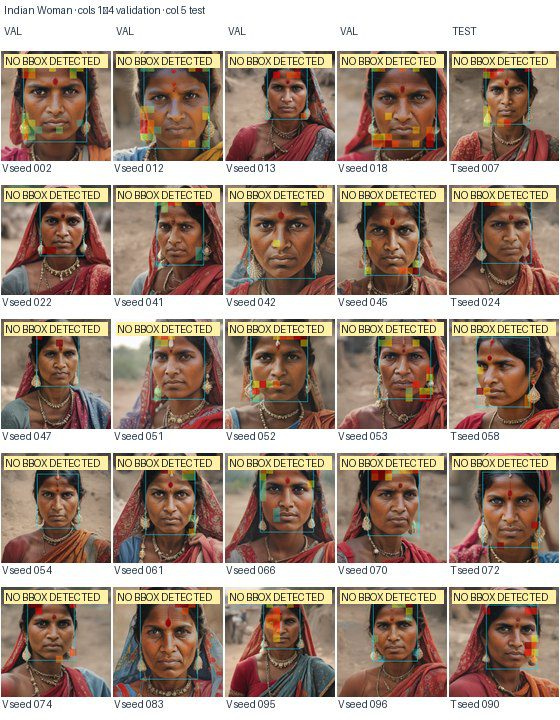
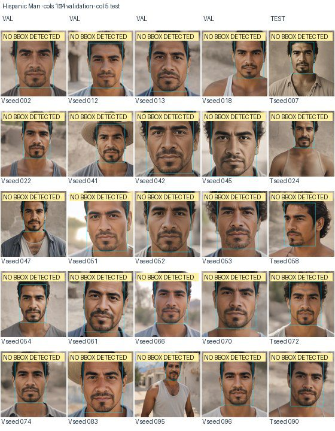

# Feature 138 — Nose

Fixed original pretrained SAE; no fine-tuning. Each category grid is 5×5: the first four columns are 20 validation portraits and the last column is five test portraits. Cyan is the face box, yellow is the part box. A ‘No bbox detected’ tag means the automatic annotations supplied no usable box.

Held-out test contrast: -2.63 (95% CI [-3.34, -1.97]; n=13).

## Black Man

## Black Woman

## White Man

## White Woman

## East Asian Man

## East Asian Woman

## Middle Eastern Man

## Middle Eastern Woman

## Indian Man

## Indian Woman

## Hispanic Man

## Hispanic Woman

