# Feature 199 — Eyes

Fixed original pretrained SAE; no fine-tuning. Each category grid is 5×5: the first four columns are 20 validation portraits and the last column is five test portraits. Cyan is the face box, yellow is the part box. A ‘No bbox detected’ tag means the automatic annotations supplied no usable box.

Held-out test contrast: -1.15 (95% CI [-1.42, -0.91]; n=90).

## Black Man

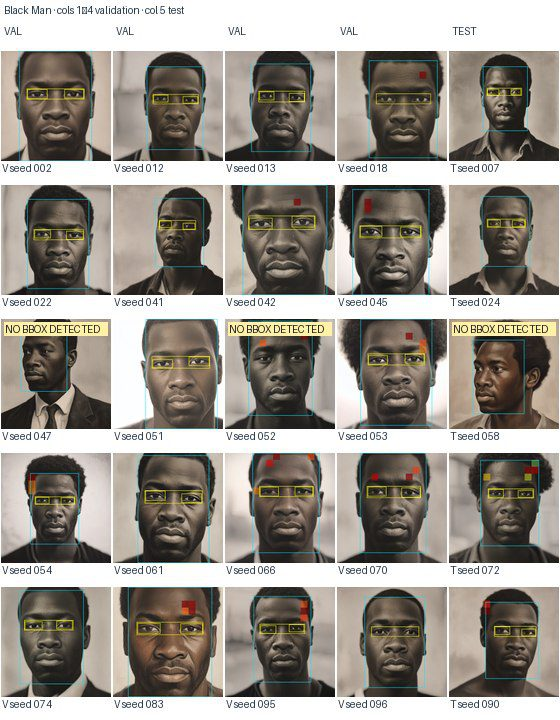

## Black Woman

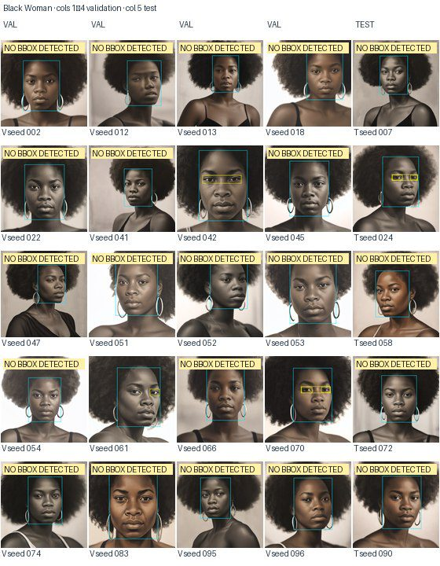

## White Man

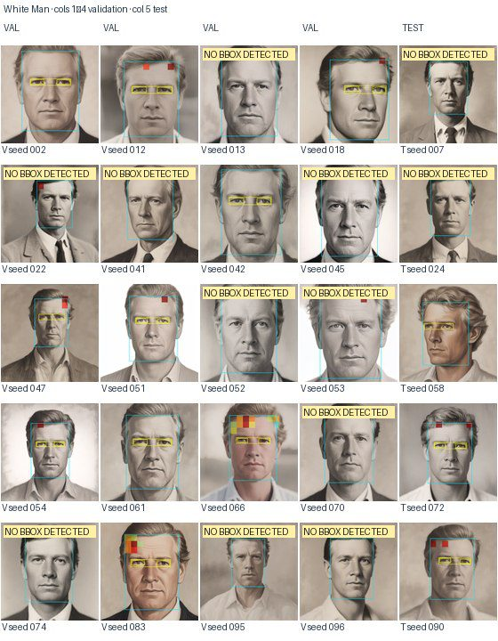

## White Woman

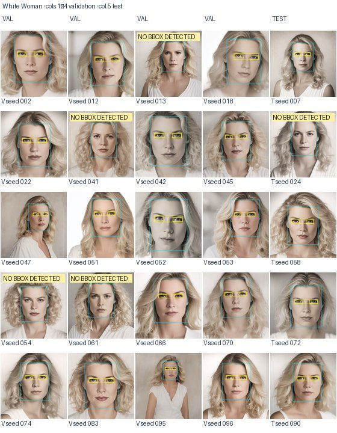

## East Asian Man

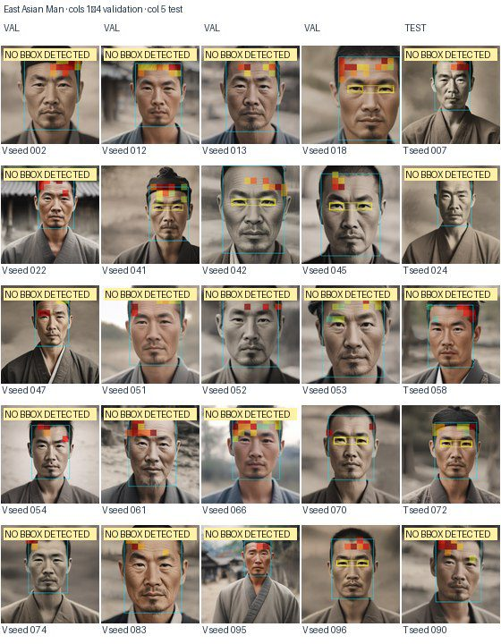

## East Asian Woman

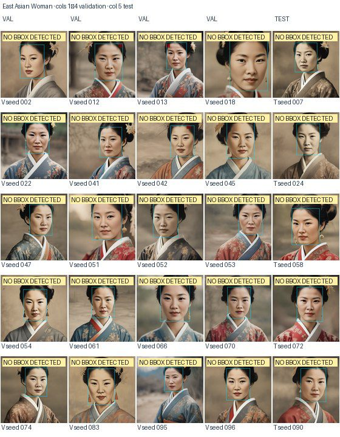

## Middle Eastern Man

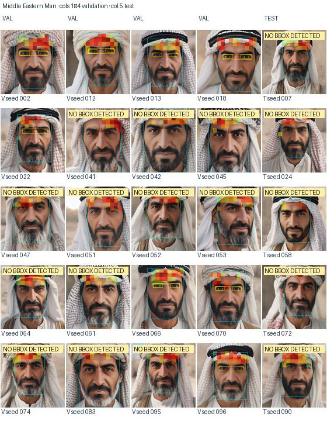

## Middle Eastern Woman

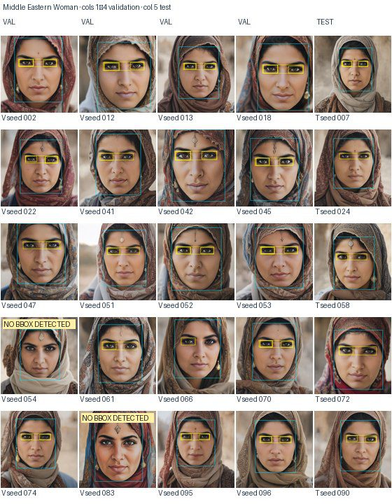

## Indian Man

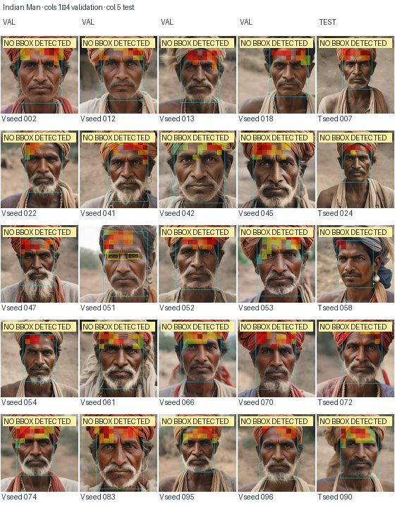

## Indian Woman

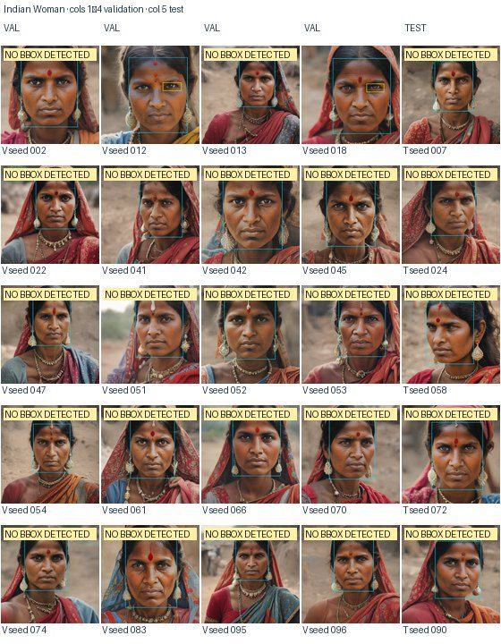

## Hispanic Man

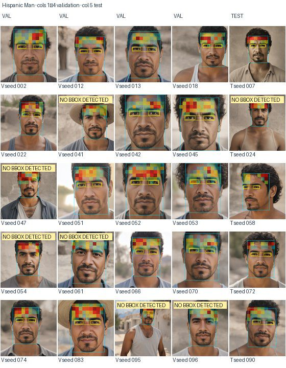

## Hispanic Woman

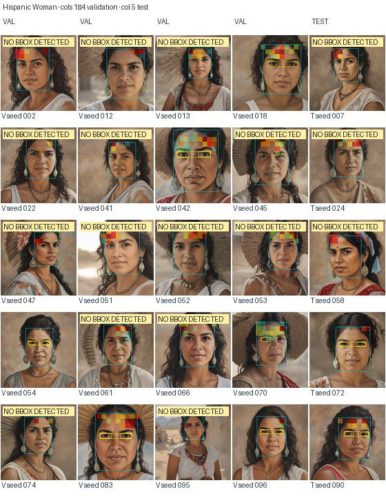

