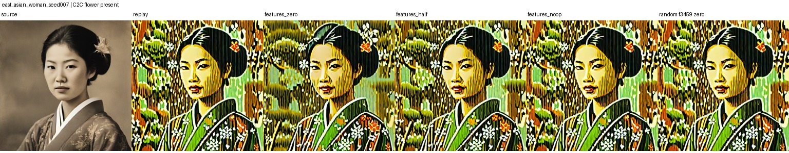
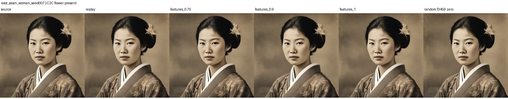
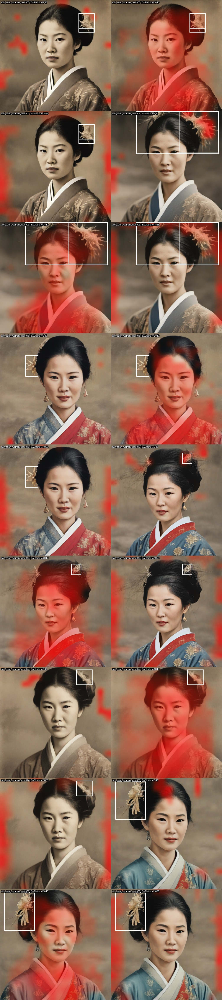
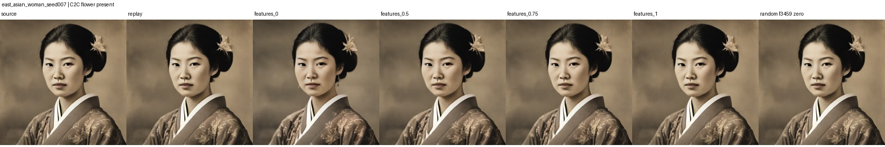
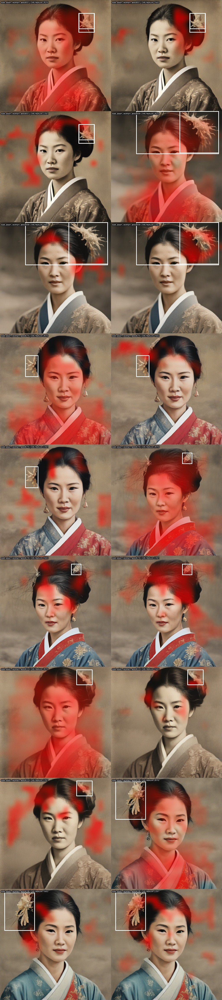

# Flower SAE image intervention

This folder collects the flower image-generation intervention results and comparison pictures. The SAE hook was applied at one SDXL Turbo U-Net layer, `unet.down_blocks.2.attentions.1`. In the four-step run, the hook ran at that same layer on each of the four denoising steps. This is not a multi-layer SAE experiment.

## Setup

The SAE was fine-tuned from the pretrained Top-K checkpoint with a C2C box-prediction head. Training used 720 images and a 720/240/240 train/validation/test split. The SAE and head were trained jointly for five epochs. The loss combined normalized reconstruction MSE, objectness binary cross-entropy, and box Smooth L1 regression, weighted 1, 1, and 5. The SAE learning rate was 1e-6 and the head learning rate was 1e-3. The frozen-SAE baseline used the same objective and updated only the head.

For the image intervention, features 940, 2810, and 1855 were selected using their contribution to the flower score from the trained box head on training images. Feature 3459 was the activity-matched random control. The intervention scaled selected feature contributions while preserving the SAE reconstruction error.

## One-step result

We replayed 20 held-out East Asian woman prompts: 12 C2C flower-positive and 8 negative. Source replays were pixel-identical. Zeroing the selected features changed the images by mean RGB MAE 11.03/255 on positives and 10.99/255 on negatives; half attenuation gave 6.10 and 6.38. The random-feature control changed them by 1.44 and 1.64. In inspected positive images, the flower ornament remained visible. Changes were similarly large on positives and negatives, and affected other image details.

## Four-step result

We repeated the intervention on four positive and four negative prompts using four inference steps. Feature ablation changed images by mean RGB MAE 32.63/255 on positives and 25.16/255 on negatives; half attenuation gave 20.86 and 18.54. The random control averaged 6.84/255. The flower remained visible in the inspected positive example.

The four-step baseline already differed substantially from the original one-step source images: mean source-to-replay MAE was 66.64/255 for positives and 57.99/255 for negatives. The larger intervention effect came with substantial image drift, so four steps did not solve flower removal in this setup.

## Frozen versus fine-tuned feature comparison

On a matched held-out set of 20 East Asian woman prompts (12 positive, 8 negative), the trained box head's flower AUC was 0.792 with the fine-tuned SAE and 0.729 with the frozen SAE. Average precision was 0.892 and 0.844, respectively. But individual SAE feature activations did not become more reliable flower indicators: the median held-out AUC among the top ten features selected on training data was 0.531 for fine-tuned and 0.578 for frozen. These small results suggest the head learned a more useful combination of spatial codes, not a consistently stronger standalone flower feature.

All labels and boxes here are C2C working targets and were not manually audited. Pixel MAE measures overall image change, not whether a flower disappeared. The current experiment did not establish reliable flower removal.

## Detailed artifacts

- [Full results, training details, and comparison images](https://github.com/ele906/sae-training/blob/main/RESULTS.md)
- [Feature AUC comparison data](https://github.com/ele906/sae-training/tree/main/visualizations/flower_auc_frozen_vs_finetuned_001)
- [One-step per-image metrics](https://github.com/ele906/sae-training/blob/main/visualizations/flower_intervention_001/metrics.csv)
- [Four-step per-image metrics](https://github.com/ele906/sae-training/blob/main/visualizations/flower_intervention_4step_001/metrics.csv)
- [Training implementation](https://github.com/ele906/sae-training/blob/main/train_box_sae.py)
- [Intervention runner in this folder](ablate_flower_features.py)

The runner expects the local `sae-training` workspace, cached model weights, residuals, and generated source images to be available alongside this folder. Those large/private run artifacts are not included here.

## Follow-up tests

### 1. Lighter interventions

We tested the original selected features (940, 2810, 1855) on four held-out C2C-positive and four negative prompts at lower strengths. Here, strength 1 is a no-op; 0.75 attenuates feature contributions by 25%, and 0.9 attenuates them by 10%.

| Retained feature contribution | Positive image MAE / 255 | Negative image MAE / 255 |
|---|---:|---:|
| 0.75 | 3.42 | 3.13 |
| 0.90 | 1.61 | 1.57 |
| 1.00 (no-op) | 0.00 | 0.00 |

The gentler intervention changed both groups less, but the flower remained visible. Positive and negative changes were similar, so lowering strength did not make the intervention flower-specific.

### 2. Feature activation localization

For each selected unit, we encoded held-out residuals into the 16 x 16 SAE grid and compared activations inside the C2C flower boxes with activations outside. The original selected features peaked inside the box in only 2 of 8 positive examples for feature 940, and 0 of 8 for features 2810 and 1855. Their spatial activation overlays show broad activity around the face, hair, clothing, and background.

This supports the hypothesis that the globally applied SAE features encode other image details along with flower-related information.

### 3. Diffusion step-count comparison

The existing four-step test used SDXL Turbo at the same U-Net layer, applying the hook on each of its four denoising steps. This tests step count within Turbo; it is not a comparison against standard SDXL Base. The four-step replay already drifted from the one-step source by MAE 66.64/255 on positives and 57.99/255 on negatives. Zeroing the selected features changed the four-step replay by MAE 32.63 and 25.16, respectively, while the random control changed it by 6.84. The flower remained visible. More steps did not solve the intervention and came with substantial baseline image drift.

### 4. Flower-only supervised SAE fine-tune

We trained a fresh SAE and box head for five epochs using only the C2C flower box targets, with the same 720/240/240 split and reconstruction, objectness, and box losses. Validation-loss selection chose the checkpoint for held-out evaluation. On the 240-image test split (13 C2C positives), the box head reached objectness AP 0.782 and mean IoU 0.128 on positive images; recall at score/IoU 0.5 remained 0. This is weak box localization.

The top three flower-head contribution features from training were 2810, 1563, and 2291. Zeroing them changed four positive images by MAE 10.98/255 and four negatives by 9.95/255. The flower remained in the inspected positive example. Feature 2810 peaked inside the C2C box in 0 of 8 held-out positives, feature 1563 in 4 of 8, and feature 2291 in 1 of 8. Fine-tuning one SAE for flower-box prediction therefore did not produce a reliable flower-only intervention in this small test.

### Takeaway

The results point more strongly to feature entanglement and global feature suppression than to a simple strength problem. The Turbo step-count test also shows that this setup drifts substantially as more denoising steps are added. A useful next experiment is to train/select units with box-local supervision and intervene only at the flower's spatial cells, then evaluate flower reduction and preservation of the person separately. All localization metrics use C2C's automatically generated boxes as labels; they have not been manually audited.

### Follow-up artifacts

- [Low-strength metrics](results/low_strength_metrics.csv)
- [Initial selected feature localization](results/initial_feature_localization.csv)
- [Flower-only box test metrics](results/flower_only_box_test_metrics.json)
- [Flower-only training history](results/flower_only_training_history.json)
- [Flower-only image intervention metrics](results/flower_only_intervention_metrics.csv)
- [Flower-only selected feature localization](results/flower_only_feature_localization.csv)
- [Experiment scripts](.)
