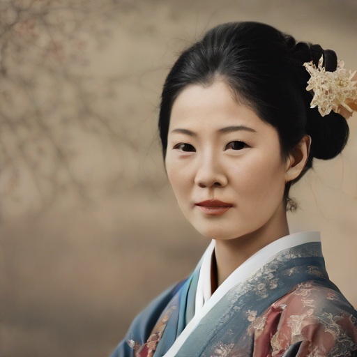
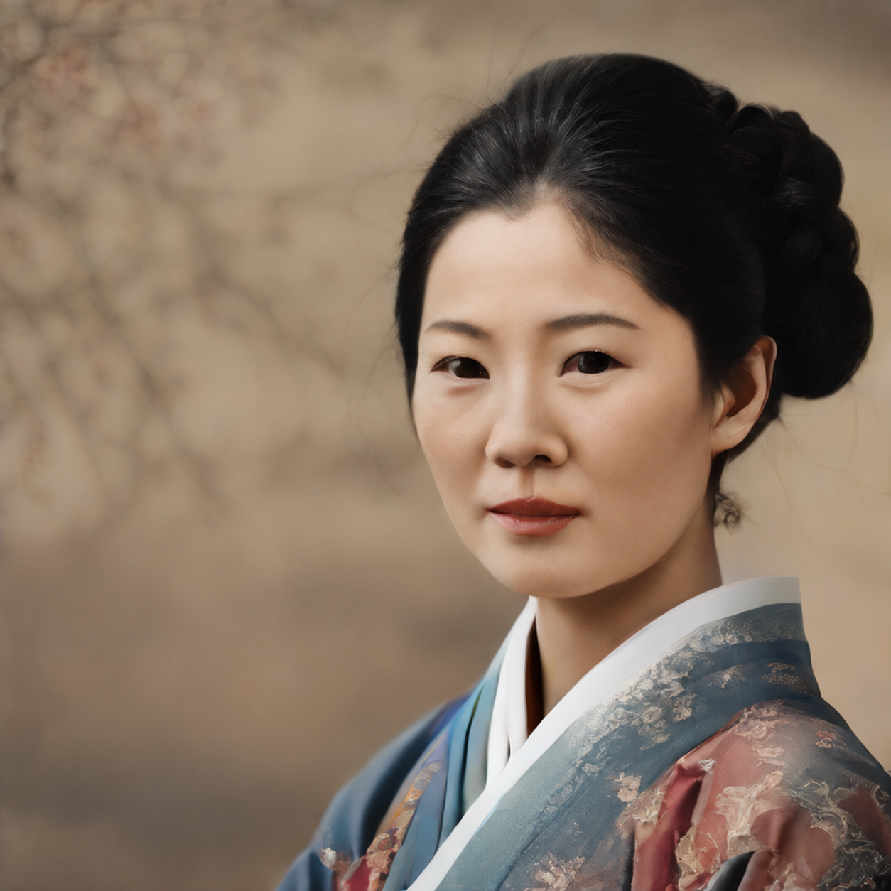

# Quick object removal example

This is a quick visual reference for the goal: remove the flower hair accessory while keeping the rest of the portrait recognizable.

| Before | Edited |
|---|---|
|  |  |

The edit removes the flower clearly. It was made with an image-editing model, not the local SDXL Turbo SAE and not a reproducible masked inpainting pipeline. The edited image also changes the crop, resolution, and some facial details. Treat it as a visual example only; it is not an SAE result or a fair preservation comparison.
