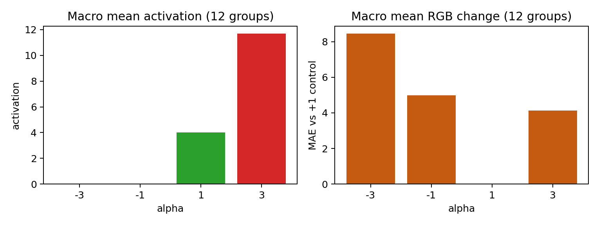

# Independent held-out test — face-focused mid.0 SAE feature 1874

This is the generalization check for feature 1874 after the original face-focused intervention sweep.  The SAE, selected feature, and intervention method were frozen.  Only the prompts and random seeds changed.

## Held-out setup

- **SAE:** face-box fine-tuned SAE at `unet.mid_block.attentions.0` (mid.0), selected epoch 20.
- **Feature:** 1874, selected previously for high face-versus-outside activation on a separate validation set.
- **Fresh samples:** 12 prompt categories × 10 new seeds (`200`–`209`) = 120 source portraits.
- **Fresh prompt template:** `a studio headshot of a {race} {gender}, neutral expression, plain light background`.
- **Interventions:** alpha `−3`, `−1`, `+1`, and `+3`; `+1` is the no-op control.
- **Total generations:** 480.  The source portrait and alpha `+1` are identical by construction.

This avoids judging the effect only on the same simple-prompt/seed data used in the first sweep.  It is still a qualitative generalization test, not evidence that the feature has one uniquely named semantic meaning.

## Results at a glance

The expected intervention behavior is present: alpha `+1` has zero pixel change from control, negative alphas suppress the feature's re-encoded activation, and positive alpha boosts it.  The next question is visual: whether the associated changes remain primarily in the face across these new prompts and seeds.

- [All per-image metrics](metrics.csv)
- [Means by category and alpha](mean_metrics_by_group_alpha.csv)
- [Exact run settings](settings.json)

## Reading the contact sheets

Each seed-200 sheet is a 2 × 3 layout:

| Original/control | α −3 | α −1 |
|---|---:|---:|
| α +1 control | α +3 | — |

The original/control and α `+1` tiles duplicate the no-op baseline deliberately, so the viewer has a visual reference point in both rows.

| Category | Representative new-seed grid | Activation/change curve |
|---|---|---|
| Black man | [grid](representative_grids/black_man_seed200.jpg) | [curve](activation_graphs/black_man.png) |
| Black woman | [grid](representative_grids/black_woman_seed200.jpg) | [curve](activation_graphs/black_woman.png) |
| White man | [grid](representative_grids/white_man_seed200.jpg) | [curve](activation_graphs/white_man.png) |
| White woman | [grid](representative_grids/white_woman_seed200.jpg) | [curve](activation_graphs/white_woman.png) |
| East Asian man | [grid](representative_grids/east_asian_man_seed200.jpg) | [curve](activation_graphs/east_asian_man.png) |
| East Asian woman | [grid](representative_grids/east_asian_woman_seed200.jpg) | [curve](activation_graphs/east_asian_woman.png) |
| Middle Eastern man | [grid](representative_grids/middle_eastern_man_seed200.jpg) | [curve](activation_graphs/middle_eastern_man.png) |
| Middle Eastern woman | [grid](representative_grids/middle_eastern_woman_seed200.jpg) | [curve](activation_graphs/middle_eastern_woman.png) |
| Indian man | [grid](representative_grids/indian_man_seed200.jpg) | [curve](activation_graphs/indian_man.png) |
| Indian woman | [grid](representative_grids/indian_woman_seed200.jpg) | [curve](activation_graphs/indian_woman.png) |
| Hispanic man | [grid](representative_grids/hispanic_man_seed200.jpg) | [curve](activation_graphs/hispanic_man.png) |
| Hispanic woman | [grid](representative_grids/hispanic_woman_seed200.jpg) | [curve](activation_graphs/hispanic_woman.png) |

## Safe conclusion

On new seeds and a new prompt template, feature 1874 remains directly controllable: attenuation removes its activation and amplification raises it.  The visual review should now check whether this control consistently stays face-localized across the ten new seeds per category before making a stronger semantic claim.
