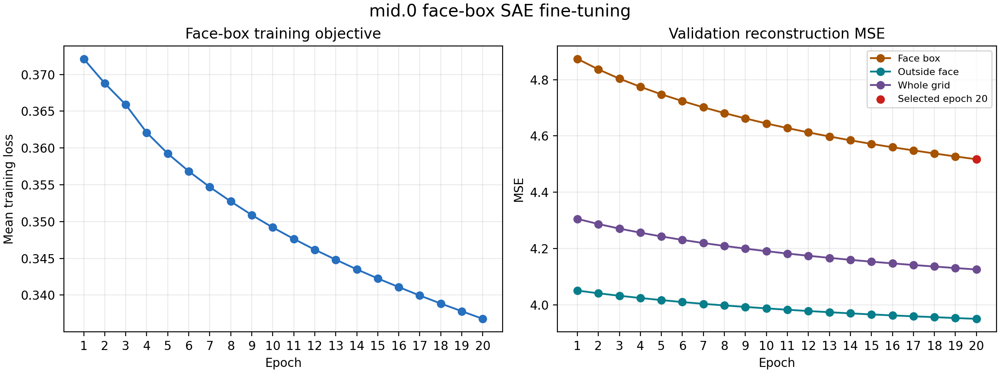

# Mid.0 face-box SAE fine-tuning

## What was trained

We initialized a new SAE from the original pretrained SAE for SDXL Turbo's
`unet.mid_block.attentions.0` layer. The diffusion generator remained frozen; only the
SAE encoder and decoder were updated. Training used activation vectors only from 16×16
grid cells whose centers fall inside automatically detected `human face` boxes.

The detector boxes are spatial masks, not human identity labels or semantic supervision.
The SAE still learns to reconstruct internal activations with its sparse Top-K objective;
it is not a face classifier.

## How this differs from the previous mid.0 fine-tune

The earlier full-grid `mid.0` run trained a separate SAE
on **every cell** of every 16×16 activation grid. Its goal was to adapt the dictionary to
the overall project activation distribution. This run starts independently from the same
pretrained checkpoint but trains only on face-box cells. Its goal is face-region
reconstruction specialization and potentially more face-localized candidate features.

Neither fine-tune changes the image generator. Because the two fine-tuned dictionaries
have different learned coordinates, their feature IDs must not be mixed.

## Training and model selection

Training ran for 20 epochs with a learning rate of 1e-06. Each
epoch used available face-boxed samples; the validation checkpoint was selected by face-box
reconstruction MSE. Epoch 20 was selected. The boxes covered
839 train, 180 validation,
and 179 held-out test portraits.

## Held-out reconstruction

| Region | Pretrained SAE MSE | Face-box-tuned SAE MSE | Reduction |
|---|---:|---:|---:|
| Face box | 4.866 | 4.457 | 8.4% |
| Outside face | 4.097 | 3.983 | 2.8% |
| Whole grid | 4.340 | 4.133 | 4.8% |

The larger held-out reduction inside face boxes supports the narrow reconstruction goal of
this run. It does not establish that any individual SAE feature represents a face part or
that editing it causes a clean facial edit. Feature pooling, localization, and intervention
tests must be rerun with this selected SAE on held-out data.

## Reproducibility

- `settings.json`: checkpoint, automatic-box source, objective, and selected epoch.
- `training_history.json`: training loss and validation reconstruction metrics per epoch.
- `heldout_reconstruction.json`: original-versus-face-box-tuned reconstruction metrics.
