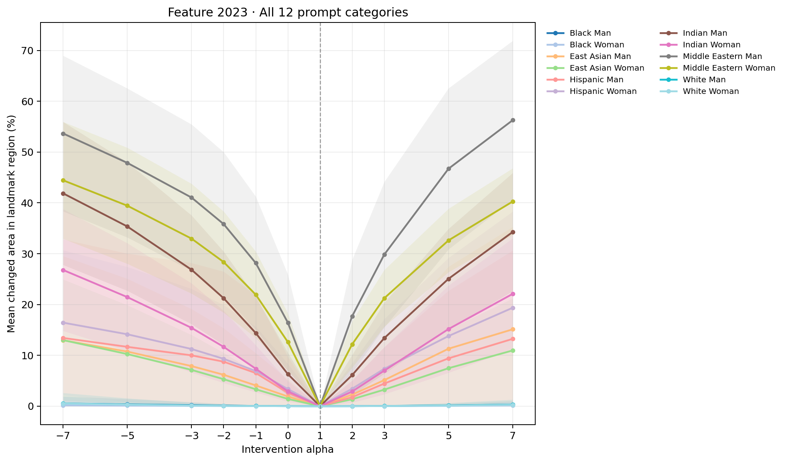

# Feature 2023 landmark-anchored head-covering-region analysis

Face Landmarker anchors a soft region that extends above the forehead and beyond the temples, down to the eyebrow line. It includes surrounding head context where a covering may sit. This is a geometric ROI, not hijab or semantic covering detection.

Jet maps show the fraction of seeds whose pixel changes from baseline by RGB MAE ≥ 12.0, within each image's landmark-anchored region. The cyan contour marks the mean region boundary. Blurred maps show mean pixel change inside the same region.

## Changed area by alpha

| Group | Alpha | Mean area % ± SD | Mean RGB MAE |
|---|---:|---:|---:|
| black_man | -7 | 0.5% ± 1.4 | 0.55 |
| black_man | -5 | 0.4% ± 1.1 | 0.47 |
| black_man | -3 | 0.2% ± 0.6 | 0.38 |
| black_man | -2 | 0.1% ± 0.4 | 0.32 |
| black_man | -1 | 0.0% ± 0.1 | 0.28 |
| black_man | +0 | 0.0% ± 0.0 | 0.23 |
| black_man | +1 | 0.0% ± 0.0 | 0.00 |
| black_man | +2 | 0.0% ± 0.0 | 0.23 |
| black_man | +3 | 0.0% ± 0.1 | 0.28 |
| black_man | +5 | 0.1% ± 0.4 | 0.36 |
| black_man | +7 | 0.3% ± 0.7 | 0.46 |
| black_woman | -7 | 0.2% ± 0.5 | 0.80 |
| black_woman | -5 | 0.1% ± 0.4 | 0.66 |
| black_woman | -3 | 0.1% ± 0.2 | 0.53 |
| black_woman | -2 | 0.0% ± 0.2 | 0.47 |
| black_woman | -1 | 0.0% ± 0.1 | 0.39 |
| black_woman | +0 | 0.0% ± 0.1 | 0.33 |
| black_woman | +1 | 0.0% ± 0.0 | 0.00 |
| black_woman | +2 | 0.0% ± 0.1 | 0.33 |
| black_woman | +3 | 0.0% ± 0.1 | 0.40 |
| black_woman | +5 | 0.1% ± 0.2 | 0.54 |
| black_woman | +7 | 0.2% ± 0.6 | 0.69 |
| east_asian_man | -7 | 13.0% ± 16.6 | 6.49 |
| east_asian_man | -5 | 10.7% ± 14.3 | 5.38 |
| east_asian_man | -3 | 7.9% ± 11.2 | 4.19 |
| east_asian_man | -2 | 6.2% ± 9.1 | 3.49 |
| east_asian_man | -1 | 4.1% ± 6.3 | 2.66 |
| east_asian_man | +0 | 1.9% ± 3.4 | 1.67 |
| east_asian_man | +1 | 0.0% ± 0.0 | 0.00 |
| east_asian_man | +2 | 2.3% ± 3.9 | 1.88 |
| east_asian_man | +3 | 5.1% ± 8.3 | 3.29 |
| east_asian_man | +5 | 11.3% ± 16.2 | 5.61 |
| east_asian_man | +7 | 15.1% ± 20.2 | 7.46 |
| east_asian_woman | -7 | 13.0% ± 11.9 | 6.37 |
| east_asian_woman | -5 | 10.3% ± 9.6 | 5.02 |
| east_asian_woman | -3 | 7.1% ± 6.9 | 3.62 |
| east_asian_woman | -2 | 5.3% ± 5.2 | 2.90 |
| east_asian_woman | -1 | 3.3% ± 3.3 | 2.14 |
| east_asian_woman | +0 | 1.4% ± 1.5 | 1.30 |
| east_asian_woman | +1 | 0.0% ± 0.0 | 0.00 |
| east_asian_woman | +2 | 1.4% ± 1.5 | 1.30 |
| east_asian_woman | +3 | 3.3% ± 3.4 | 2.13 |
| east_asian_woman | +5 | 7.5% ± 7.7 | 3.69 |
| east_asian_woman | +7 | 11.0% ± 10.2 | 5.08 |
| hispanic_man | -7 | 13.4% ± 19.4 | 6.34 |
| hispanic_man | -5 | 11.7% ± 18.4 | 5.53 |
| hispanic_man | -3 | 10.0% ± 18.2 | 4.89 |
| hispanic_man | -2 | 8.8% ± 17.7 | 4.38 |
| hispanic_man | -1 | 6.5% ± 15.3 | 3.34 |
| hispanic_man | +0 | 2.6% ± 7.1 | 1.83 |
| hispanic_man | +1 | 0.0% ± 0.0 | 0.00 |
| hispanic_man | +2 | 1.8% ± 3.2 | 1.62 |
| hispanic_man | +3 | 4.5% ± 7.2 | 2.64 |
| hispanic_man | +5 | 9.4% ± 13.3 | 4.54 |
| hispanic_man | +7 | 13.2% ± 17.4 | 6.39 |
| hispanic_woman | -7 | 16.4% ± 14.3 | 7.23 |
| hispanic_woman | -5 | 14.1% ± 13.3 | 6.37 |
| hispanic_woman | -3 | 11.3% ± 11.8 | 5.22 |
| hispanic_woman | -2 | 9.3% ± 10.6 | 4.46 |
| hispanic_woman | -1 | 6.9% ± 8.7 | 3.52 |
| hispanic_woman | +0 | 3.4% ± 5.0 | 2.23 |
| hispanic_woman | +1 | 0.0% ± 0.0 | 0.00 |
| hispanic_woman | +2 | 3.4% ± 5.0 | 2.33 |
| hispanic_woman | +3 | 7.4% ± 9.8 | 3.92 |
| hispanic_woman | +5 | 13.8% ± 15.4 | 6.53 |
| hispanic_woman | +7 | 19.4% ± 18.9 | 8.66 |
| indian_woman | -7 | 26.8% ± 12.0 | 11.75 |
| indian_woman | -5 | 21.5% ± 10.6 | 9.35 |
| indian_woman | -3 | 15.4% ± 8.8 | 7.00 |
| indian_woman | -2 | 11.7% ± 7.1 | 5.60 |
| indian_woman | -1 | 7.4% ± 4.6 | 4.12 |
| indian_woman | +0 | 2.9% ± 2.0 | 2.51 |
| indian_woman | +1 | 0.0% ± 0.0 | 0.00 |
| indian_woman | +2 | 2.9% ± 2.2 | 2.51 |
| indian_woman | +3 | 7.0% ± 4.6 | 4.08 |
| indian_woman | +5 | 15.2% ± 8.6 | 6.76 |
| indian_woman | +7 | 22.1% ± 10.9 | 8.98 |
| white_man | -7 | 0.5% ± 2.1 | 0.45 |
| white_man | -5 | 0.3% ± 1.2 | 0.37 |
| white_man | -3 | 0.2% ± 0.6 | 0.29 |
| white_man | -2 | 0.1% ± 0.3 | 0.24 |
| white_man | -1 | 0.0% ± 0.2 | 0.20 |
| white_man | +0 | 0.0% ± 0.1 | 0.15 |
| white_man | +1 | 0.0% ± 0.0 | 0.00 |
| white_man | +2 | 0.0% ± 0.0 | 0.15 |
| white_man | +3 | 0.0% ± 0.2 | 0.20 |
| white_man | +5 | 0.1% ± 0.5 | 0.30 |
| white_man | +7 | 0.3% ± 1.0 | 0.39 |
| white_woman | -7 | 0.5% ± 1.3 | 0.56 |
| white_woman | -5 | 0.3% ± 0.8 | 0.46 |
| white_woman | -3 | 0.1% ± 0.3 | 0.36 |
| white_woman | -2 | 0.1% ± 0.1 | 0.31 |
| white_woman | -1 | 0.0% ± 0.1 | 0.25 |
| white_woman | +0 | 0.0% ± 0.0 | 0.20 |
| white_woman | +1 | 0.0% ± 0.0 | 0.00 |
| white_woman | +2 | 0.0% ± 0.0 | 0.20 |
| white_woman | +3 | 0.0% ± 0.1 | 0.24 |
| white_woman | +5 | 0.1% ± 0.2 | 0.35 |
| white_woman | +7 | 0.2% ± 0.6 | 0.45 |
