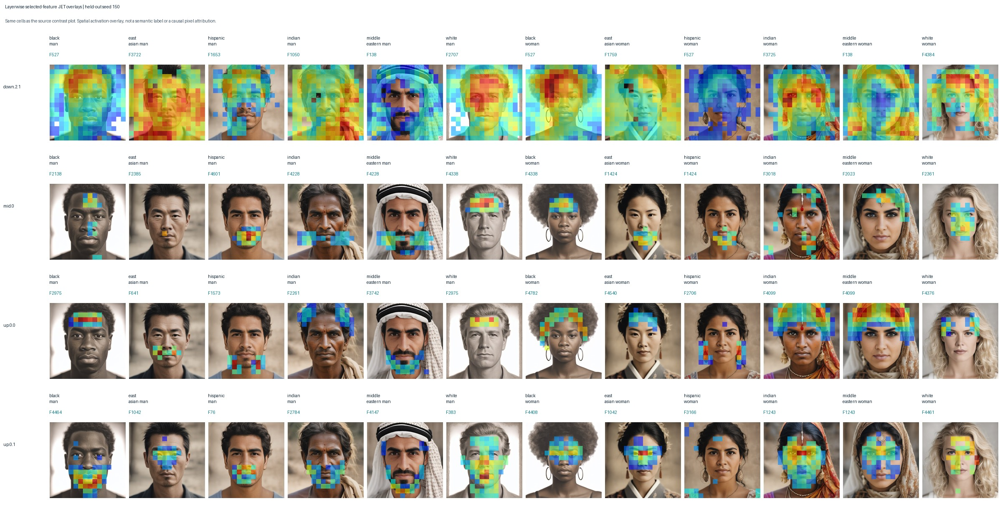

# Layerwise signed feature sweeps and JET overlays

These visualize the exact layer/group selections in [the source plot](../layerwise_group_effects_jet.png).

Held-out seeds: 150, 151, 152. Multipliers: -5, -3, -2, -1, 0, 1, 2, 3, 5.

**1 = original, 0 = remove, negative = reverse the selected contribution.** Each edit uses `output + (s - 1) * z_f * decoder_direction_f` and preserves reconstruction error.

The original-code overlay is nonnegative. Signed overlays show `s * original z_f` over edited images, not re-encoded activations or pixel-level causal attribution. All maps are coarse spatial SAE cells resized with nearest-neighbor (pixelated) rendering; zero cells are transparent.

Color scale is shared across displayed seeds/groups for each layer-specific feature. It is not shared across different features or layers. See `overlay_scales.csv`. The signed palette spans minus to plus the largest displayed multiplier times that feature scale.

The source experiment ranks **one feature per layer/group cell** (48 selections). The script also supports `--top-k` to expand the discovery ranking. Top-K SAE sparsity remains 10; it is different from the number of ranked features visualized.

Prompt labels are generation conditions, not inferred human identity. These are exploratory visual interventions; no bias reduction or image-quality improvement is established.

- [down.2.1: all selected features and signed sweeps](unet_down_blocks_2_attentions_1/README.md)
- [mid.0: all selected features and signed sweeps](unet_mid_block_attentions_0/README.md)
- [up.0.0: all selected features and signed sweeps](unet_up_blocks_0_attentions_0/README.md)
- [up.0.1: all selected features and signed sweeps](unet_up_blocks_0_attentions_1/README.md)

## Verification and data

- `verification.json`: source hash, checkpoint hashes, exact replay/no-op checks, cached pooling agreement.
- `selected_features.csv`: frozen source selections (or discovery-only top-k extension).
- `intervention_metrics.csv`: signed multiplier and image/delta measurements for every edit.
- `visual_review.csv`: blank covering/hair/clothing/face/artifact review fields.
- `overlay_scales.csv`: numeric normalization for each layer-specific feature.

Full-resolution PNGs and raw arrays are local under `raw/` (git-ignored); compact JPEG visualizations and numeric metrics are committed.
