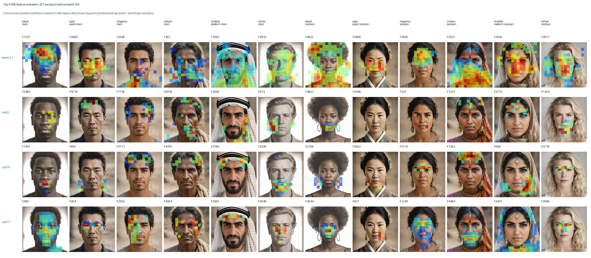
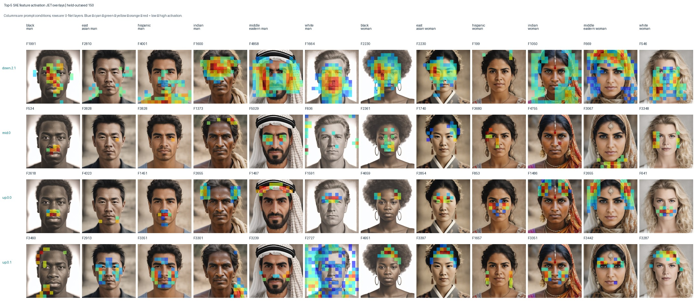

# Top-K selected-feature spatial coverage

Discovery top-K: 5; held-out baseline seed: 150.
Area is the fraction of SAE cells with `z_f > 0`, not image-pixel area or activation magnitude.

| Layer | Rank 1 | Rank 2 | Rank 3 | Rank 4 | Rank 5 |
|---|---:|---:|---:|---:|---:|
| down.2.1 | 81.0% | 50.7% | 31.5% | 31.0% | 28.7% |
| mid.0 | 8.5% | 6.7% | 5.7% | 5.7% | 3.8% |
| up.0.0 | 11.9% | 8.6% | 8.1% | 7.0% | 6.9% |
| up.0.1 | 14.7% | 17.8% | 12.4% | 10.7% | 11.9% |

## Baseline JET activation overlays

Rows are U-Net layers; columns are prompt groups. Each feature uses its own activation color scale.

### Rank 4

### Rank 5

## Mean held-out contrast, in feature SD

This uses all held-out seeds 150–199; feature selection remains discovery-only.

| Layer | Rank 1 | Rank 2 | Rank 3 | Rank 4 | Rank 5 |
|---|---:|---:|---:|---:|---:|
| down.2.1 | +2.13 SD | +2.04 SD | +1.69 SD | +1.53 SD | +1.42 SD |
| mid.0 | +1.23 SD | +1.18 SD | +1.02 SD | +0.91 SD | +1.03 SD |
| up.0.0 | +1.41 SD | +1.42 SD | +1.17 SD | +1.37 SD | +1.22 SD |
| up.0.1 | +2.00 SD | +1.61 SD | +1.76 SD | +1.61 SD | +1.79 SD |

All entries average the 12 prompt groups. Feature IDs were ranked using discovery seeds 100–149 only.
The complete per-feature values are in `spatial_area.csv`.
