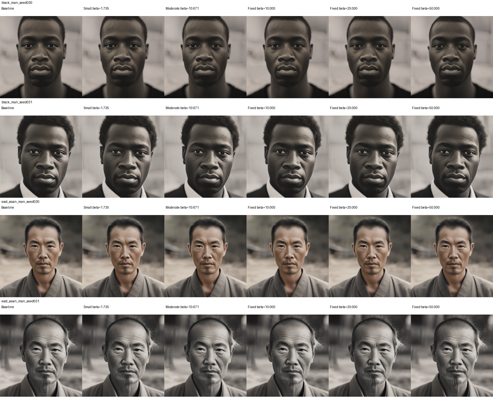
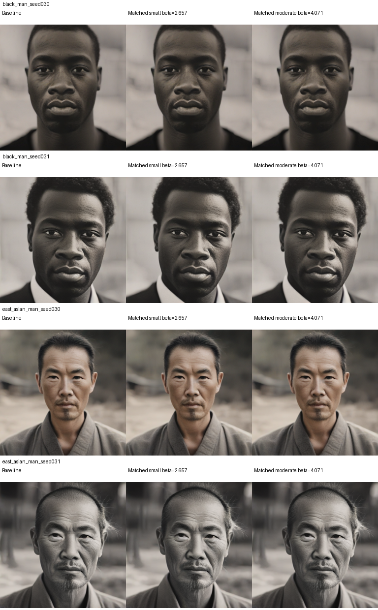
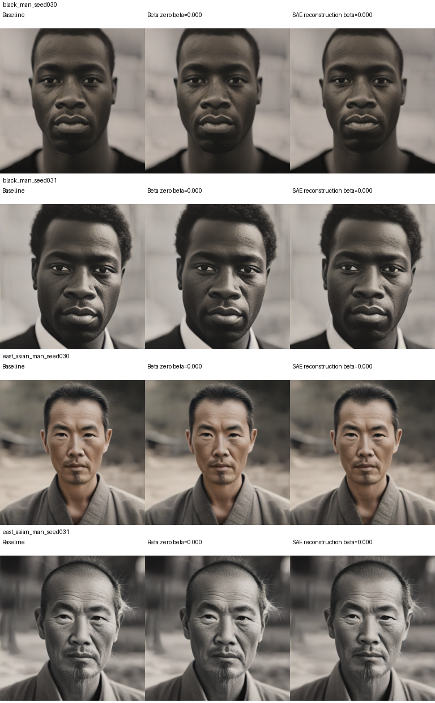
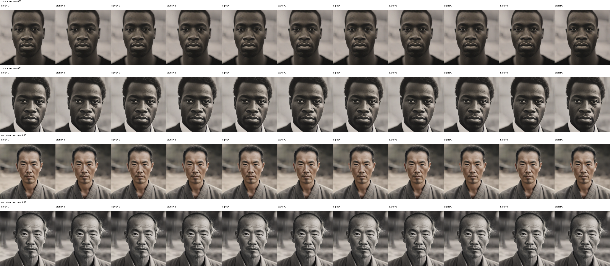

# Additive SAE smoke test — feature 4228

Checkpoint: `layers/runs/mid0_sae_face_001/sae`, SHA-256 `cbb3a0a2d0c43c822c7ba97a494de38ae56ea25401a8d31484ffa32e7cc329a6`. Layer: `unet.mid_block.attentions.0`. The SAE was fine-tuned; the SDXL Turbo generator stayed frozen. This report uses the checkpoint of the active multiplicative experiment.

**Smoke test passed.** All 60 paired no-intervention controls matched the multiplicative α=1 pixels exactly. The four displayed contexts use the same prompts and seeds as that experiment. Feature 4228 was naturally nonzero in both displayed Black-man prompt contexts and exactly zero at every spatial location in both displayed East-Asian-man prompt contexts. Prompt labels describe the conditioning text, not ground-truth identity.

## Additive sweep

Small β = **1.73515**, moderate β = **10.67096**, plus fixed **10, 20, 50**. Offsets are added at every spatial position of the selected feature. Small/moderate values come from nonzero activations across the 60 paired baseline contexts.

## Matching actual perturbation magnitude

Targets for the applied block-output L2 norm are **42.5242** and **65.1363**. These are perturbation norms, not additive constants. The offset is solved separately in each context using the same additive function, including fp16 rounding; the displayed β values are approximately **2.6573** and **4.071–4.072**. All matched smoke conditions were within 0.5% of their target.

## No-op and reconstruction controls

β=0 is an exact no-op for the historical residual-preserving intervention. Replacing the full residual with SAE reconstruction is a separate control.

## Existing multiplicative references

These images were copied from the active multiplicative sweep, using the same checkpoint, prompts and seeds. Negative multipliers are potentially out of distribution.

## Measurements

| Context | Strength | β | Initially zero? | Modified feature mean | Applied output L2 | Pixel MAE |
|---|---|---:|:---:|---:|---:|---:|
| black_man_seed030 | small | 1.73515 | False | 3.458 | 27.767 | 0.497 |
| black_man_seed030 | moderate | 10.67096 | False | 12.394 | 170.723 | 1.926 |
| black_man_seed030 | matched_small | 2.65731 | False | 4.381 | 42.524 | 0.645 |
| black_man_seed030 | matched_moderate | 4.07098 | False | 5.794 | 65.136 | 0.898 |
| black_man_seed030 | fixed_10 | 10.00000 | False | 11.723 | 160.008 | 1.813 |
| black_man_seed030 | fixed_20 | 20.00000 | False | 21.723 | 319.997 | 3.208 |
| black_man_seed030 | fixed_50 | 50.00000 | False | 51.723 | 800.005 | 7.042 |
| black_man_seed031 | small | 1.73515 | False | 2.274 | 27.764 | 0.502 |
| black_man_seed031 | moderate | 10.67096 | False | 11.210 | 170.724 | 1.440 |
| black_man_seed031 | matched_small | 2.65734 | False | 3.196 | 42.524 | 0.598 |
| black_man_seed031 | matched_moderate | 4.07118 | False | 4.610 | 65.136 | 0.738 |
| black_man_seed031 | fixed_10 | 10.00000 | False | 10.539 | 160.008 | 1.369 |
| black_man_seed031 | fixed_20 | 20.00000 | False | 20.539 | 319.997 | 2.427 |
| black_man_seed031 | fixed_50 | 50.00000 | False | 50.539 | 800.005 | 5.933 |
| east_asian_man_seed030 | small | 1.73515 | True | 1.735 | 27.764 | 0.423 |
| east_asian_man_seed030 | moderate | 10.67096 | True | 10.671 | 170.722 | 1.298 |
| east_asian_man_seed030 | matched_small | 2.65731 | True | 2.657 | 42.524 | 0.513 |
| east_asian_man_seed030 | matched_moderate | 4.07140 | True | 4.071 | 65.136 | 0.646 |
| east_asian_man_seed030 | fixed_10 | 10.00000 | True | 10.000 | 160.007 | 1.243 |
| east_asian_man_seed030 | fixed_20 | 20.00000 | True | 20.000 | 319.996 | 2.160 |
| east_asian_man_seed030 | fixed_50 | 50.00000 | True | 50.000 | 800.009 | 4.844 |
| east_asian_man_seed031 | small | 1.73515 | True | 1.735 | 27.762 | 0.599 |
| east_asian_man_seed031 | moderate | 10.67096 | True | 10.671 | 170.725 | 1.844 |
| east_asian_man_seed031 | matched_small | 2.65731 | True | 2.657 | 42.524 | 0.719 |
| east_asian_man_seed031 | matched_moderate | 4.07149 | True | 4.071 | 65.136 | 0.913 |
| east_asian_man_seed031 | fixed_10 | 10.00000 | True | 10.000 | 160.006 | 1.755 |
| east_asian_man_seed031 | fixed_20 | 20.00000 | True | 20.000 | 319.999 | 3.090 |
| east_asian_man_seed031 | fixed_50 | 50.00000 | True | 50.000 | 800.007 | 7.477 |

## Interpretation and files

The inactive contexts show that positive addition can introduce a feature that multiplication cannot change when its original value is exactly zero. This is a mechanism check, not evidence that the feature is causally specific to a demographic group. Visible changes, semantic selectivity, evaluator confidence, facial validity and degradation require separate assessment. No demographic evaluation results are claimed in this smoke report.

The encoder uses nonnegative Top-K (k=10); newly introduced coordinates are decoded linearly, without clipping or reapplying Top-K. Additions can increase support beyond k and are not assumed to follow the natural latent distribution. Full original/modified dictionaries and post-reencoded selected-feature maps are preserved.

Contact sheets are viewing derivatives. **Every original PNG in [originals/](originals/) remains at 512×512 without resizing or recompression.** [Per-image measurements](per_image_results.csv), [lossless activation archives](activations/), [configuration and calibration](config/), [source code](code/), and [file hashes](manifest.json) are included. The 44 multiplicative reference images are separate from the 40 additive/control images.

Workspace source: `/n/fs/goose/experiments/mid0_sae_selectivity/additive_20261114_174738_954258`. Full parallel additive workers are separate and remain in progress.

## Signed fixed-activation follow-up

[View all 130 signed fixed-target images, paired controls, and naturalness measurements](fixed_targets/README.md). Targets range from −200 through +200, including 0.
