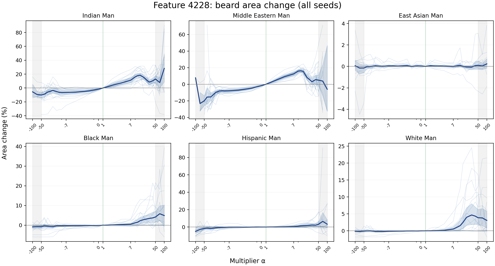
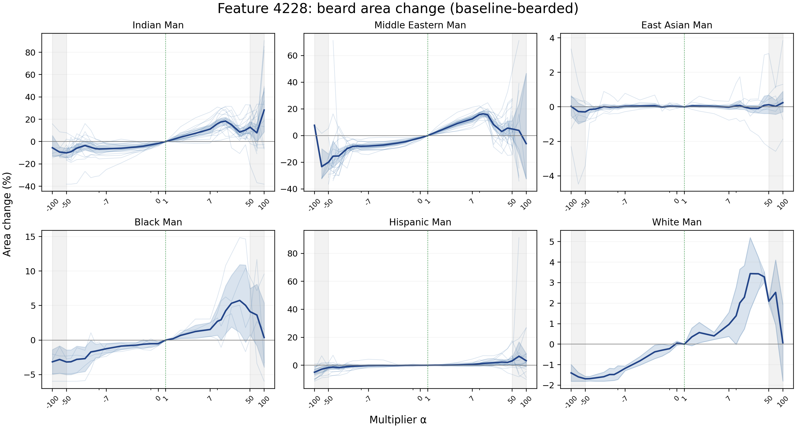
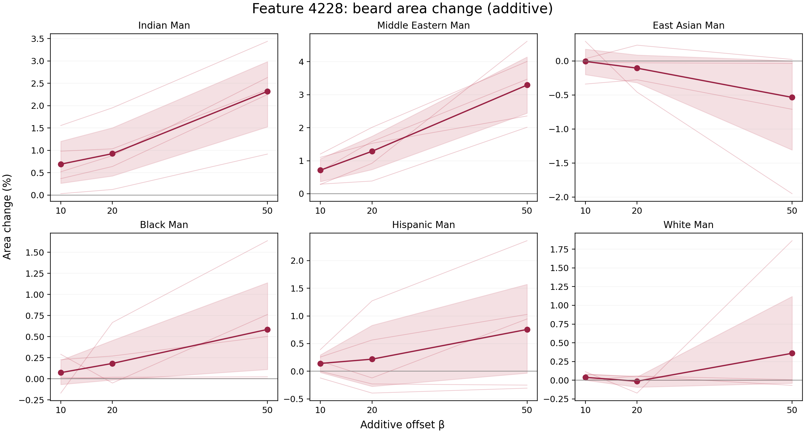
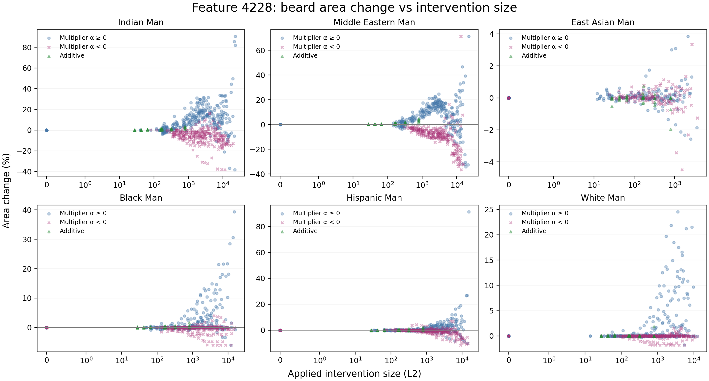
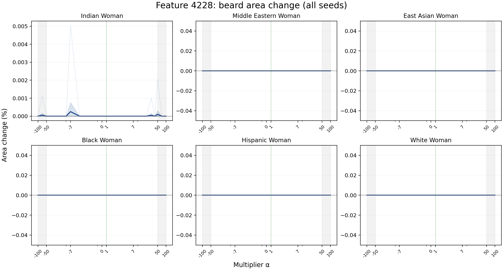
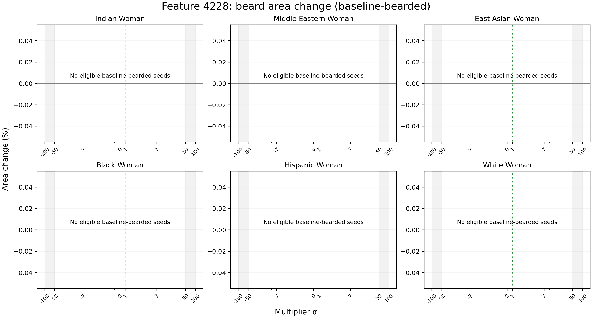
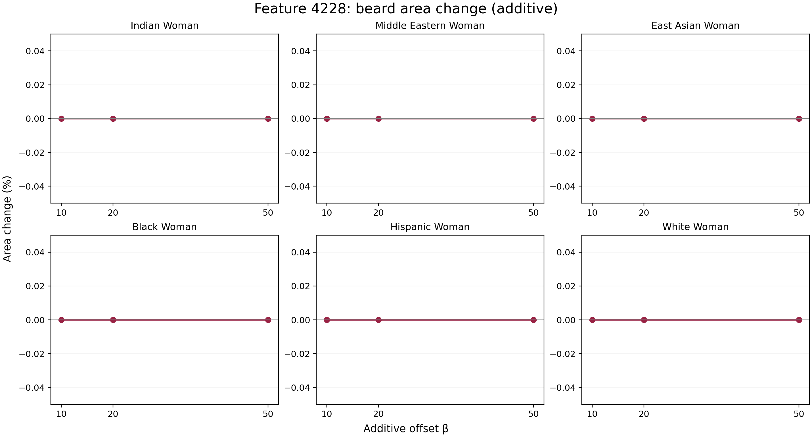
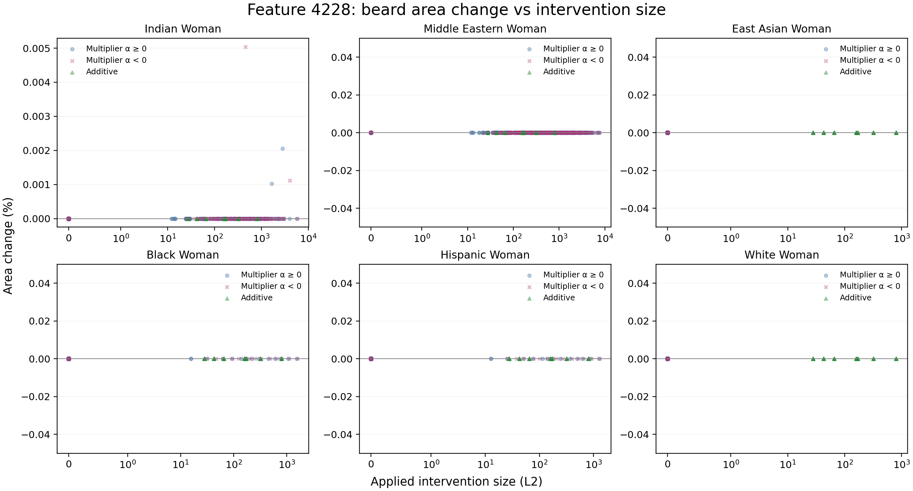

# Feature 4228: beard area changes

Four views of the existing experiment, shown separately for men’s and women’s prompt groups. This revision changes presentation only; no images were generated or rescored.

## Men’s prompt groups

### 1. beard area change (all seeds)



### 2. beard area change (baseline-bearded)



### 3. beard area change (additive)



### 4. beard area change vs intervention size



## Women’s prompt groups

### 1. beard area change (all seeds)



### 2. beard area change (baseline-bearded)



### 3. beard area change (additive)



### 4. beard area change vs intervention size



## How to read the figures

Beard area is the parser’s class14 area divided by its facial classes1–11 and14, excluding neck and hair. The axis label “Area change (%)” means edited beard-area percentage minus the same-prompt, same-seed control percentage:10% to12% is shown as+2. This is a percentage-point difference, not relative percentage growth. These remain parser measurements rather than validated beard masks. Prompt gender does not establish facial-hair presence.

1. **All seeds:** all20 multiplicative seeds per group. Thin lines are individual seeds, the bold line is their mean, and shading around it is the existing95% seed-bootstrap interval. α=0 removes the coordinate, α=1 leaves it unchanged, α<0 reverses sign, and α>1 amplifies. Gray end bands mark |α|≥50 as a caution range, not a per-image distortion verdict.
2. **Baseline-bearded:** the same analysis restricted to baseline parsed beard/face fraction≥1%. A panel with no eligible seeds is missing a qualifying sample, not a measured zero effect.
3. **Additive:** five seeds per group at offsets10,20,50. Each edit is compared with its saved no-intervention baseline.
4. **Applied L2:** L2 is the magnitude of the actual block-output change after dtype casting: `sqrt(sum((edited_block - original_block)**2))`. It is a measurement, **not regularization or a training penalty**. For a change vector(3,4), L2=5. Opposite changes(3,4) and(−3,−4) have the same L2, so size alone does not describe direction. The different markers identify intervention methods/signs. This scatter plot helps inspect responses at comparable sizes; it does not by itself establish a direction effect after controlling for magnitude.

Panel y scales vary so small responses remain visible. Graph4 contains20 multiplicative seeds and five additive seeds; graph3 is not a magnitude-matched comparison with graph1. No new uncertainty calculations or statistical tests are introduced.

## Data and reproduction

The original scored tables, archives, checkpoints, input hashes and methodological details are preserved in the [original scoring report](ORIGINAL_ANALYSIS.md) and the local source run recorded in config/plot_presentation/input_hashes.csv. The unchanged scored tables remain in this report’s results/ directory on GitHub.

```bash
PYTHONNOUSERSITE=1 PYTHONPATH=/n/fs/goose/experiments/mid0_sae_selectivity/deps /n/fs/goose/el8403/conda-envs/goose/bin/python config/plot_presentation/code/presentation.py --source-run /n/fs/goose/experiments/mid0_sae_selectivity/beard_interventions_20261117_020843_219166 --output-dir /path/to/new_figure_directory
```
