# Slide21: direct pixel differences

Feature4228, seed30, all12 prompt groups. Each group’s baseline/+10/+20/+50 columns are pairwise pixel-different:72/72 comparisons. These differences do not establish meaningful semantic or beard changes.

MAE = mean(abs(editedRGB − referenceRGB)) across all512×512×3 channel values, in0–255 intensity units. Changed-pixel percentage counts positions where at least one channel differs. The CSV also records changes of at least10 intensity units.

| Prompt group | +10 vs baseline MAE | +20 MAE | +50 MAE |
|---|---:|---:|---:|
| black_man | 1.813 | 3.208 | 7.042 |
| black_woman | 2.010 | 3.795 | 9.619 |
| east_asian_man | 1.243 | 2.160 | 4.844 |
| east_asian_woman | 1.265 | 2.136 | 4.558 |
| hispanic_man | 0.991 | 1.762 | 3.828 |
| hispanic_woman | 1.901 | 3.508 | 8.568 |
| indian_man | 2.395 | 4.354 | 9.290 |
| indian_woman | 2.655 | 4.440 | 9.198 |
| middle_eastern_man | 2.756 | 5.839 | 12.867 |
| middle_eastern_woman | 1.943 | 3.332 | 6.962 |
| white_man | 1.048 | 1.978 | 5.179 |
| white_woman | 1.383 | 2.635 | 6.823 |

## Difference previews

Top rows show saved photos. Bottom rows show absolute RGB differences from baseline, amplified4× for visibility and capped at255. This amplification is for display only. Full unamplified signed and absolute differences are retained losslessly in NPZ on the research host.

### black_man

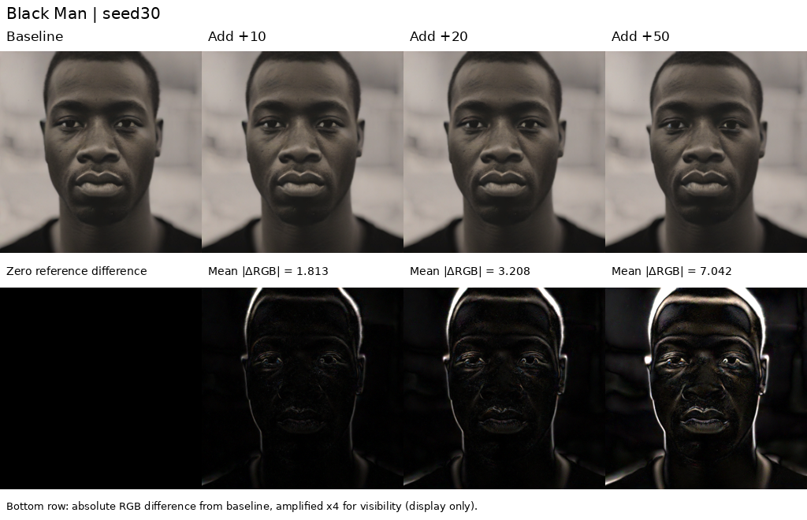

### black_woman

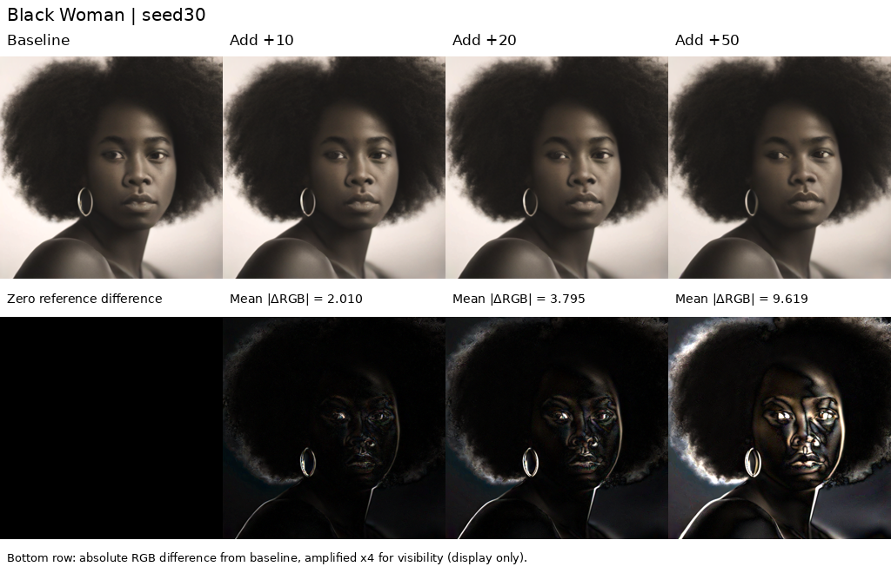

### east_asian_man

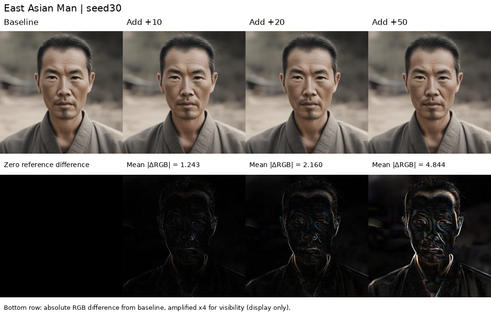

### east_asian_woman

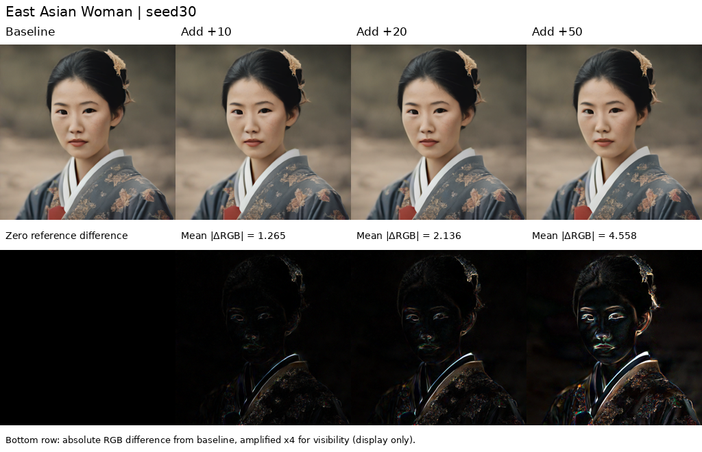

### hispanic_man

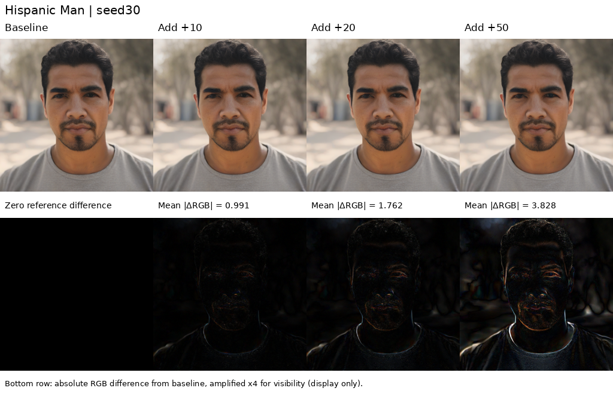

### hispanic_woman

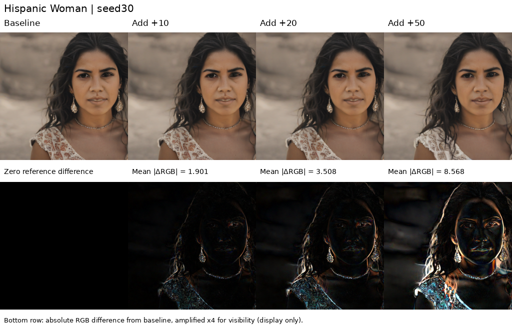

### indian_man

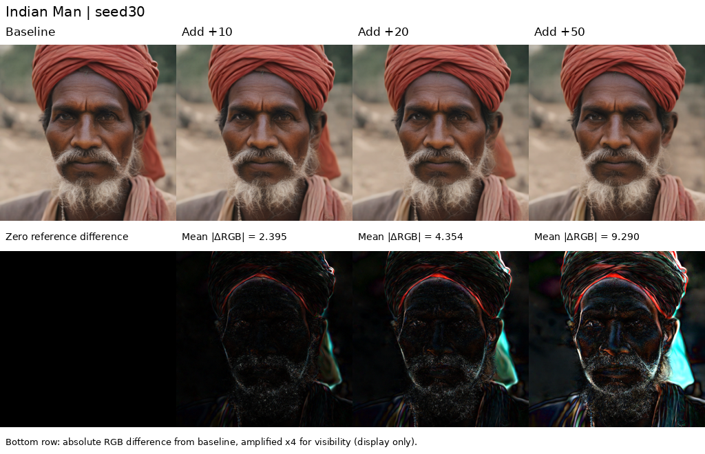

### indian_woman

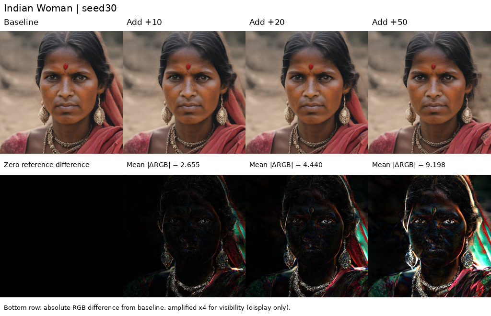

### middle_eastern_man

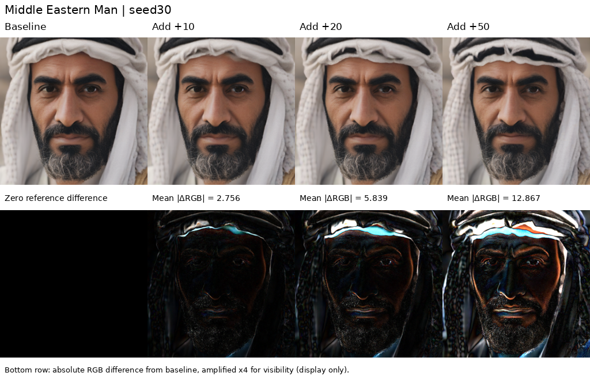

### middle_eastern_woman

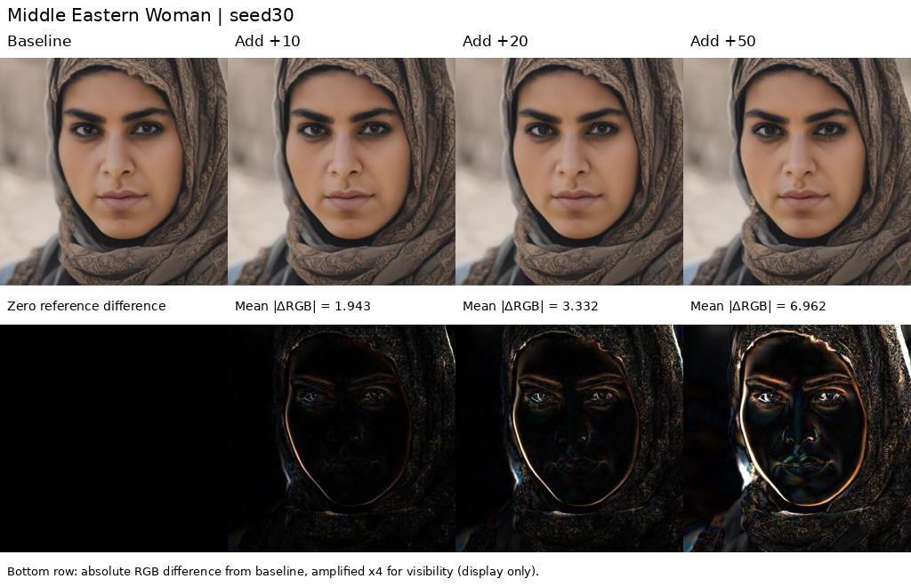

### white_man

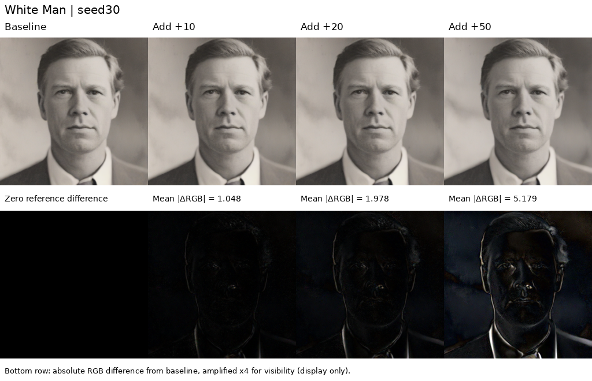

### white_woman

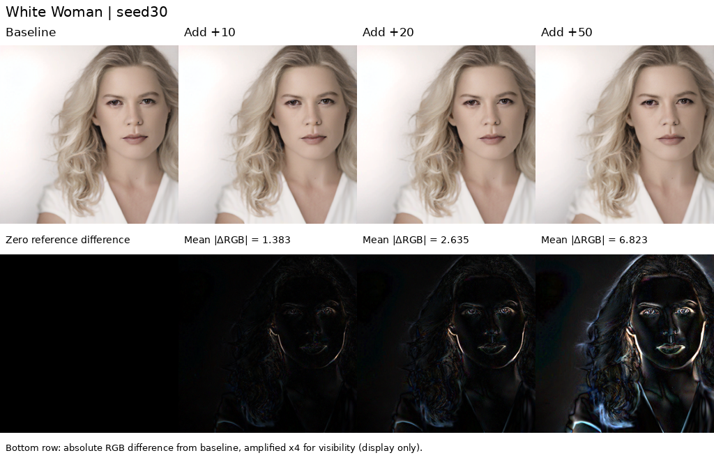

results/actual_pixel_examples.csv lists actual RGB values at the same coordinate in all four conditions. It includes a fixed center pixel and an explicitly selected maximum-difference pixel; the latter is not representative. No image generation, model inference or source-image modification was performed.

Full lossless difference arrays remain at `/n/fs/goose/experiments/mid0_sae_selectivity/slide21_pixel_audit_20261118_191943_543108/differences/`. The previews and CSV data are published here; original generated PNGs were not altered.
