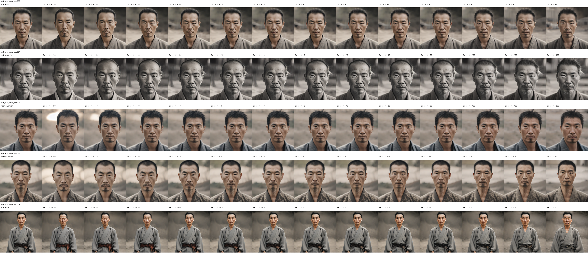
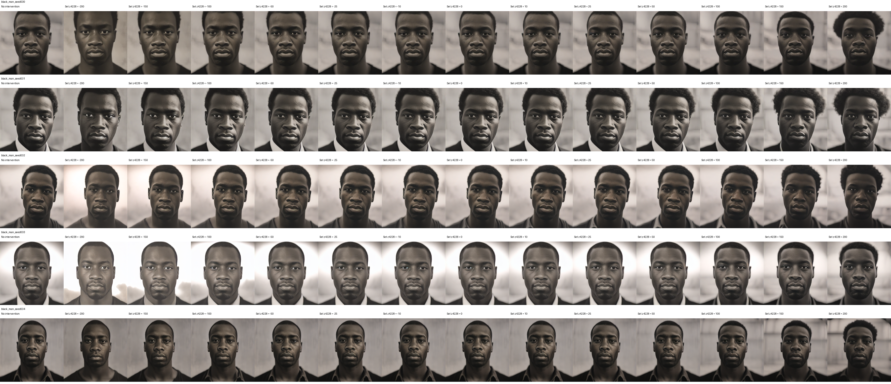
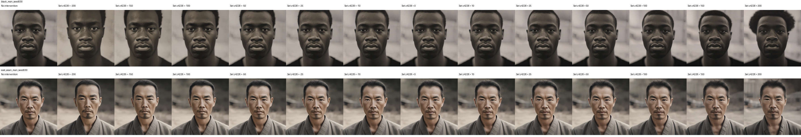

# Feature 4228: signed fixed-activation sweep

**All 130 edited images completed and passed exact-coordinate validation.** Five paired seeds (30–34), two prompt groups, 13 target values. Same face fine-tuned mid.0 SAE and frozen SDXL Turbo generator as the active multiplicative experiment.

Targets: **−200, −150, −100, −50, −25, −10, 0, 10, 25, 50, 100, 150, 200**.

This replaces `z_4228` at **every 16×16 spatial position** by the target. It is not multiplication and does not add a constant offset to the existing feature. The historical reconstruction residual is preserved through `output + (target - original_coordinate) @ decoder_direction`. Negative values are decoded linearly without clipping.

## East-Asian-man prompts

## Paired Black-man prompts

## First paired seed

## What is established

- Every saved modified feature coordinate equals its requested signed target exactly.
- All images and controls remain available as original 512×512 PNGs in [originals/](originals/). The sheets above are derivatives.
- Applied perturbation norms, original activity, support changes, negative fractions, and post-reencoding discrepancy are recorded in [activation_and_naturalness.csv](activation_and_naturalness.csv).
- Equal coordinate targets are **not** equal perturbation magnitudes in naturally active versus inactive contexts. This is an exploratory forced-activation test, separate from the matched-norm additive experiment.
- Nonzero uniform targets can introduce coordinates beyond natural Top-K support. Negative targets also violate the encoder's natural nonnegativity. Neither fixed targets nor matched norms guarantee equally natural interventions.

## Visual interpretation

In seed 30, +200 does not visibly produce a full beard. Negative values appear to strengthen a small goatee, while strong settings also affect hair and facial shape. Other seeds show context-dependent changes. These are qualitative observations, not validated beard scores or evidence of demographic causal specificity. The prompt labels are conditioning text, not ground-truth identity labels.

No automated demographic or beard-evaluation result is claimed here. Blinded attribute review and random-feature comparisons remain necessary before interpreting semantic selectivity.

## Reproducibility

Checkpoint: `layers/runs/mid0_sae_face_001/sae`, SHA-256 `cbb3a0a2d0c43c822c7ba97a494de38ae56ea25401a8d31484ffa32e7cc329a6`. Layer: `unet.mid_block.attentions.0`.

[Configuration and validation](config/), [per-image generation metadata](all_generations.csv), [code](code/), and [file hashes](manifest.json). Full original/modified latent dictionaries, selected-feature spatial maps and post-reencoding maps remain losslessly saved in the permanent experiment directory:

`/n/fs/goose/experiments/mid0_sae_selectivity/fixed4228_20261114_182404_209571`

The CSV records each activation archive's path and SHA-256; archives are preserved locally rather than duplicated in this GitHub preview. Resume an individual seed using the worker's exact config and `additive.py --run WORKER_DIRECTORY`. The five workers reuse verified baseline and reconstruction controls and preserve separate append-only attempt journals.
