# Exploratory SAM beard-proxy analysis: two prompt groups

Existing feature-4228 images only; no diffusion generation or training. Indian-man and Middle-Eastern-man prompts, seeds30–34, baseline/+10/+50. These groups were selected after viewing the previous pilot, so this is exploratory and cannot establish demographic specificity.

## Measurement

The same baseline landmark rule defines box/points for each seed, frozen across its edits. Box-plus-points is the primary policy motivated by the previous pilot; box-only is a sensitivity check. Each chooses the highest SAM-quality candidate; all alternatives are saved. Quality is not beard confidence. Coverage = sum(mask × fixed baseline soft lower-face ROI) / sum(ROI). Paired change is edited minus baseline, in percentage points. The ROI can include neck/skin and is not beard ground truth.

All proposals remain in paired_changes.csv, including semantically unusable masks. Visual screening records usable_proxy/uncertain/non_hair_or_incomplete, with reasons. It is an assistant feasibility check, not independent validation. A screened subset requires both baseline and edit usable; post-intervention exclusions can bias results and remain descriptive. No score in this report establishes a true beard-area change.

## Paired images

## Findings from the complete five-seed check

Box-plus-points overlays broadly follow visible facial hair for all five Middle-Eastern-man seeds at baseline, +10 and +50, with imperfect boundaries. In Indian-man images, only seed30 provides usable paired proxies at both offsets; other masks include substantial skin/neck or are uncertain. This visual screening is by the assistant, not independent ground truth. The group restriction alone therefore does not solve measurement validity.

| Prompt group | Offset | Screened seed pairs | Mean proposal change (pp) | Exploratory 95% bootstrap interval |
|---|---:|---:|---:|---|
| indian_man | fixed_10 | 1/5 | -0.56 | Unavailable (one seed) |
| indian_man | fixed_50 | 1/5 | -0.75 | Unavailable (one seed) |
| middle_eastern_man | fixed_10 | 5/5 | 0.21 | [-0.77, 0.93] |
| middle_eastern_man | fixed_50 | 5/5 | 2.71 | [1.90, 3.80] |

The +50 Middle-Eastern-man SAM proposal increases modestly; this is an exploratory region-proposal association, not a validated increase in beard hair or proof that feature4228 controls beards. +10 does not give a clear directional change in this proxy. One screened Indian-man seed cannot support a group-level conclusion. Box-only failures show that the measurement depends strongly on prompting. No claim of no semantic effect, demographic causal specificity, or visual naturalness follows.

### indian_man_seed30

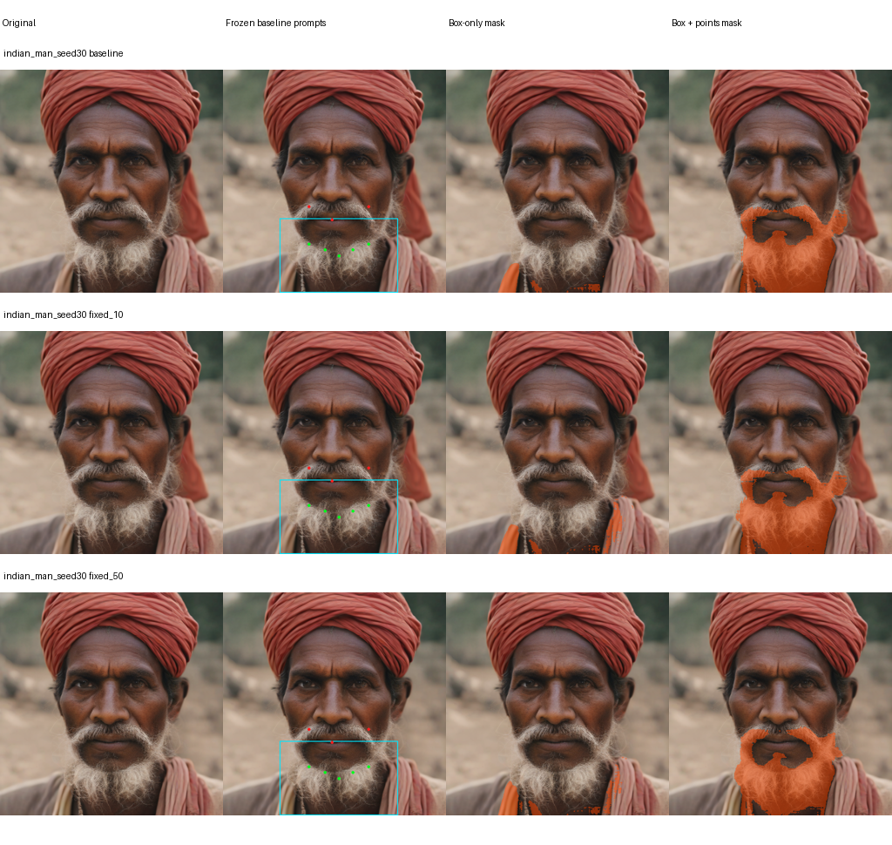

### indian_man_seed31

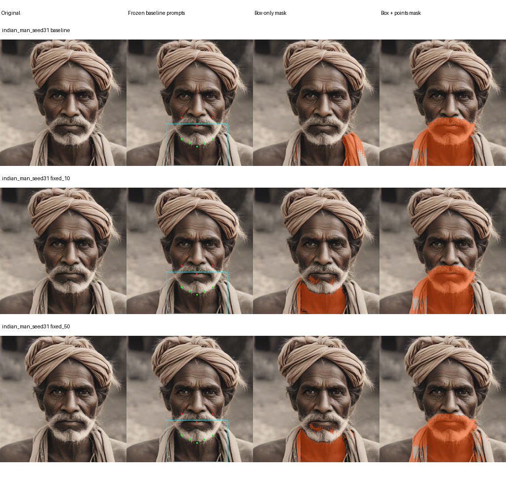

### indian_man_seed32

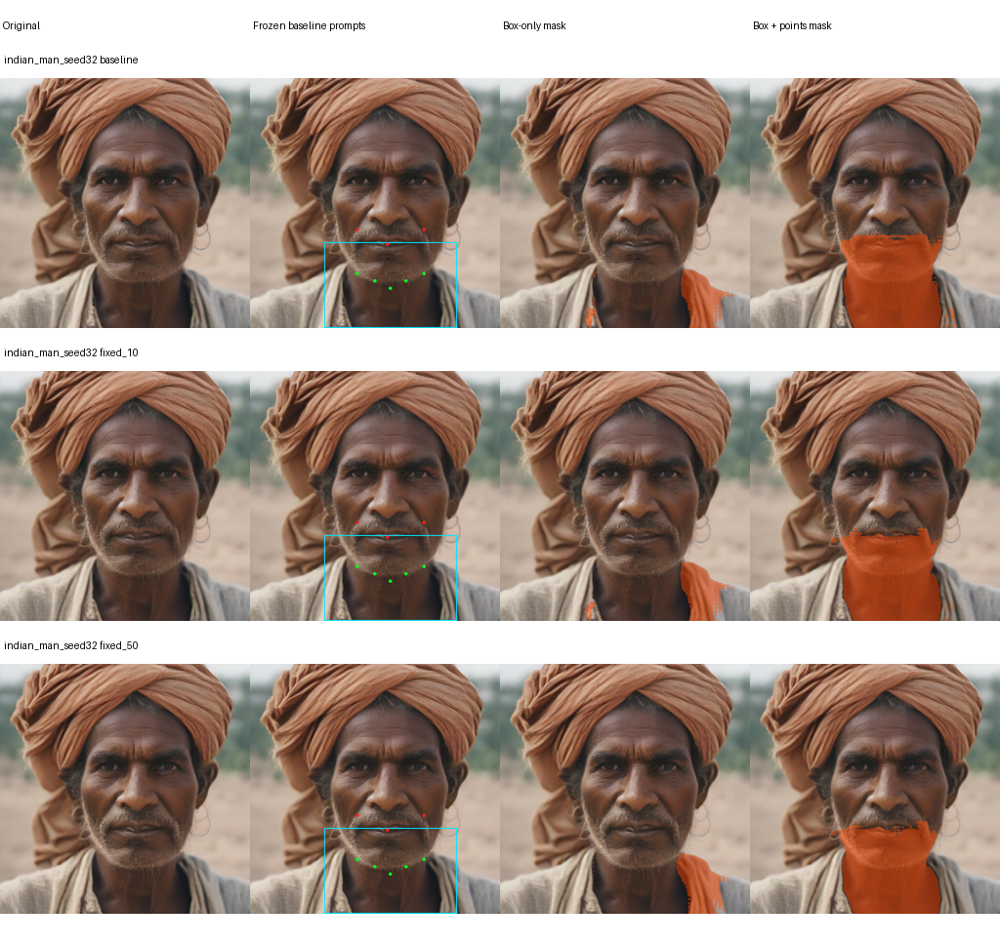

### indian_man_seed33

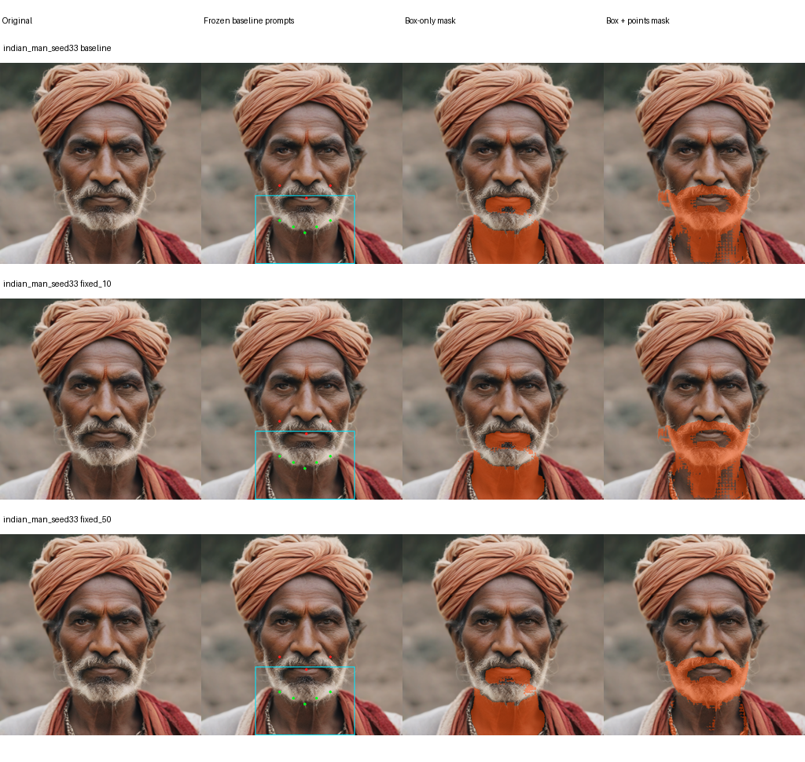

### indian_man_seed34

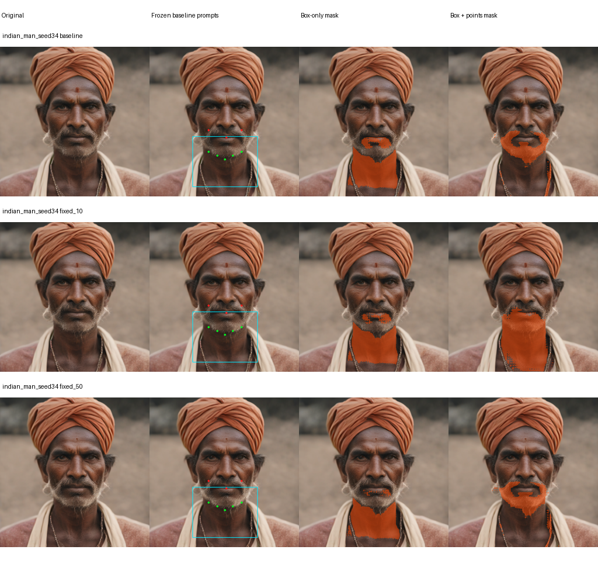

### middle_eastern_man_seed30

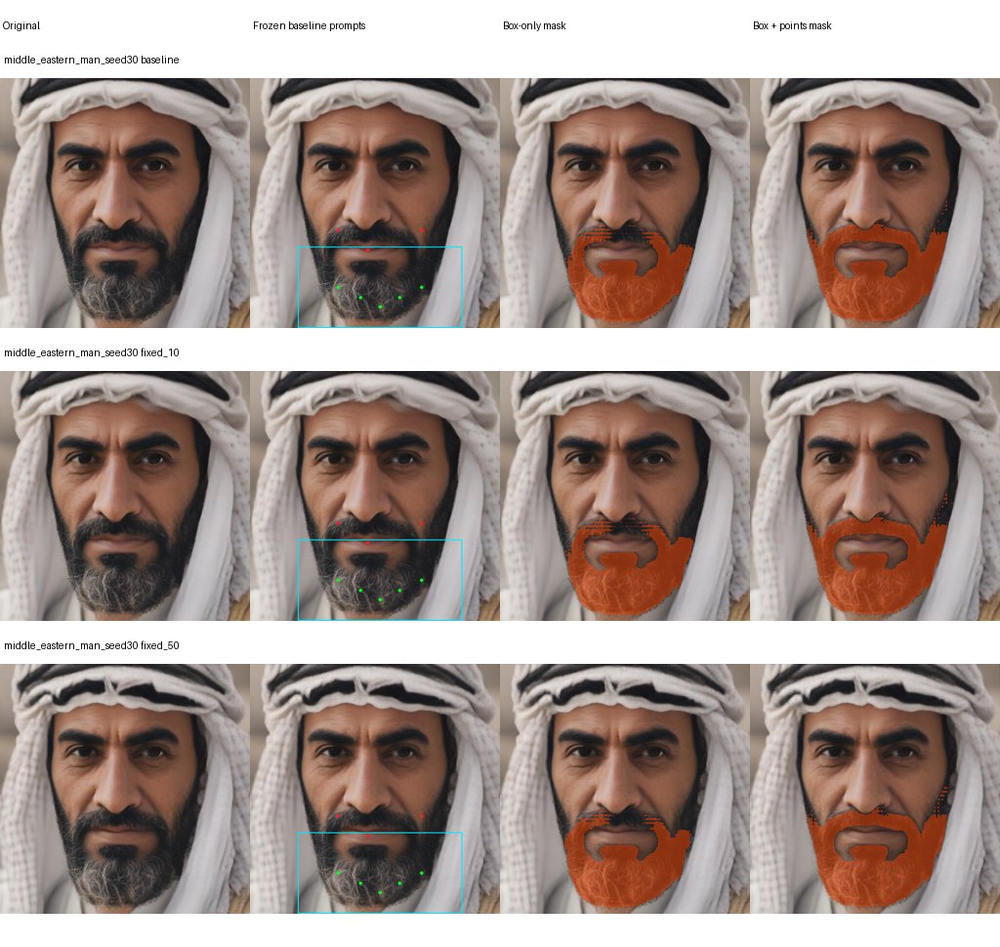

### middle_eastern_man_seed31

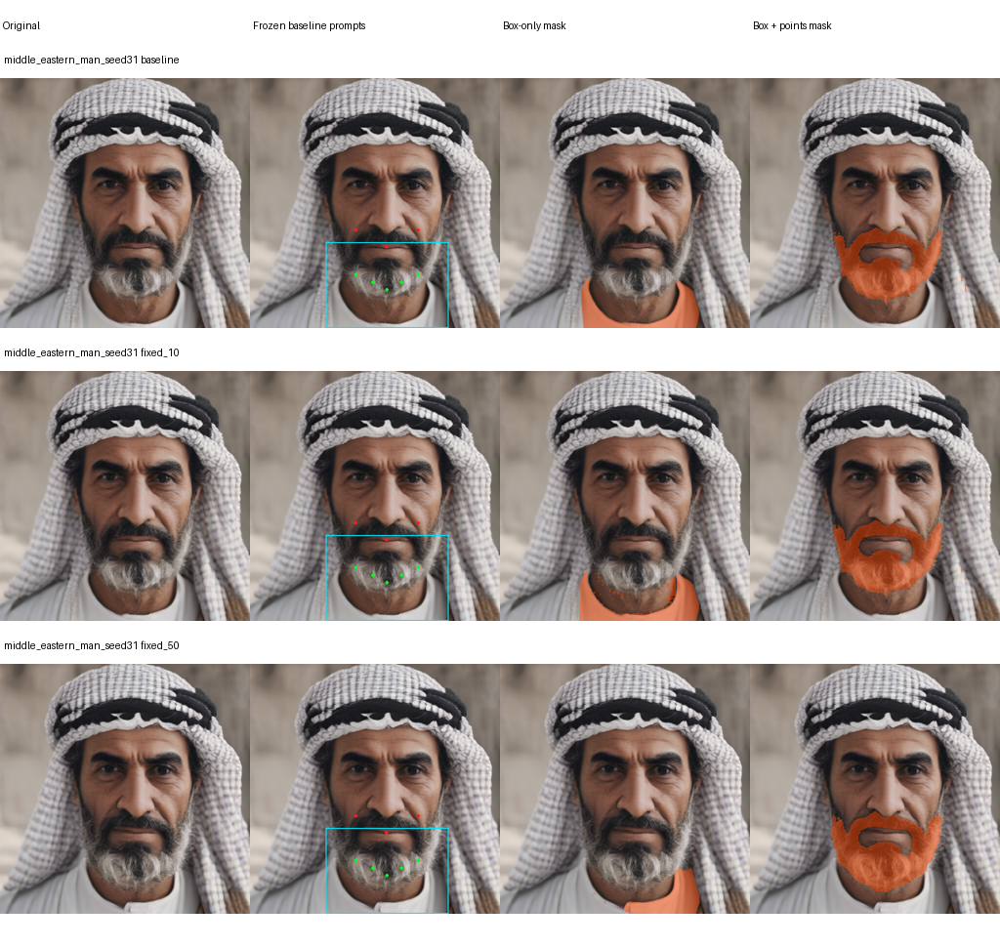

### middle_eastern_man_seed32

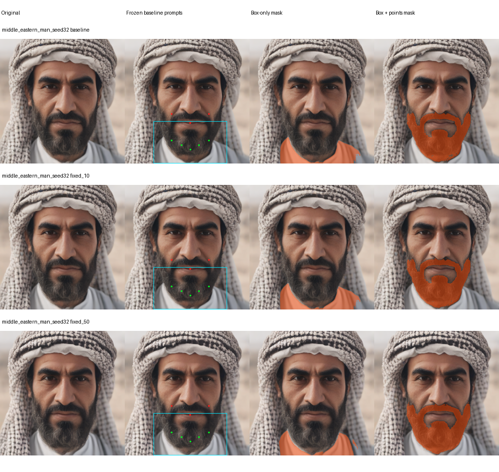

### middle_eastern_man_seed33

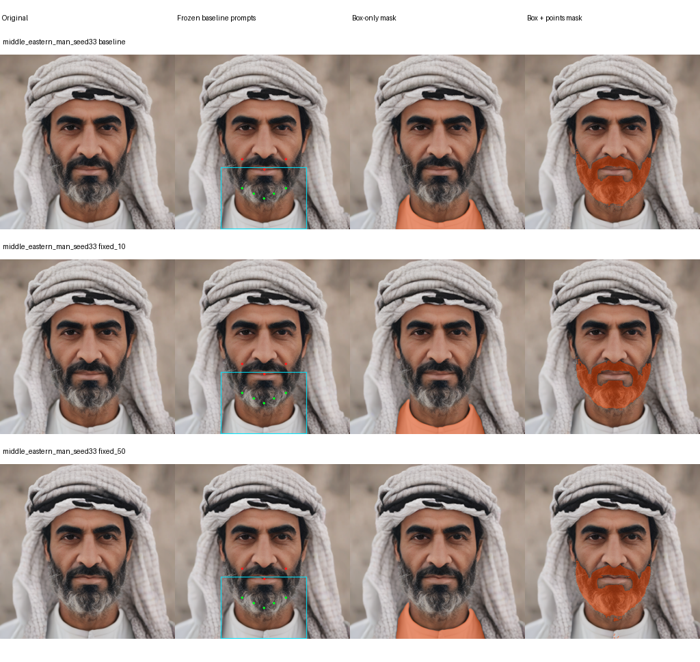

### middle_eastern_man_seed34

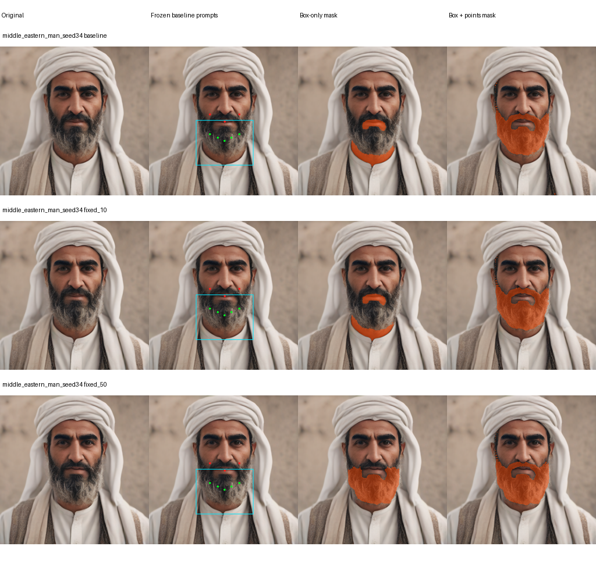

## Analysis and uncertainty

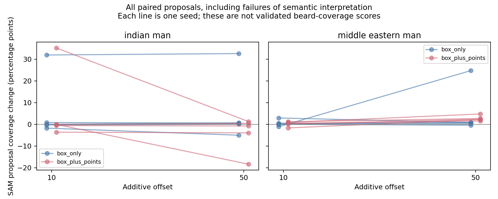

results/summary.csv reports per-group, per-offset paired seed means, sample sizes, and percentile-bootstrap intervals. Five seeds are the units; prompt policies and offsets are not independent observations. No group comparison or confirmatory p-values are claimed. Small-sample intervals and post-selection screening are exploratory. A change in mask area can reflect segmentation drift, skin, pose, or image changes rather than hair.

## Preservation and resume

config/code contains the executed source snapshot, configuration and input hashes. originals contains untouched lossless images; overlays/figures are separate derivatives. sam_arrays preserves masks, scores, logits; image_embeddings preserves embeddings. logs/events.jsonl is the incremental journal. Exact matching seed30 images/prompts reuse prior predictions, with provenance. All masks/candidates are retained.

```bash
sbatch instance-segmentation/two_group_sam/pilot.sbatch /n/fs/goose/experiments/mid0_sae_selectivity/sam_beard_two_groups_20261117_003306_350126
PYTHONNOUSERSITE=1 PYTHONPATH=/n/fs/goose/experiments/mid0_sae_selectivity/deps /n/fs/goose/el8403/conda-envs/goose/bin/python /n/fs/goose/experiments/mid0_sae_selectivity/sam_beard_two_groups_20261117_003306_350126/config/code/report.py --run /n/fs/goose/experiments/mid0_sae_selectivity/sam_beard_two_groups_20261117_003306_350126
```

Full originals/tensors remain on the research host. GitHub contains derived galleries, diagnostic CSVs, configurations and code only.
