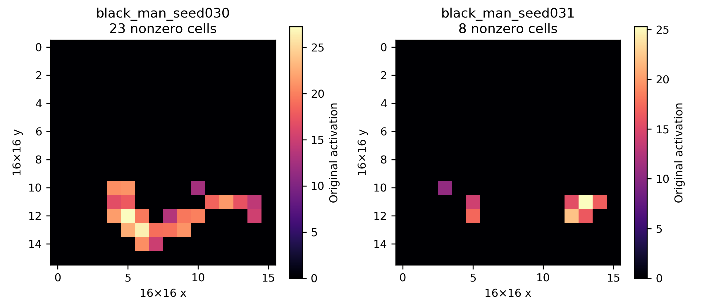
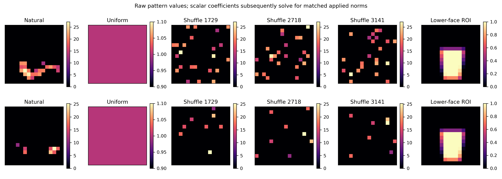
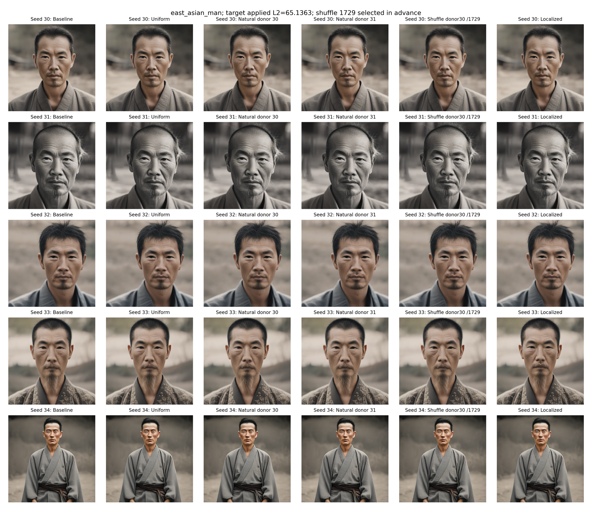
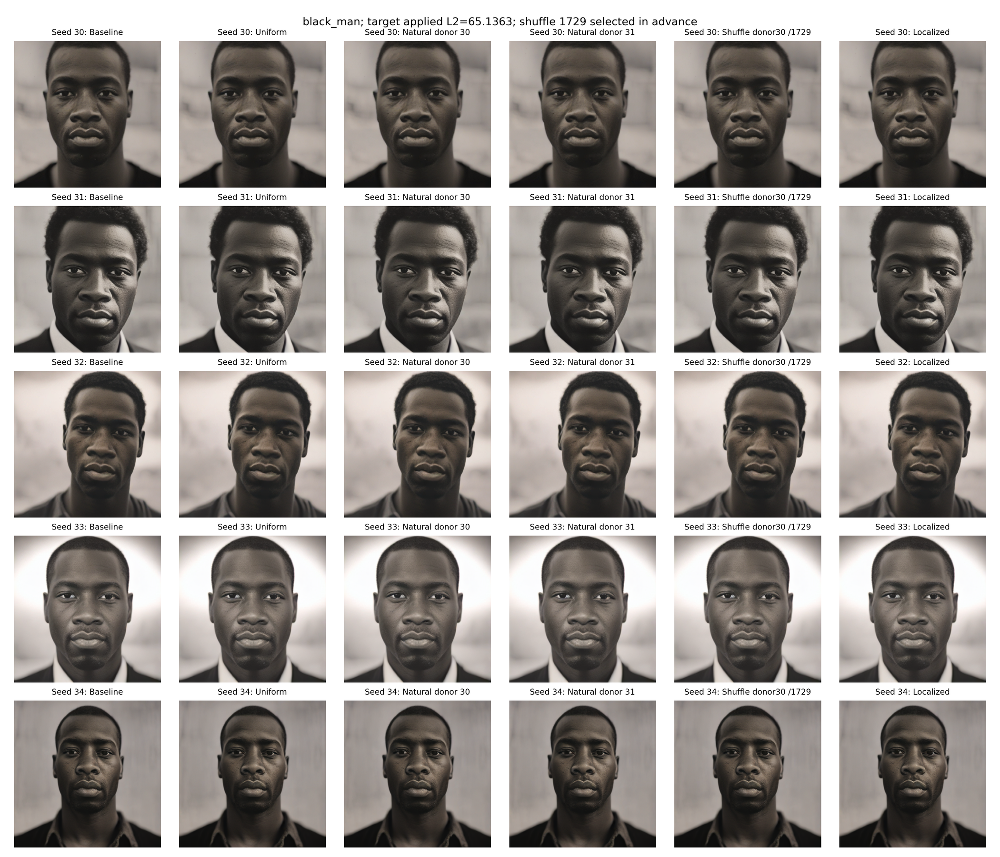
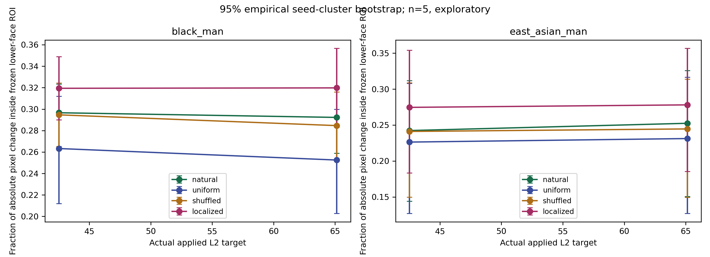
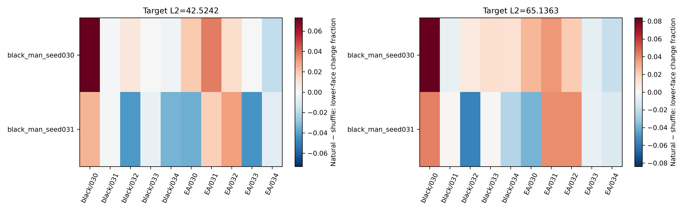
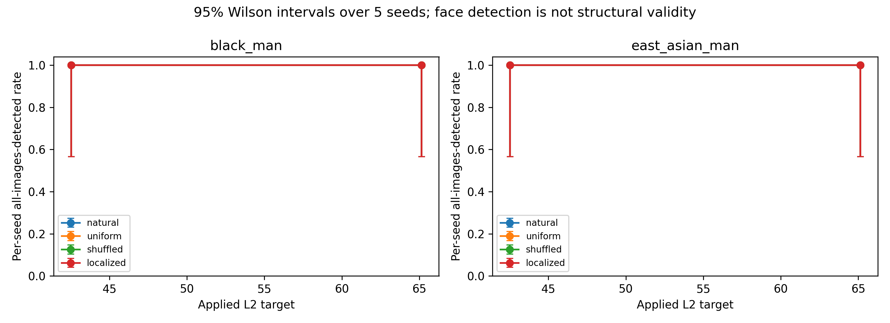
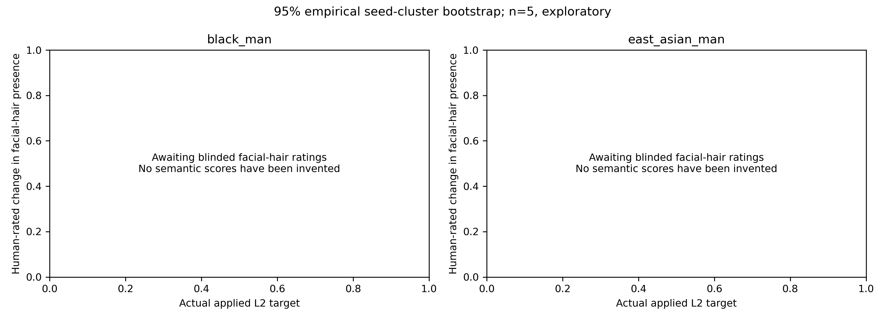

# Spatial activation-pattern transfer — feature 4228

**Completed: 200 matched edited conditions, 10 generated no-op replays, and 10 reused baselines.** Full original images, latent dictionaries, spatial maps and applied block-output tensors are preserved permanently in:

`/n/fs/goose/experiments/mid0_sae_selectivity/spatial4228_20261114_183629_015130`

This GitHub report contains derived figures, CSVs, code and image previews only. Raw tensor archives and original generations are not duplicated here.

## What was tested

One face-fine-tuned SAE (`layers/runs/mid0_sae_face_001/sae`, SHA-256 `cbb3a0a2d0c43c822c7ba97a494de38ae56ea25401a8d31484ffa32e7cc329a6`), one layer (`unet.mid_block.attentions.0`), and the same frozen single-step SDXL Turbo generator. No training, alternative SAE or alternative diffusion model.

Two naturally active Black-man donor maps (seeds 30, 31; 23 and 8 nonzero spatial cells) are added to paired Black-man and East-Asian-man contexts at seeds 30–34. Conditions: natural maps, uniform patterns, three exact spatial permutations per donor (shuffle seeds 1729,2718,3141), and recipient landmark-derived lower-face patterns. Uniform/localized conditions are shared across donors. Unscaled shuffled maps preserve the exact donor value distribution. Coefficients are subsequently matched against the actual fp16-applied block-output norm; tiny coefficient differences across layouts are recorded.

Targets: **42.5242 and 65.1363**. All 200 edits are within 0.5%; worst relative error is approximately **0.000627%**. No clipping, hidden map normalization or Top-K reapplication.

**Activity is checked cell by cell.** East-Asian-man seed 33 has two nonzero cells; seeds 30,31,32,34 are completely inactive. Black-man seeds32 and34 are also inactive. None are silently relabeled or discarded.

## Donors and spatial controls

Donor maps are transferred in absolute image-grid coordinates without pose alignment or warping. Lower-face masks use the existing MediaPipe extended-chin ROI and float BOX area averaging from 512×512 to 16×16, retaining fractional weights. This is geometric localization, not beard segmentation.

## Paired generation previews

Each row is one recipient seed. Columns show baseline, uniform, natural donor 30, natural donor 31, donor 30 shuffled with seed 1729, and localized intervention. All edited columns use applied L2 target 65.1363. The displayed shuffle seed was fixed before evaluating outcomes. PNGs are resized viewing derivatives of full figures; full-resolution PDF figures are also included. Original generated 512px PNGs remain untouched in the permanent archive.

## What the measurements establish

Equal applied norms produce markedly different sparse-support shifts. At target 65.1363, uniform edits exceed k=10 support at about 99.8% of spatial cells in East-Asian-man contexts, compared with 6.0% for natural-pattern edits. Thus matching L2 alone does not make interventions equally natural.

| Context | Method | Pixel MAE | Lower-face fraction of image change | Spatial cells beyond k=10 |
|---|---|---:|---:|---:|
| black_man | natural | 0.537 | 0.292 | 4.1% |
| black_man | uniform | 0.684 | 0.253 | 96.6% |
| black_man | shuffled | 0.466 | 0.285 | 5.8% |
| black_man | localized | 0.854 | 0.320 | 28.6% |
| east_asian_man | natural | 0.629 | 0.252 | 6.0% |
| east_asian_man | uniform | 0.777 | 0.231 | 99.8% |
| east_asian_man | shuffled | 0.549 | 0.245 | 6.1% |
| east_asian_man | localized | 1.412 | 0.278 | 22.0% |

For East-Asian-man contexts at target 65.1363, natural minus shuffled lower-face change concentration is **+0.00784**, with 95% seed-bootstrap interval **[−0.01036,0.02715]** and exact two-sided sign-flip p=0.5. This five-seed experiment does **not establish a clear localization advantage** for the natural pattern over shuffled patterns. These are image-change measures, not facial-hair measurements.

All 220 conditions had MediaPipe detections and FairFace probability vectors. Detection does not establish structural validity; demographics are classifier predictions of perceived appearance, not ground-truth identities. The main detection figure uses 95% Wilson intervals over five seed-level all-images-detected events; a 5/5 detection result has a lower bound of about0.566.

## Facial-hair effects remain unmeasured

No validated facial-hair classifier or reviewed beard segmenter was available. The existing SAM probes are class-agnostic and are not beard-accuracy measurements. We therefore prepared **27 blinded review sheets covering 200 edits and 10 no-op pairs**, with facial-hair presence, full-beard presence, estimated coverage, structural validity and artifact fields. No human ratings have been supplied yet, and no semantic values are invented.

[Blinded instructions and preview sheets](review_preview/) and the [review form](review_preview/review_form.csv) are included. All 27 pages and the separate blinding key remain in the local archive; the key is deliberately withheld here. Rerun analyze.py after ratings are entered, without regenerating any images.

## Statistics, reproducibility and limits

Comparisons are paired within recipient seed and fixed donor. Shuffle/donor replicates are averaged before seed-level inference; repeated images do not count as independent seeds. Intervals enumerate the empirical seed-cluster bootstrap (all 5^5 resamples); sign-flip tests enumerate all 2^5 assignments. Five seeds and two fixed donors support exploratory analysis, not a confirmatory or multiplicity-adjusted claim. Activity-stratified descriptive results are provided separately.

The smoke test passed with 24 edited conditions and two pixel-identical no-op replays. Seed30 subsequently resumed with exactly 42 total generation attempts, confirming that smoke images were not regenerated. Full condition plans, versioned code snapshots, environments, per-attempt journals, all raw data and the output-file hash manifest remain in the permanent experiment directory.

[Paired comparisons](results/paired_comparisons.csv), [per-image results](results/per_image_results.csv), [naturalness measurements](results/naturalness.csv), [per-image demographic confidences](evaluations/demographic_predictions.csv), [configuration](configuration.csv), [checkpoint hashes](source_checkpoint_hashes.csv), [code](code/) and [research summary](results/research_summary.md).

This experiment establishes a controlled comparison of spatial layouts and quantifies their distinct support shifts. **It does not yet establish that feature 4228 controls beards, nor demographic causal specificity.** Blinded semantic ratings are the next required evidence.
