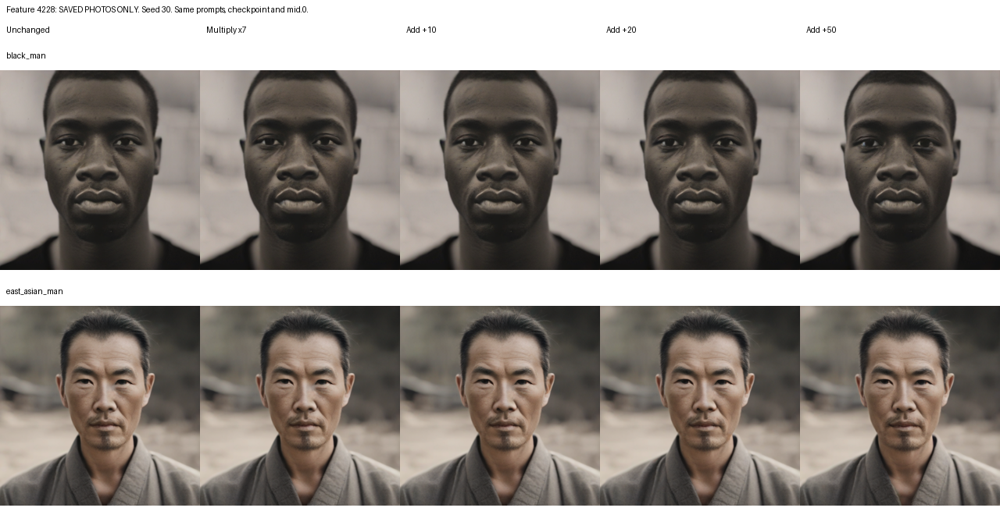
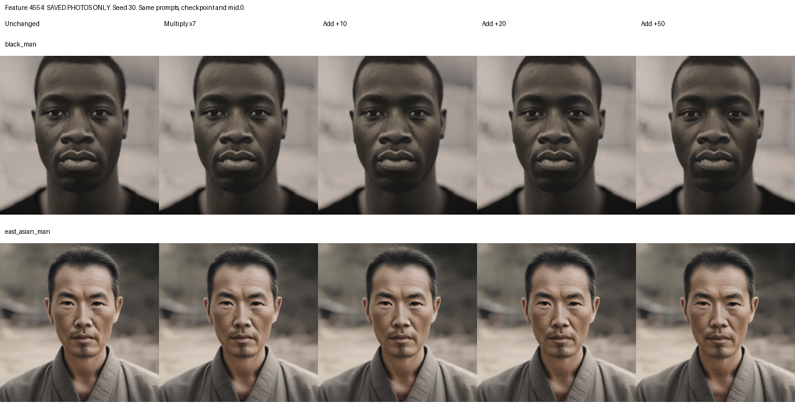
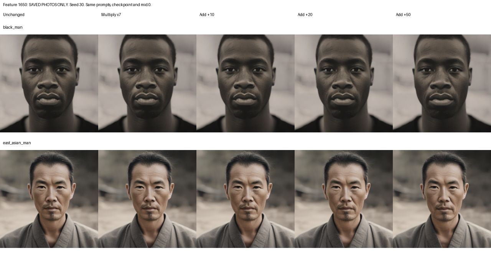
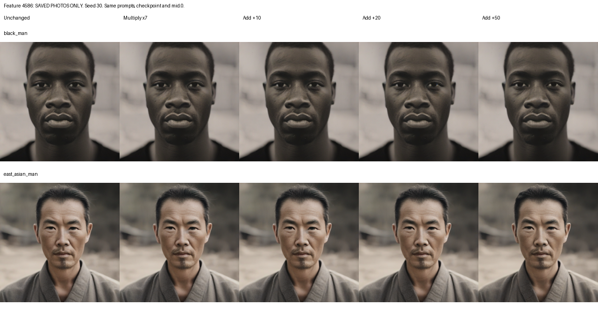
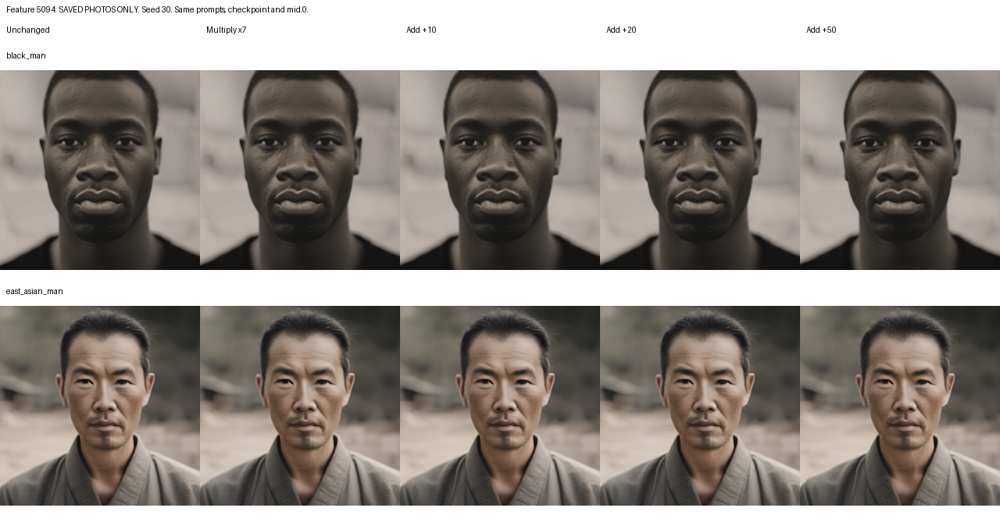
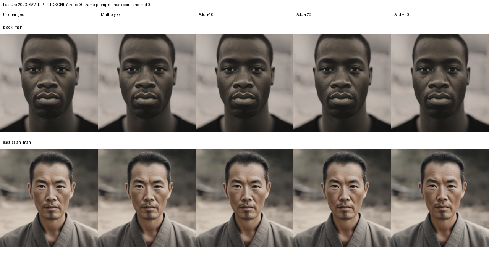
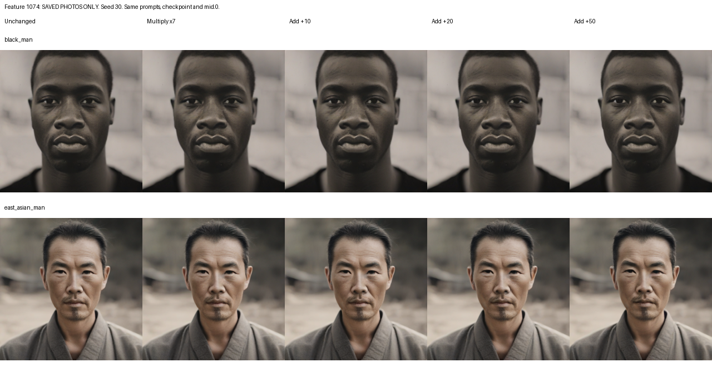
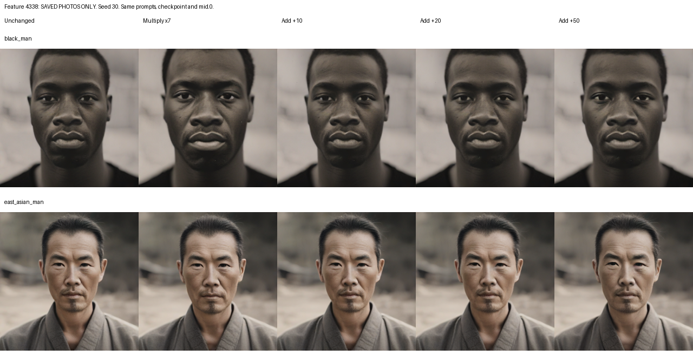
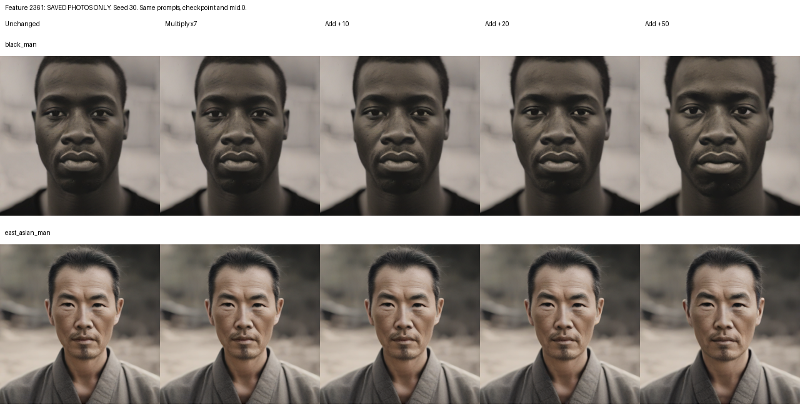
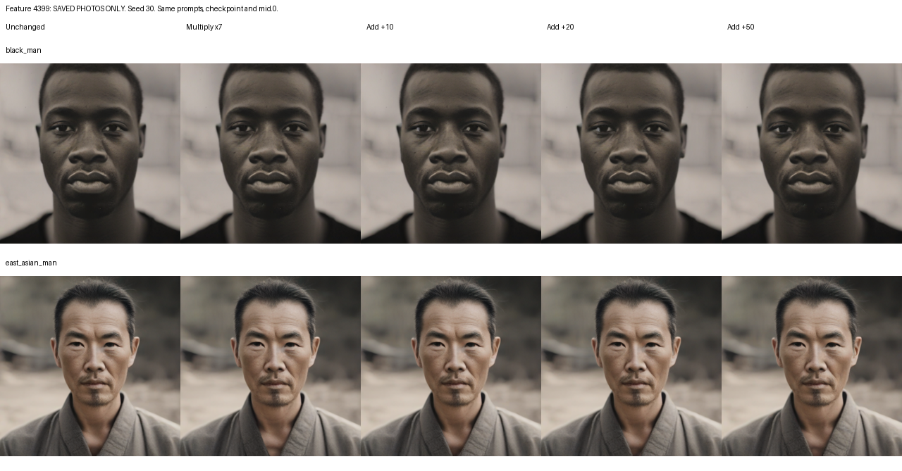

# Gallery: the old ten-feature intervention photos

**These photos already existed. No new generations were run.** The gallery arranges saved results from the face-fine-tuned mid.0 SAE (`cbb3a0a2d0c43c822c7ba97a494de38ae56ea25401a8d31484ffa32e7cc329a6`) and the same frozen SDXL Turbo generator.

Every preview uses **seed30**, chosen before reviewing effects. Columns are **unchanged, multiplication×7, addition+10,+20,+50**. All ten features and all12 prompt groups are included. Click a feature page for all groups. The two-row previews below show Black-man and East-Asian-man prompt contexts. Prompt categories are conditioning labels, not ground-truth identities.

These multiplier/additive columns are **not magnitude-matched**. Quantitative matched-condition summaries and the README/LaTeX research report are provided separately. A photo that looks similar at thumbnail size is not proof of zero effect.

## [Feature 4228: all twelve groups](features/feature_4228.md)

## [Feature 4554: all twelve groups](features/feature_4554.md)

## [Feature 1650: all twelve groups](features/feature_1650.md)

## [Feature 4586: all twelve groups](features/feature_4586.md)

## [Feature 5094: all twelve groups](features/feature_5094.md)

## [Feature 2023: all twelve groups](features/feature_2023.md)

## [Feature 1074: all twelve groups](features/feature_1074.md)

## [Feature 4338: all twelve groups](features/feature_4338.md)

## [Feature 2361: all twelve groups](features/feature_2361.md)

## [Feature 4399: all twelve groups](features/feature_4399.md)

## What these images can and cannot tell us

We have not established reliable single-coordinate semantic control for these features. That is different from saying all edits have no effect. Pixel change, demographic prediction, facial-hair change and image quality are separate outcomes.

Weak or inconsistent effects do not show that “race itself” is the cause. Prompt wording, distributed activations, spatial structure, feature interactions and the measurement being used remain possible explanations. The tested feature edits are interventions on a model representation, not on an intrinsic human race variable.

Originals are untouched. The gallery consists of256px viewing derivatives; all512px originals, latent archives and previous results remain in `/n/fs/goose/experiments/mid0_sae_selectivity/additive_20261114_174738_954258/` and the matching multiplicative sweep. [Every gallery photo's source path and hash](results/gallery_sources.csv) is recorded.

## Quantitative summary and LaTeX

[Research summary](research_summary.md) · [LaTeX source](report.tex) · [PDF](report.pdf). These use all4,200 existing edits, not only the gallery examples.
