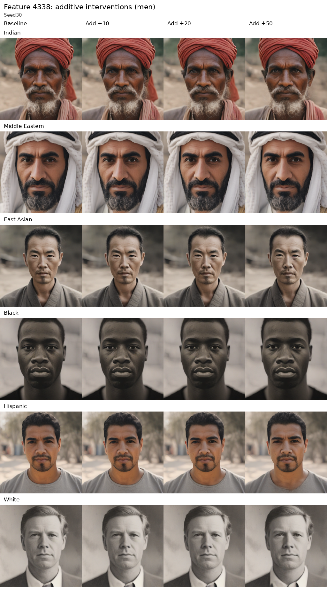
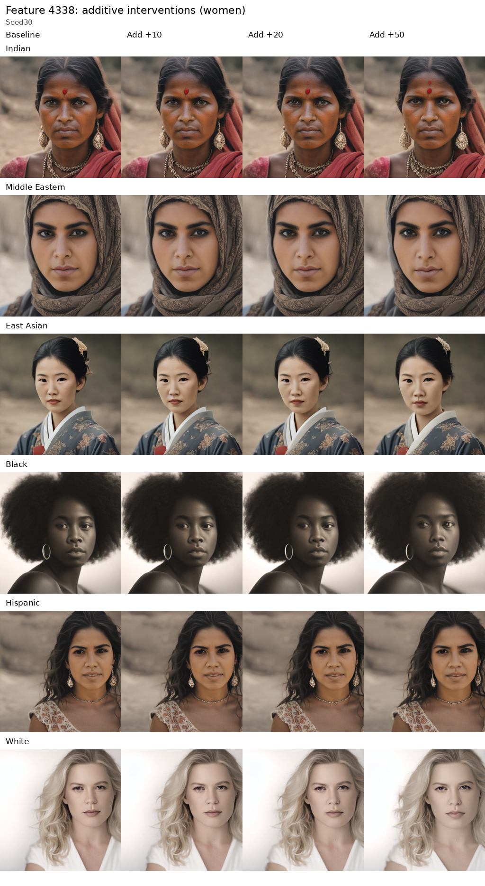
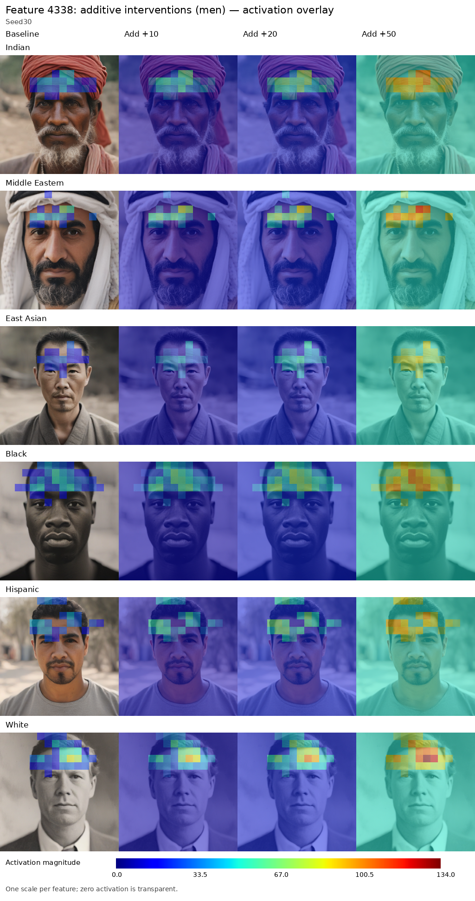
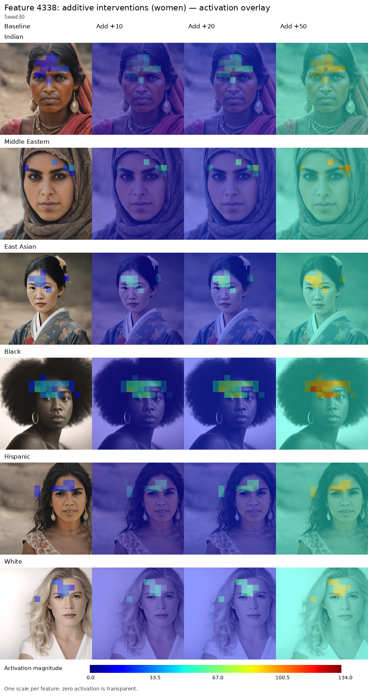

# Feature 4338: additive interventions

Six race-prompt rows per sheet. Columns: **baseline → add+10 → add+20 → add+50**. Same saved prompt and seed30 across columns.

[All features](../README.md) · [Heatmap definitions and code](../additive/README.md) · [Earlier multiplication/addition comparison](../gallery/feature_4338.png)

## Men

## Women

## Jet activation overlays

Colors indicate modified SAE coordinate magnitude. One shared scale is used for this feature’s men’s and women’s sheets; zero is transparent. These are activation maps, not beard masks.

