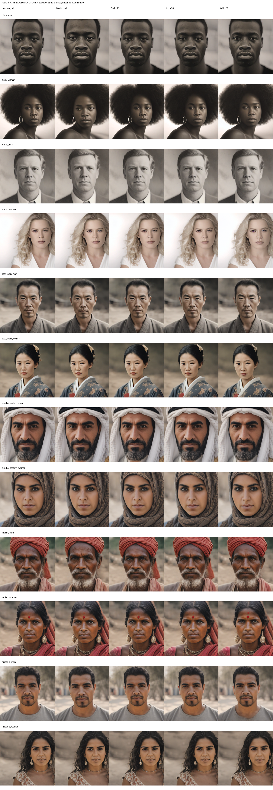

# Feature 4338: existing photos

Same saved prompt and seed30 across columns: **unchanged → multiply×7 → add+10 → add+20 → add+50**. Each row is a prompt group. These are direct viewing derivatives of old PNGs, not new generations. Originals remain at512×512 in the experiment archive. Multipliers and additive constants are different units; these columns are not perturbation-matched.

[Back to all ten features](../README.md)

