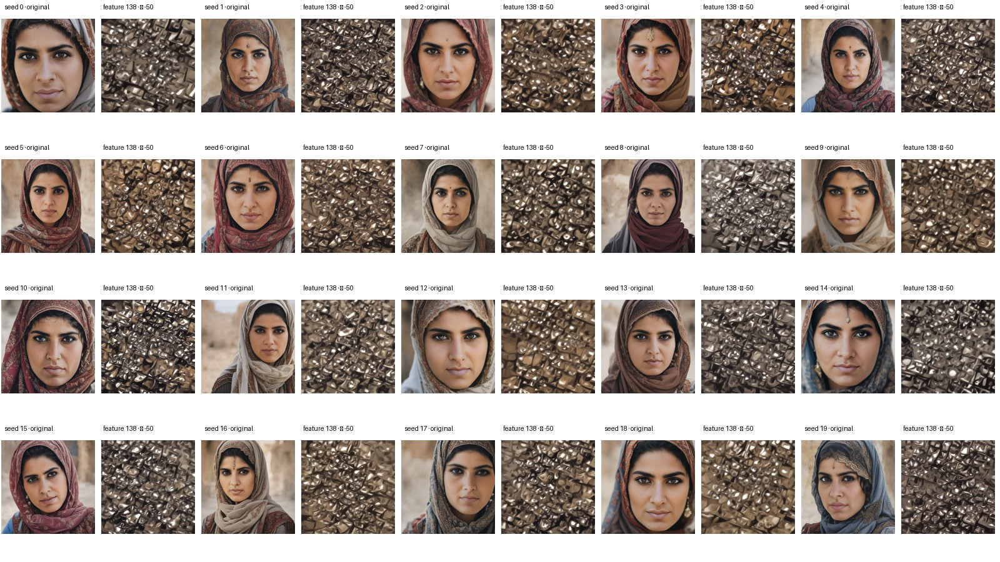
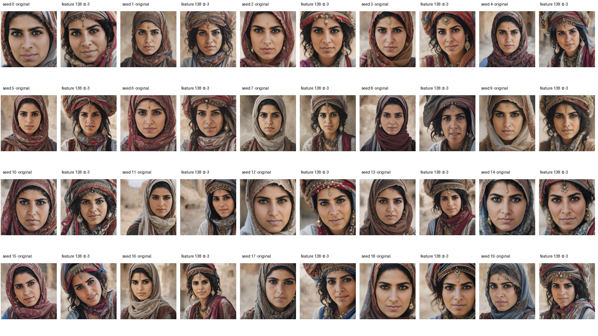
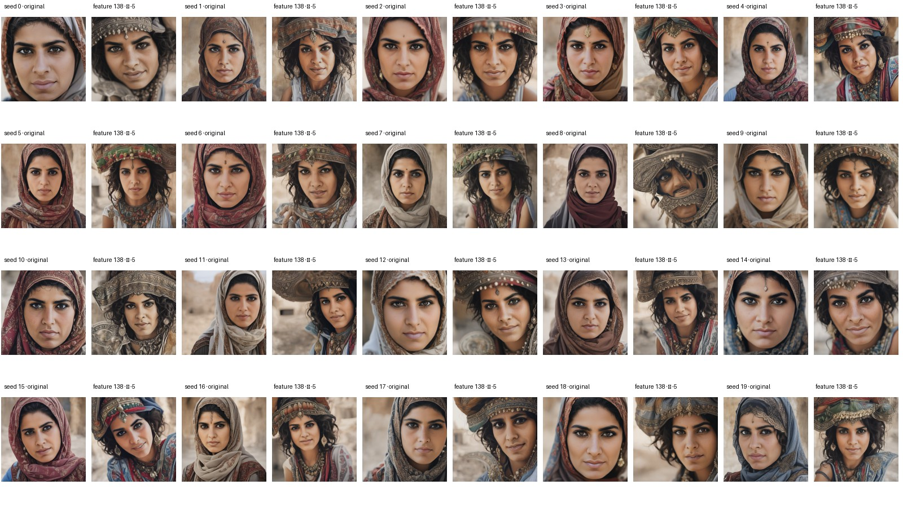
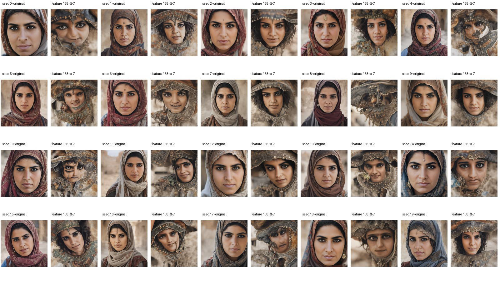
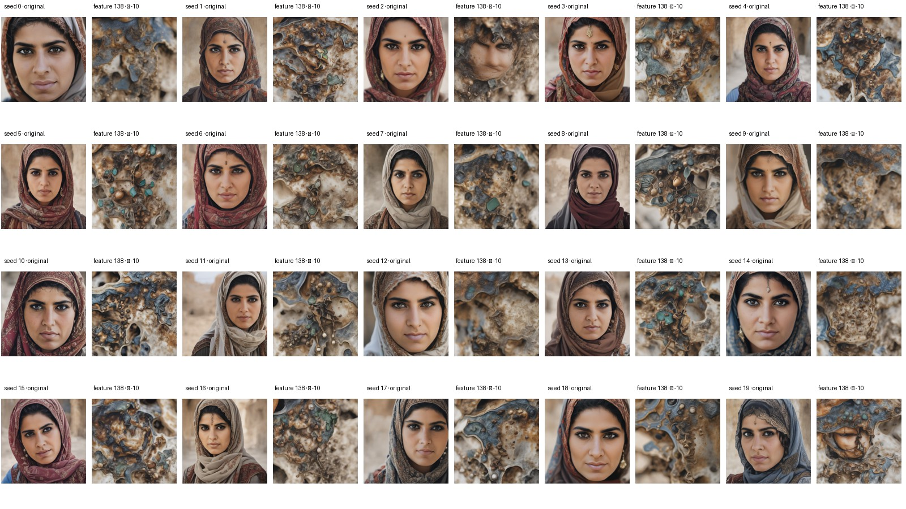
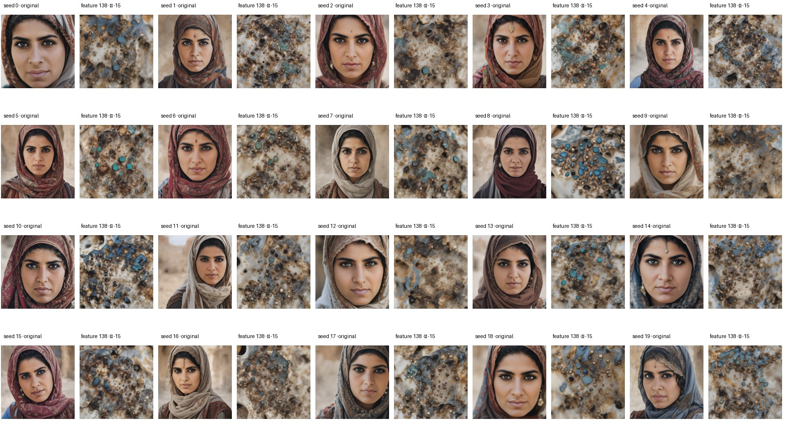
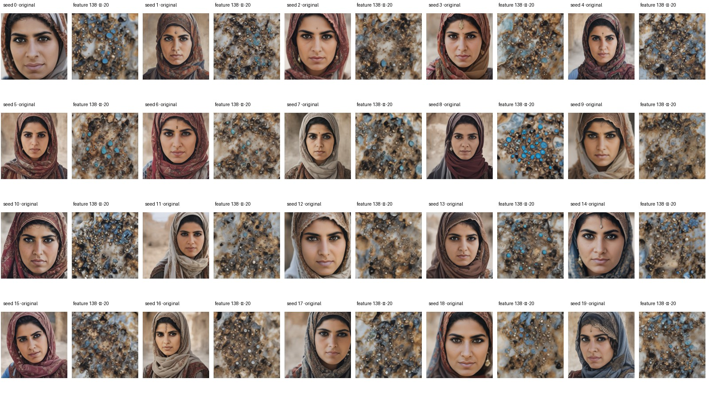

# Feature 138 negative-steering visual review

## What was compared

This is the same visual check used for feature 3725: same 20 Middle Eastern woman prompt images, seeds 0–19, and same alpha values (−50, −3, −5, −7, −10, −15, −20). Values −50, −5, −10, and −20 came from the existing feature 138 sweep. I generated the three missing values (−3, −7, and −15) with the same model, SAE layer, checkpoint, prompt, and seed replay. Each contact sheet pairs the original image with its intervention output.

## What the images show

| Alpha | Face appearance | Headwear appearance | Takeaway |
|---:|---|---|---|
| −50 | Faces are completely replaced by an abstract metallic-looking texture in all 20 images. | Not assessable. | Severe failure. |
| −3 | Faces remain mostly recognizable. | Many outputs add ornate headwraps or headdress-like details; existing scarves remain. | No clear removal. |
| −5 | Faces are mostly recognizable, with some distortions. | Headwear and jewelry often become more elaborate. | The edit tends to add or exaggerate the target-associated styling. |
| −7 | More face and clothing distortions. | Elaborate headwear remains or is amplified. | No clean removal. |
| −10 | Many faces are obscured or replaced by heavily textured patterns. | The output is dominated by new textures and artifacts. | Unusable intervention. |
| −15, −20 | Faces are largely lost in texture-like outputs. | Headwear is no longer meaningfully assessable. | Severe failure. |

Across these 20 examples, I did not find a strength that clearly removes headwear while preserving the face. This is a qualitative review by one reviewer, not a blinded annotation study.

## Paired contact sheets

Original images are on the left; feature 138 outputs are on the right.

### Alpha −50

### Alpha −3

### Alpha −5

### Alpha −7

### Alpha −10

### Alpha −15

### Alpha −20

