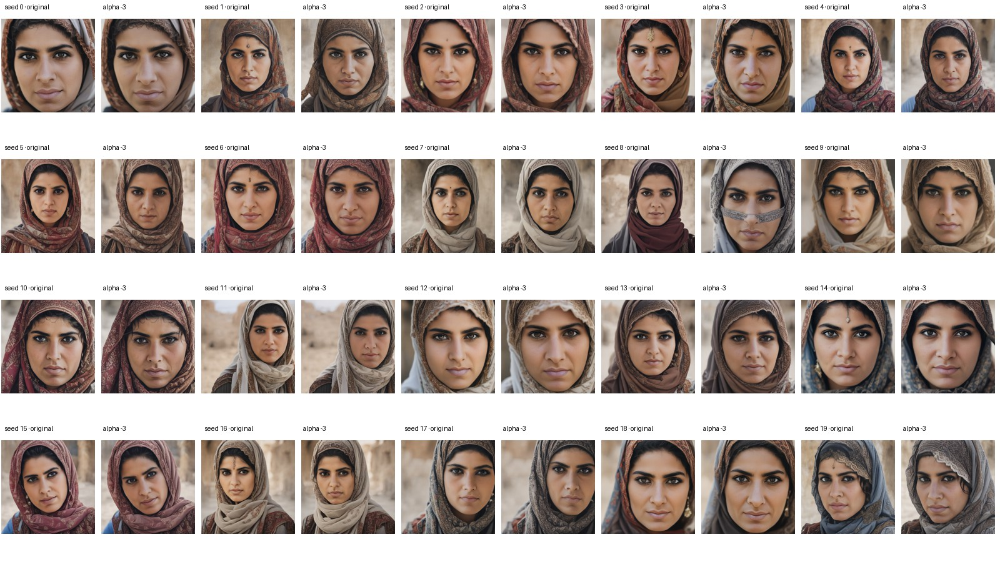
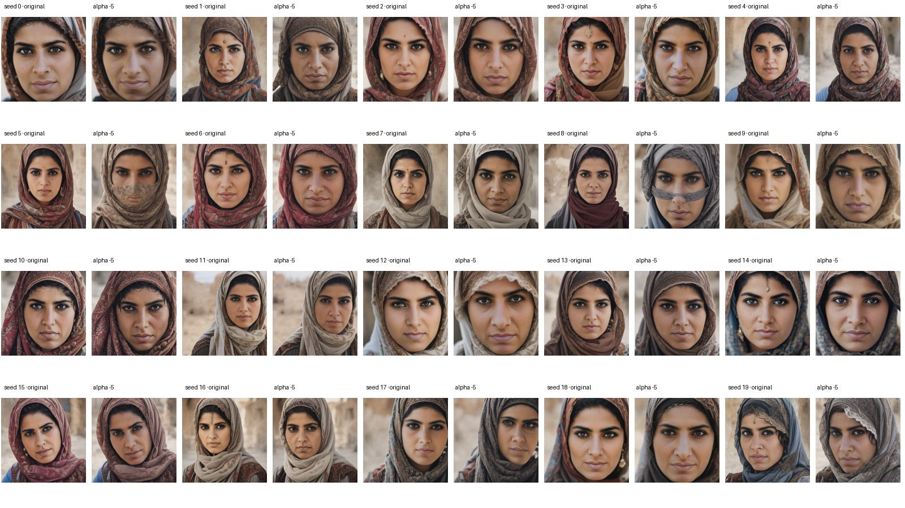
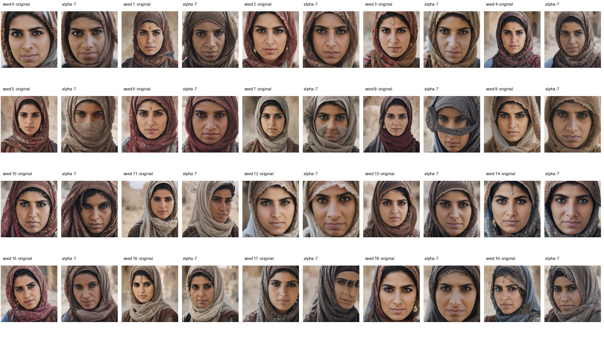
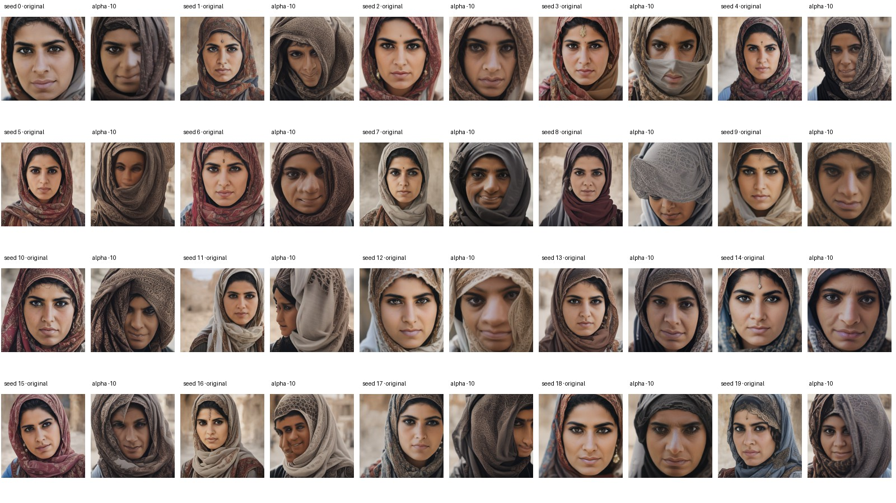
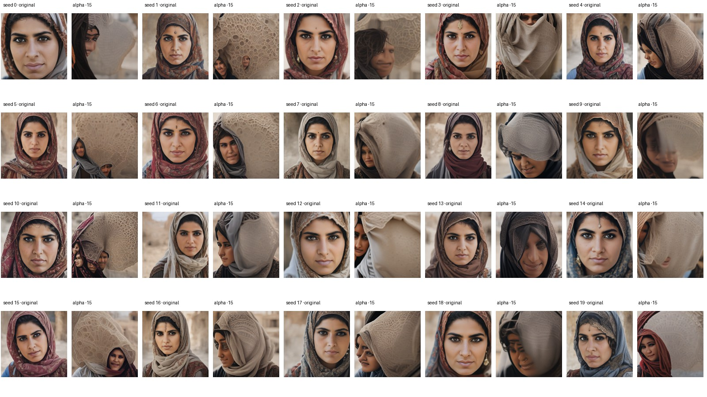
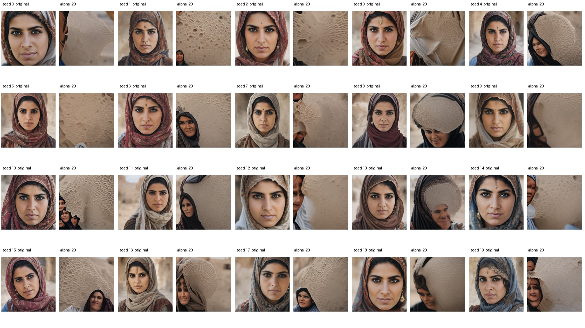

# Visual review of mild negative steering for feature 3725

I compared each saved intervention image with its same-seed original for the 20 Middle Eastern woman prompts. The sheets cover α = −3, −5, −7, −10, −15, and −20.

## What the images show

- **α = −3, −5, −7:** Faces generally remain recognizable, but the scarves/head coverings remain. I did not see a clear, repeatable headwear-only removal.
- **α = −10:** Images change more, but the head covering often shifts or expands across the face; this is not a clean removal.
- **α = −15, −20:** Strong artifacts appear, including oversized textured cloth-like shapes, obscured faces, and distorted or partial faces.

Across these settings there is no convincing strength that both preserves the face and removes the headwear. This is a visual screening by one reviewer, not a blinded or independent annotation study. The sample is limited to 20 generated images from one prompt group.

## Paired contact sheets

Each tile pair shows the original on the left and the intervention on the right.

### α = −3

### α = −5

### α = −7

### α = −10

### α = −15

### α = −20

