# Feature 3725 headwear multiplier screen

This combined screen covers alpha values −120 through −3, plus 0 and +5 through +20, on the same 20 Middle Eastern woman images. In this intervention, alpha +1 is the no-op; alpha 0 removes the original feature contribution; values below 0 reverse the feature direction.

An image passes when Florence-2 detects a face and neither its detailed caption nor object labels mention a configured forbidden attribute (earrings, turban, headscarf/scarf, hijab, veil, head covering/wrap, or dupatta). A multiplier is accepted only when all 20 images pass (zero failures allowed).

Florence-2 predictions are heuristic, so these pass counts are only an automated screen. The negative-alpha per-image detections and contact sheets are in the [negative-alpha details](../headwear_negative_screen/REPORT.md).

## Results

| Intervention alpha ( +1 = unchanged ) | Images checked | Passed automated check¹ | Flagged by automated check¹ | All 20 passed? |
|---:|---:|---:|---:|:---:|
| -120 | 20 | 0 | 20 | no |
| -100 | 20 | 0 | 20 | no |
| -75 | 20 | 2 | 18 | no |
| -50 | 20 | 9 | 11 | no |
| -30 | 20 | 4 | 16 | no |
| -20 | 20 | 3 | 17 | no |
| -15 | 20 | 3 | 17 | no |
| -10 | 20 | 0 | 20 | no |
| -7 | 20 | 0 | 20 | no |
| -5 | 20 | 0 | 20 | no |
| -3 | 20 | 0 | 20 | no |
| +0 | 20 | 0 | 20 | no |
| +5 | 20 | 4 | 16 | no |
| +10 | 20 | 9 | 11 | no |
| +15 | 20 | 12 | 8 | no |
| +20 | 20 | 13 | 7 | no |

No multiplier passed all 20 images. Although −50 had 9/20 automated passes, visual review of all 20 outputs shows severe corruption: a beige textured object covers most of each frame and faces are missing or fragmentary. This is not successful headwear removal. The detector's “pass” count only checks for a face label and no listed-item mention; it does not measure image quality or preserve the face. See the [alpha −50 visual review](../headwear_negative_screen/REPORT.md#visual-review-of-alpha--50). Among nonnegative settings, +20 had the most automated passes (13/20), which also requires visual review before interpretation.

¹ **Pass** = Florence-2 detected a face and did not mention a listed head covering or jewelry item. **Flagged/rejected** = it did not detect a face, or it mentioned a listed item. These are automated predictions, not verified labels. **Accepted** = all 20 images passed; even one flagged image makes the answer “no.”

## Positive-alpha image grids

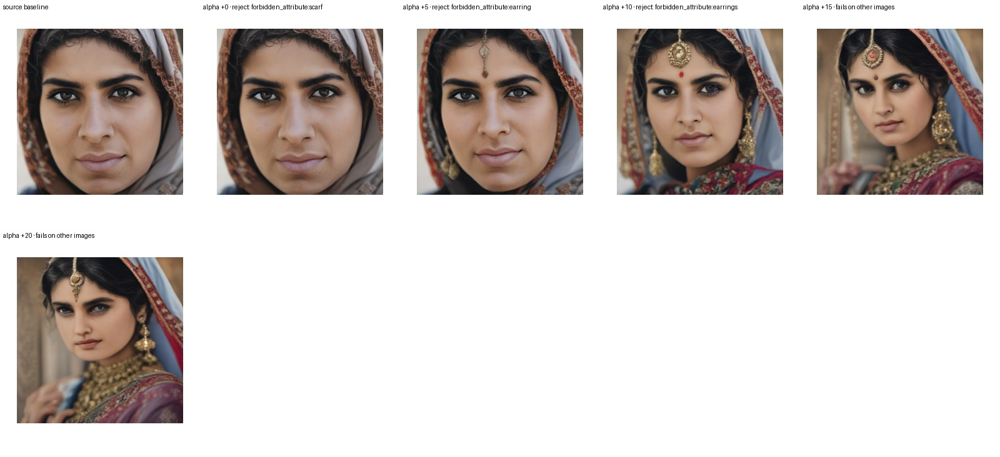

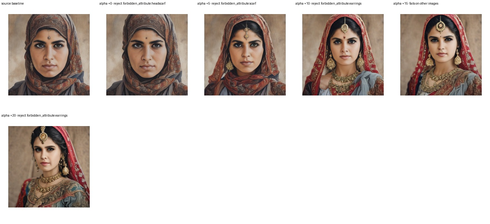

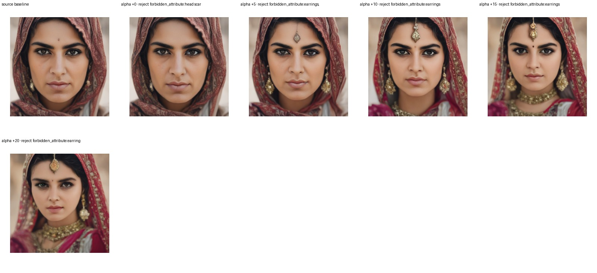

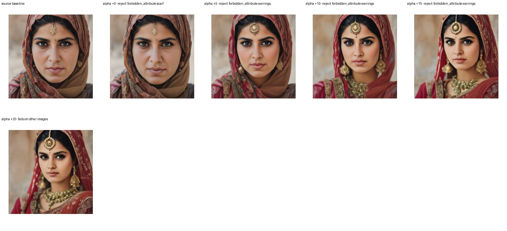

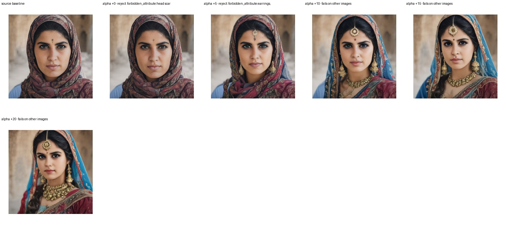

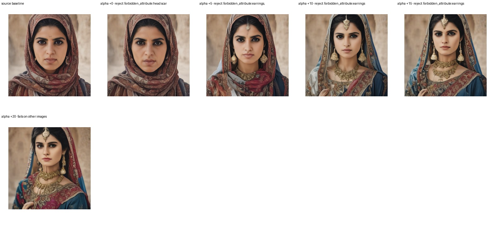

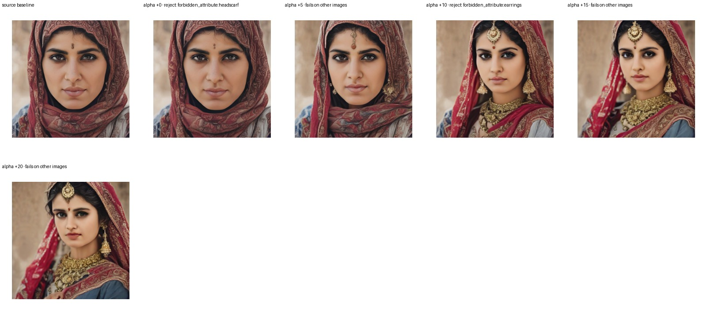

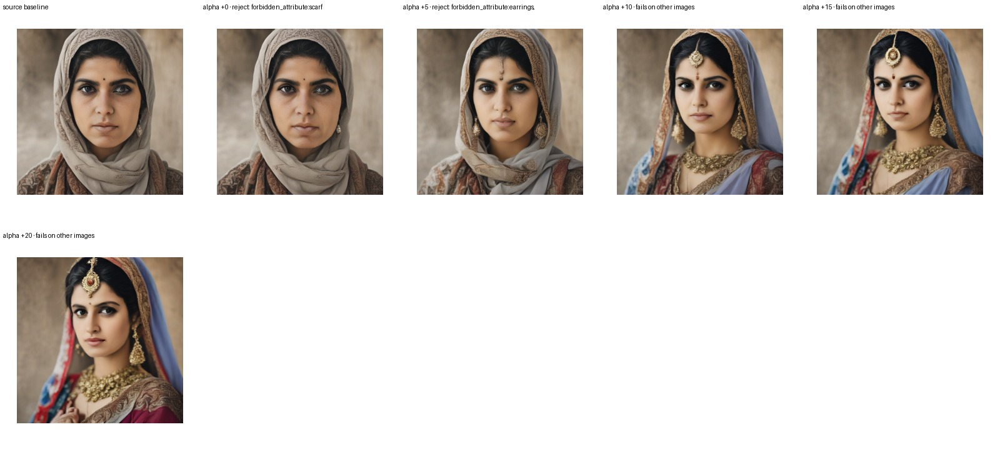

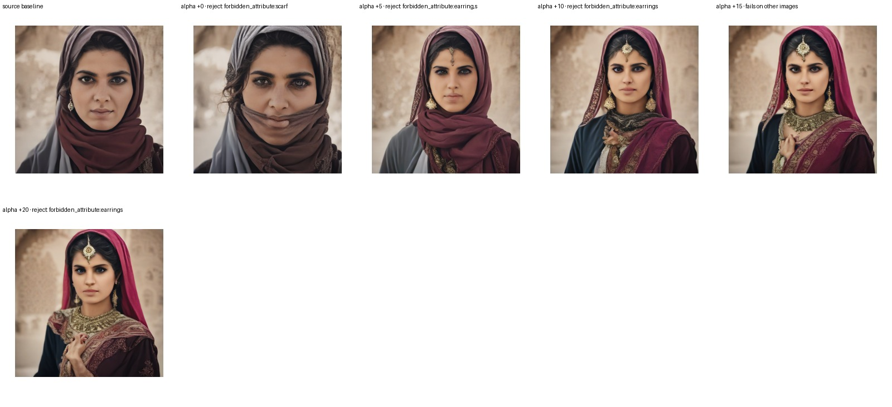

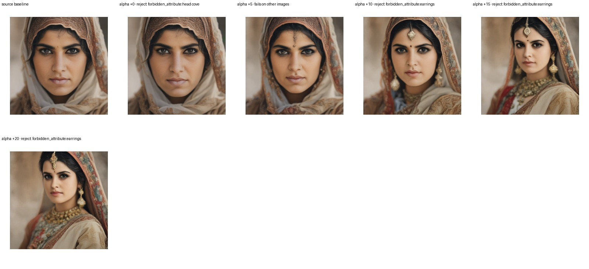

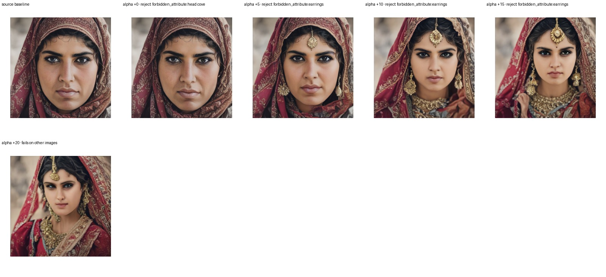

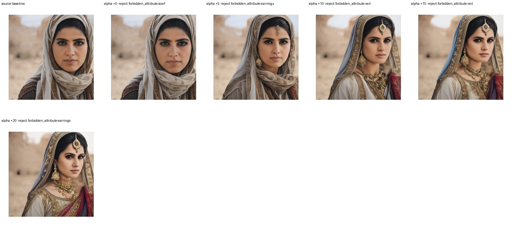

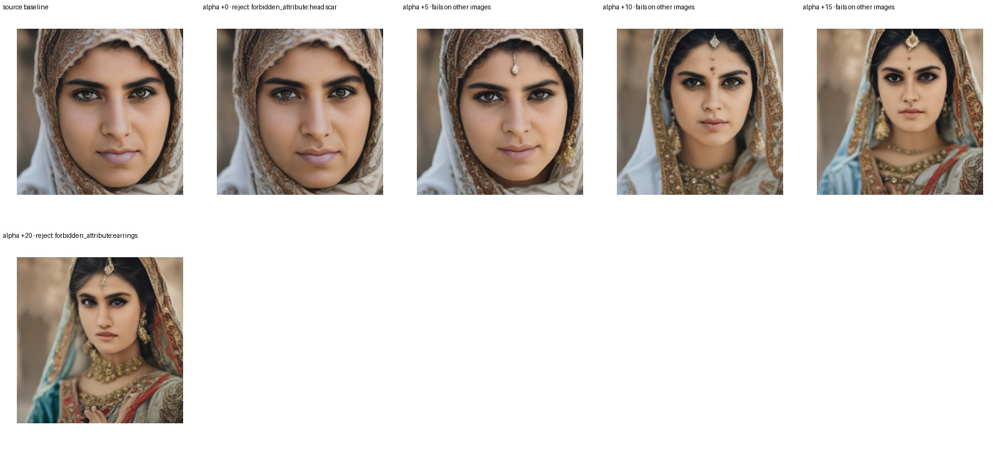

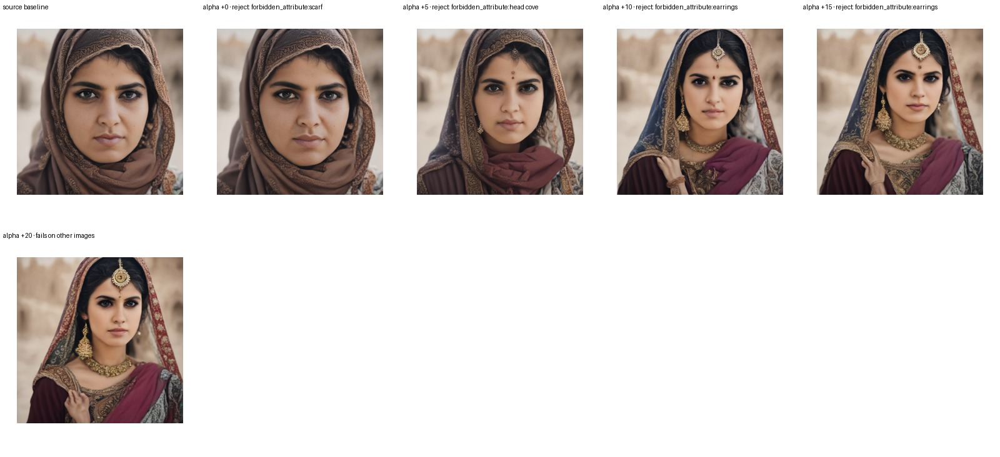

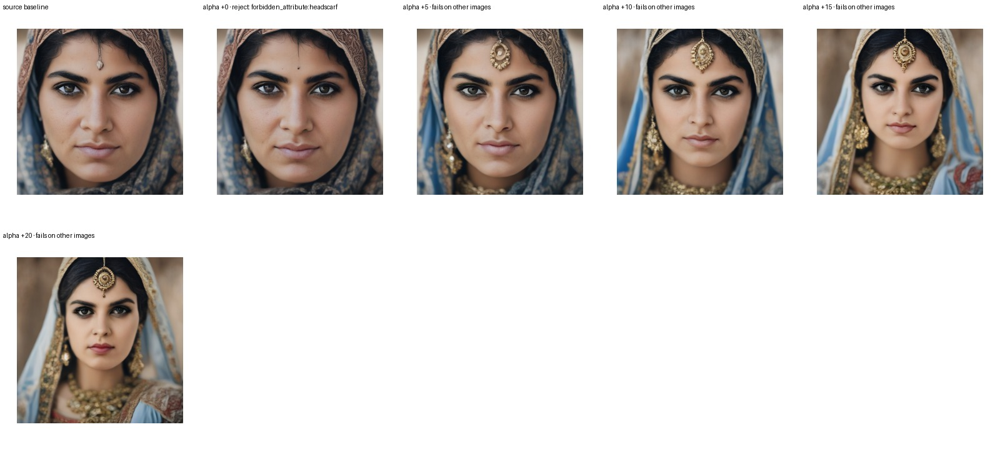

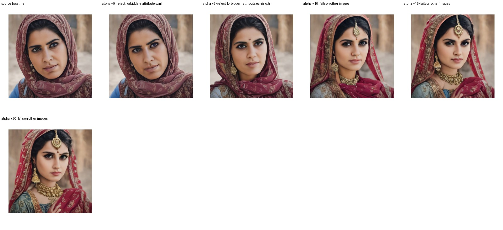

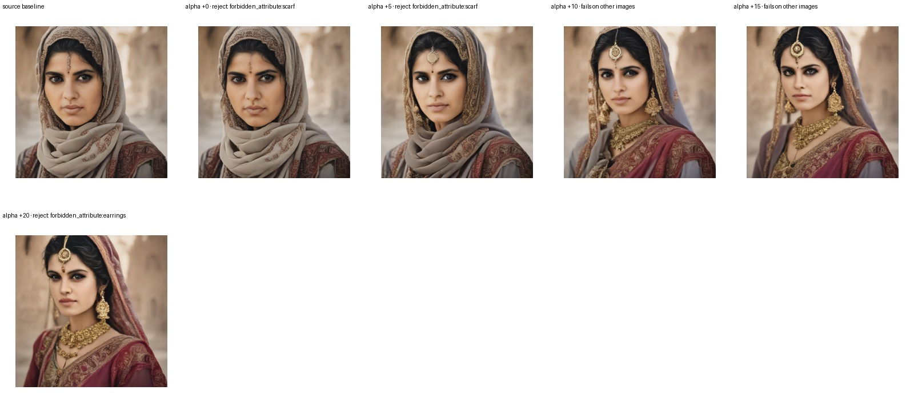

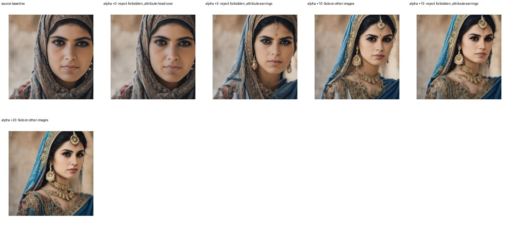

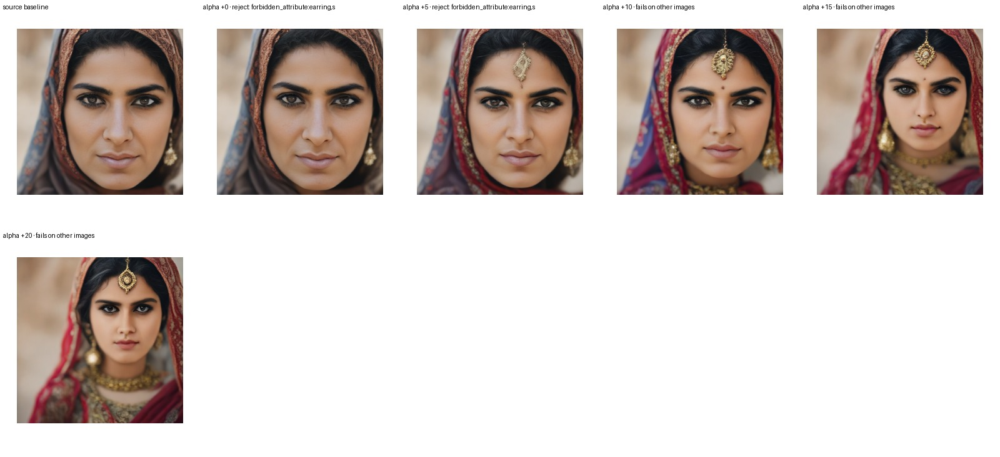

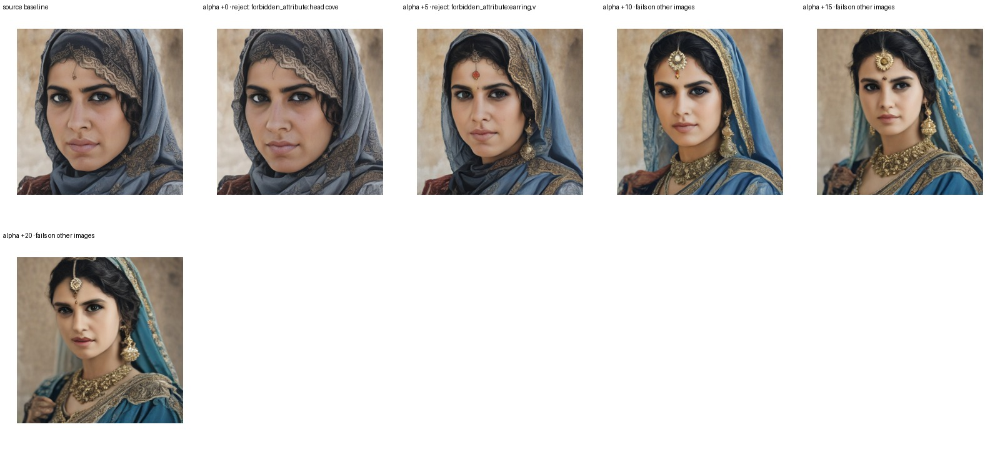
