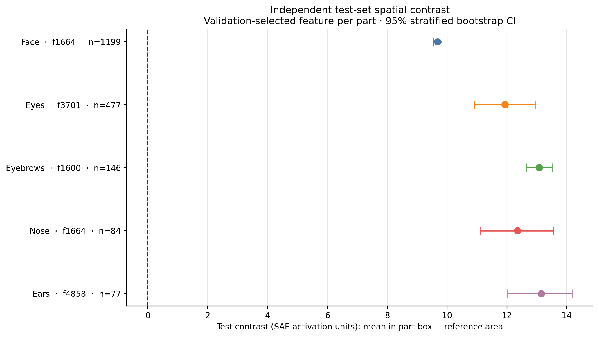
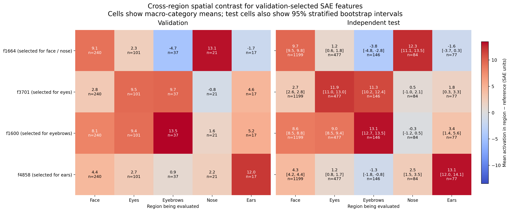

# Independent face-parts test set (seeds 200–299)

## Dataset and protocol

This is a new, test-only set of 1,200 generated portraits: 100 images for each
of the same 12 race/gender prompt categories, using seeds 200–299. The seed
range is disjoint from both the training data and the earlier supplemental
test set (seeds 100–199). No SAE training, checkpoint selection, or feature
ranking was performed on these images.

Florence-2 automatically produced region boxes. The annotations have not been
reviewed by a person. The fixed pretrained SAE and the fixed face-parts
fine-tuned SAE were evaluated on residual activations from these images. The
feature heatmaps use features ranked on the training run's validation data.

## Held-out activation reconstruction

MSE below is measured on SAE activation vectors inside automatically annotated
regions; it is not image-pixel error. Values are macro-averaged across prompt
categories with usable annotations.

| Region | Images with usable box | Prompt categories | Pretrained SAE MSE | Fine-tuned SAE MSE | Reduction |
| --- | ---: | ---: | ---: | ---: | ---: |
| Eyes | 477 | 12 | 2.0825 | 1.4395 | 30.9% |
| Eyebrows | 162 | 11 | 2.0837 | 1.4732 | 29.3% |
| Nose | 85 | 8 | 2.0988 | 1.4508 | 30.9% |
| Ears | 77 | 9 | 2.1629 | 1.7149 | 20.7% |
| Mean across regions | — | — | 2.1070 | 1.5196 | 27.9% |

There is a usable face box for 1,199 of the 1,200 images. A usable region box
requires enough annotated activation cells for evaluation. The lower MSE means
the fine-tuned SAE reconstructed these held-out activations more closely. It
does not show that the SAE detects or semantically represents facial parts.

## Held-out spatial activation contrast

The features were selected on validation data at epoch 20 and then evaluated
without re-selection on this independent test set. Contrast is mean activation
inside each automatic part box minus activation in its reference area, averaged
within race/gender categories and then equally across categories. Error bars
are 95% stratified image-bootstrap intervals. The annotations are automatic
and have not been reviewed by a person.

| Part | Fixed feature | Test contrast (95% interval) | Usable images | Categories | Reference |
| --- | ---: | ---: | ---: | ---: | --- |
| Face | 1664 | 9.68 (9.54–9.82) | 1,199 | 12 | Outside face |
| Eyes | 3701 | 11.93 (10.91–12.96) | 477 | 12 | Rest of face |
| Eyebrows | 1600 | 13.08 (12.64–13.51) | 146 | 11 | Rest of face |
| Nose | 1664 | 12.35 (11.10–13.55) | 84 | 8 | Rest of face |
| Ears | 4858 | 13.14 (12.02–14.18) | 77 | 9 | Outside image |

The plot and full-precision tables are in [`test_contrast/`](test_contrast/).
The intervals are unadjusted and the nose/ear estimates use relatively few
images, so treat them as preliminary spatial associations rather than semantic
labels. The [nose feature map](final_feature_localization/nose/feature_1664.jpg)
shows its activation overlays on held-out portraits.

## Cross-region feature comparison

Each of the four unique validation-selected features was scored in every
annotated region using that region's part-minus-reference contrast. The left
panel shows validation data and the right panel shows the independent test
data, with one shared zero-centered color scale. Test cells also show
stratified-bootstrap intervals. This makes cross-region activation visible:
for example, feature 1664 has positive test contrast in the face and nose, but
negative contrast in the eyebrows and ears. Positive cross-region values mean
the feature is spatially associated with more than one annotated region; they
do not establish exclusivity.

The [CSV table](test_contrast/feature_cross_contrast/feature_cross_contrast.csv)
contains full-precision values and test intervals. The validation-selected
feature IDs and test-only data remain fixed for this comparison.

For image-level inspection, the [cross-feature jet overlay sheet](test_contrast/feature_cross_contrast/cross_feature_jet_overlays.jpg)
shows one portrait per region, with each selected feature overlaid across all
five regions. Validation is on the left and independent test on the right.
For easier viewing, there is also one contact sheet per unique feature:
[feature 1664](test_contrast/feature_cross_contrast/contact_sheets/feature_1664_contact_sheet.jpg),
[feature 3701](test_contrast/feature_cross_contrast/contact_sheets/feature_3701_contact_sheet.jpg),
[feature 1600](test_contrast/feature_cross_contrast/contact_sheets/feature_1600_contact_sheet.jpg),
and [feature 4858](test_contrast/feature_cross_contrast/contact_sheets/feature_4858_contact_sheet.jpg).

For direct visual inspection, [`test_contrast/nose_examples/validation/contact_sheet.jpg`](test_contrast/nose_examples/validation/contact_sheet.jpg)
and [`test_contrast/nose_examples/test/contact_sheet.jpg`](test_contrast/nose_examples/test/contact_sheet.jpg)
show nose feature 1664's jet activation overlays on sampled validation and
independent test portraits, with cyan face boxes and yellow nose boxes. The
contact sheets include up to two usable examples per prompt category. The
underlying individual overlays and render settings are alongside them.

## Files

- `face_parts_evaluation.json`: full pooled and per-category metrics.
- `manifest.csv`: prompt groups, seeds, test split, and relative image paths.
- `annotations/bounding_boxes.csv`: aggregated automatic region boxes.
- `contact_sheets/`: plain generated portraits grouped by prompt category.
  These are for browsing the images; they do not show training epochs.
- `final_feature_localization/`: feature-to-region maps from the selected SAE
  checkpoint only. One sheet per candidate feature; rows show categories with
  the full-image activation overlay, face box, and target-part box. No epoch
  columns appear here.
- `test_contrast/`: the quantitative held-out test contrast plot, summary
  tables, category-level values, calculation settings, and generation script.
  `feature_cross_contrast/` contains the validation/test feature-by-region
  comparison, and `nose_examples/` contains the actual validation and test
  portraits with jet overlays.
- `region_heatmaps/<region>/feature_<id>.jpg`: epoch comparison sheets. Each
  row is a prompt category; columns show epochs 0, 4, 8, 12, 16, and 20 for the
  same held-out portrait. Each tile has the region's automatic bounding box
  and a pixelated jet-style overlay for that feature. For example, see
  [`region_heatmaps/eyes/feature_1600.jpg`](region_heatmaps/eyes/feature_1600.jpg).
- `detector/REPORT.md`: detector summary and coverage details.
- `generation_settings.json`: generation model, prompts, seeds, and settings.

The history contains metrics for all 20 epochs, but visual checkpoints were
saved every four epochs. Therefore, the feature sheets show six snapshots
(including the pretrained epoch 0), not all 21 epochs. To produce overlays for
every epoch, the SAE must be trained again with `--snapshot-interval 1` before
rendering the sheets.

For the final-checkpoint maps without epoch comparisons, start at
[`final_feature_localization/index.md`](final_feature_localization/index.md).

Individual generated images, cached model features, and residual activations
are stored locally and are not included in the GitHub repository.
