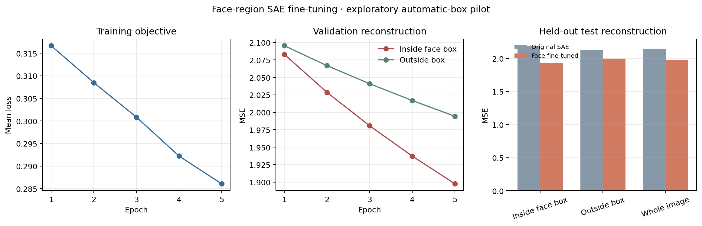
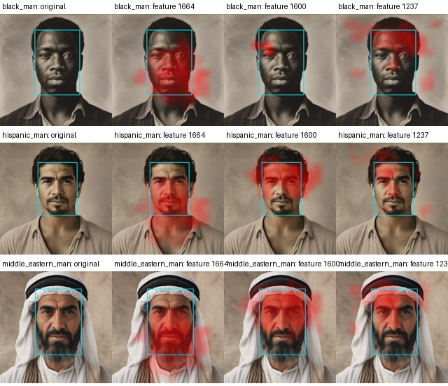

# Face-region SAE fine-tuning: first pass

The existing Top-K SAE was initialized from its pretrained checkpoint and fine-tuned on activation grid cells whose centers fall inside Florence-2 object-detection boxes labeled `human face`. The generator and original checkpoint were not updated. Phrase grounding was not used. The original SAE and the fine-tuned copy were compared on the same held-out images.

## Results

The best checkpoint was epoch 5, selected by validation face-box reconstruction MSE.

On the 240-image test split, face-box MSE changed from 2.188 to 1.935 (11.6% lower). Outside-box MSE changed from 2.133 to 1.999 (6.3% lower). Whole-grid MSE changed from 2.149 to 1.980.

The SAE reconstructs the held-out activations better inside the boxes, and also improves reconstruction outside them. This is not evidence by itself that individual features became face-specific or that changing them will edit faces.

## Heatmaps and feature ranking

The top features are ranked by mean activation inside minus outside the automatic boxes on validation images. The heatmap contact sheet shows those features on one held-out test portrait from each of the 12 prompt groups. Cyan outlines mark the same automatic box; red overlays show feature activation, normalized per map.

See `face_localized_features.csv`, `training_history.json`, `heldout_reconstruction.json`, and `settings.json` for the measurements and provenance.

## Limitations

All boxes are automatic, unreviewed labels. Their median area is about 30% of the image, so the mask often includes more than the face. The detector boxes focus the training samples spatially, but the SAE received no labels for eyes, ears, hair, or skin tone individually. The heatmaps and feature ranking are exploratory and should be visually reviewed before feature interventions.
