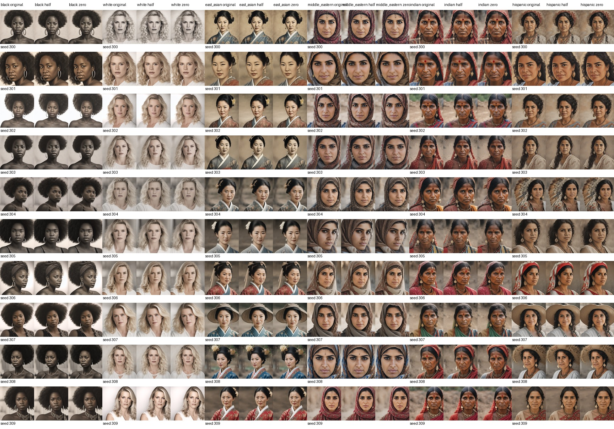

# Face SAE feature 3725 ablation diagnostic

This run compares the original replay with half-strength and zero-strength feature 3725 on 60 existing women-group portraits (seeds 300–309). The SAE and diffusion model are frozen.

Zero strength removes only the selected feature's decoder contribution at the SAE hook. Half strength attenuates that contribution by 50%. The original is the strength-1 control.

## Mean image change

Pixel MAE is measured against the unchanged replay on a 0–255 scale. It measures visual change, not whether any specific attribute was removed.

| Prompt group | Half strength MAE | Zero strength MAE |
|---|---:|---:|
| black | 0.000 | 0.000 |
| white | 0.000 | 0.000 |
| east asian | 1.835 | 3.093 |
| middle eastern | 3.928 | 6.732 |
| indian | 6.062 | 10.313 |
| hispanic | 1.631 | 2.609 |

## Interpretation

This is a diagnostic of feature 3725's causal effect on these generated outputs. The source dataset does not label or control bindis, earrings, or headwear, so an image change cannot be called bindi or earring removal. Any change may involve other upper-face or styling details. Visual review is needed alongside the pixel-change summary.

## Visual review

The unmodified replay matched all 60 saved source images exactly (pixel MAE 0). At zero strength, feature 3725 produced no measurable pixel change for Black- and White-woman prompts. It produced larger, but still modest, changes for the other groups; the Indian-woman group had the largest mean pixel MAE (10.31/255).

In full-resolution examples that visibly contain a red forehead mark, including `indian_woman_seed300`, the mark remains after feature 3725 is zeroed. Earrings and head coverings also remain. The output changes are subtle and appear to affect broader facial appearance or detail. Thus, **zeroing feature 3725 in this current dataset does not remove the visible bindi in the inspected example**. This is evidence against treating feature 3725 as a standalone bindi control, though a dedicated bindi-positive/negative test is still needed.

This was an inference-time intervention; it did not update or save new SAE weights.
