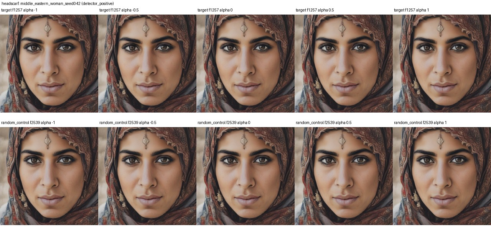
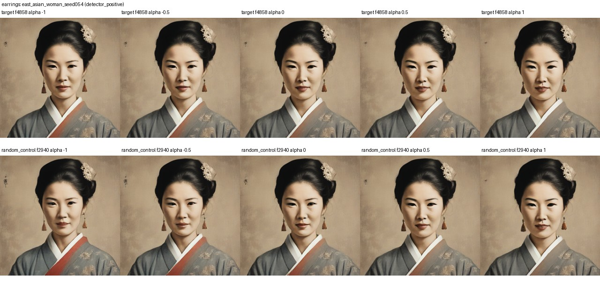

# Headscarf and earring SAE ablation pilot

We replayed 16 same-prompt validation images with their original seeds. The pretrained SAE and diffusion model stayed frozen. Strength 0 removes the candidate feature contribution; 0.5 keeps half; 1 is unchanged. We also tried -0.5 and -1, which subtract more than the measured feature contribution. A matched random feature is included for comparison.

Candidate IDs were selected from discovery data: headscarf feature 1257 and earring feature 4858. Matched random controls were 2539 and 2940, respectively. The full comparison showed weak held-out concept association for these candidates (validation AUC 0.228 for headscarf and 0.407 for earrings).

## Mean image change

Mean absolute RGB pixel difference from the unchanged replay, on a 0–255 scale. This measures image change, not whether the target disappeared.

| Concept | Strength | Candidate feature | Random feature |
|---|---:|---:|---:|
| headscarf | -1 | 1.127 | 0.761 |
| headscarf | -0.5 | 0.951 | 0.673 |
| headscarf | 0 | 0.765 | 0.577 |
| headscarf | 0.5 | 0.586 | 0.479 |
| headscarf | 1 | 0.000 | 0.000 |
| earrings | -1 | 6.334 | 10.386 |
| earrings | -0.5 | 5.051 | 8.634 |
| earrings | 0 | 3.658 | 6.359 |
| earrings | 0.5 | 2.129 | 3.650 |
| earrings | 1 | 0.000 | 0.000 |

All 16 source replays matched the originals exactly, and strength 1 was an exact no-op for candidate and random features.

## What we saw

In the inspected examples, zeroing or making the candidate negative did not clearly remove the headscarf or earrings. Negative strength caused more change than zero for each candidate, but the random feature changed the earring images more on average. That looks like a stronger activation perturbation, not reliable object control.

The examples were selected using unreviewed Florence-2 labels; detector negatives can be missed detections. This is a small exploratory test, not evidence that these items are inherently undesirable or that removal improves fairness. See [all comparison grids](.) and [per-image measurements](metrics.csv).
