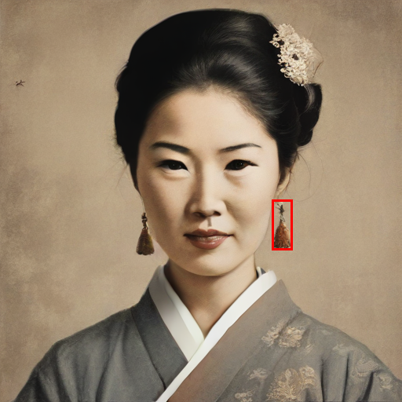
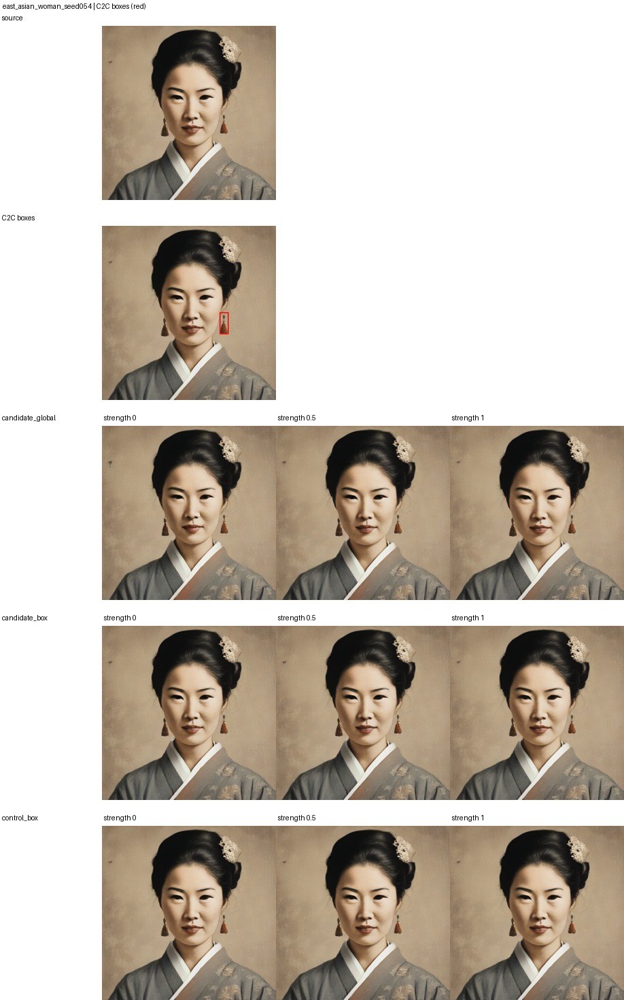
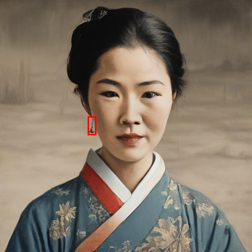
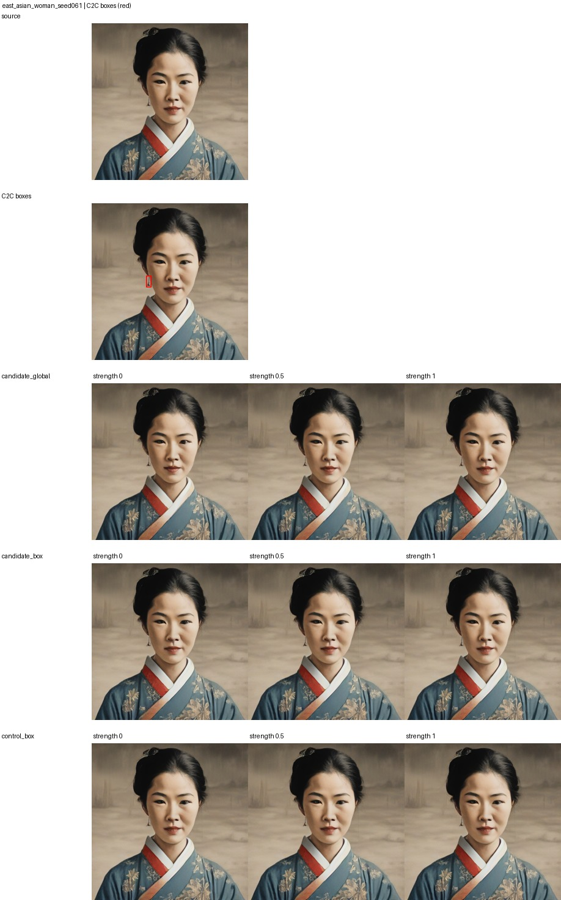
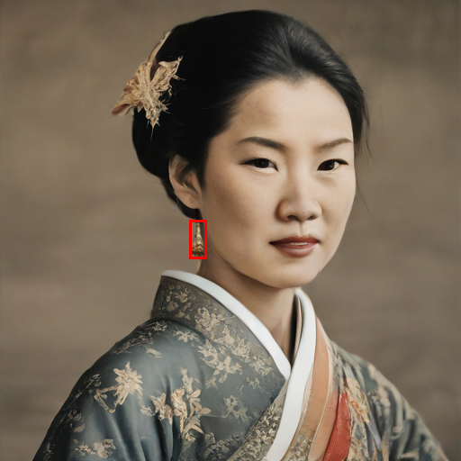
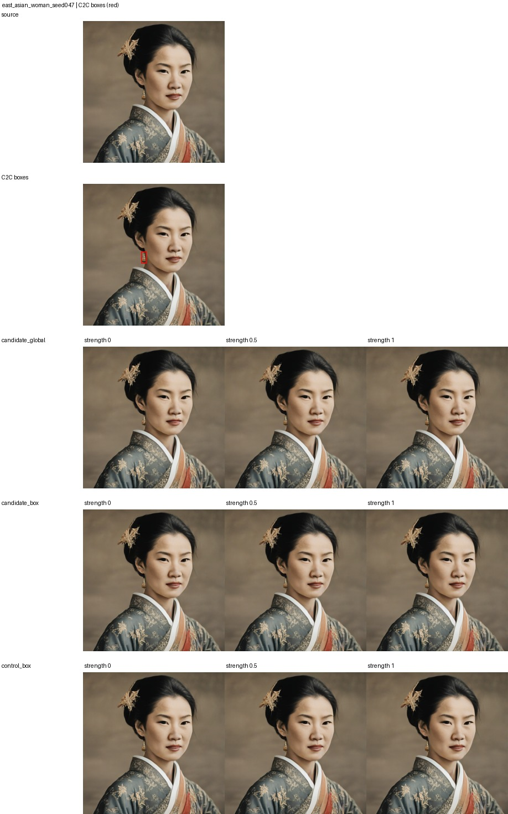
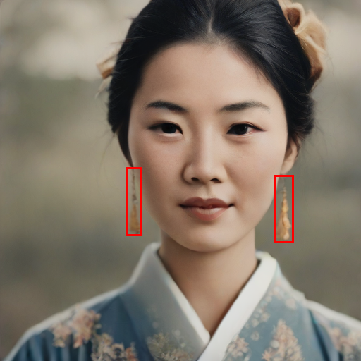
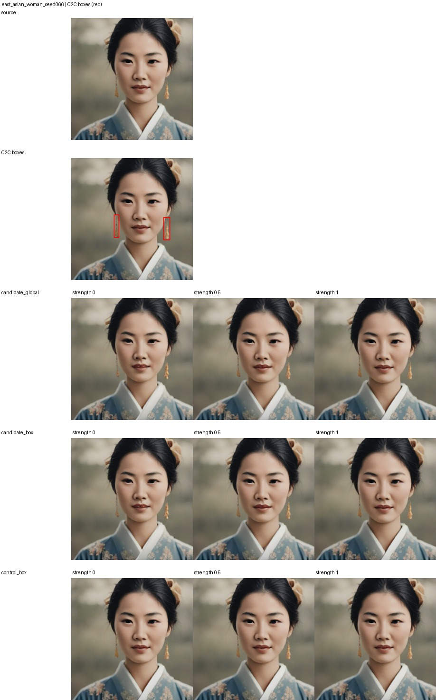

# C2C-box-masked SAE earring intervention

C2C bounding boxes are mapped from 512x512 image coordinates to the SAE code's runtime spatial grid. The candidate SAE feature is reduced globally and inside only the boxed cells; a matched random feature is reduced inside the same boxes. A one-cell border is added to accommodate coarse activation resolution.

Candidate feature: 4858. Random control: 2940. 4 same-prompt validation positives. Strength 1 is unchanged; 0 removes the feature contribution.

## Mean image change

MAE is the mean absolute RGB difference on a 0–255 scale. Inside/outside values measure the rendered image change relative to the C2C box; they are not object-presence scores.

| Intervention | Strength | Whole image MAE | Inside box MAE | Outside box MAE |
|---|---:|---:|---:|---:|
| candidate_global | 0 | 4.354 | 9.612 | 4.318 |
| candidate_global | 0.5 | 2.466 | 5.386 | 2.447 |
| candidate_global | 1 | 0.000 | 0.000 | 0.000 |
| candidate_box | 0 | 2.799 | 6.092 | 2.775 |
| candidate_box | 0.5 | 1.637 | 3.794 | 1.623 |
| candidate_box | 1 | 0.000 | 0.000 | 0.000 |
| control_box | 0 | 0.831 | 1.578 | 0.826 |
| control_box | 0.5 | 0.562 | 1.079 | 0.559 |
| control_box | 1 | 0.000 | 0.000 | 0.000 |

All source replays were pixel-identical, and strength 1 was an exact no-op. The candidate feature changed the images, but visual inspection showed the earrings remained. Global reduction altered more of the image; box masking reduced those side effects but did not make the candidate feature a reliable earring control.

Inspect the red-box overlays and comparison grids below.

## east_asian_woman_seed054

## east_asian_woman_seed061

## east_asian_woman_seed047

## east_asian_woman_seed066

