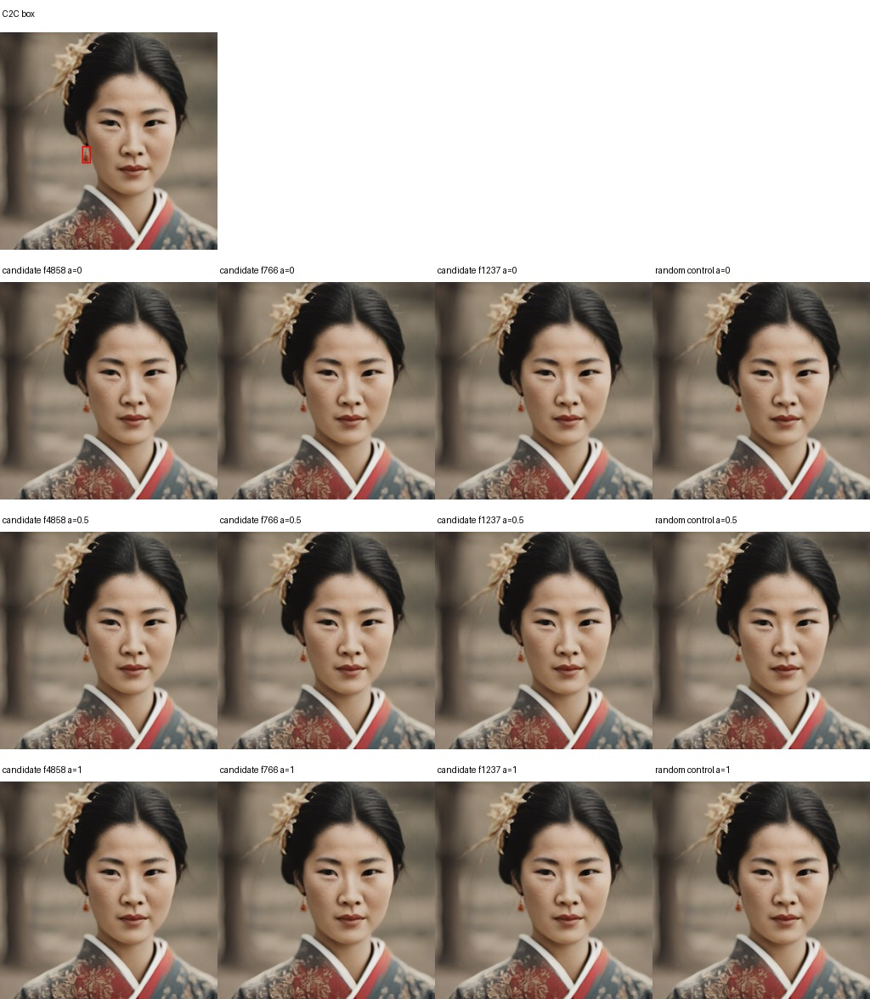
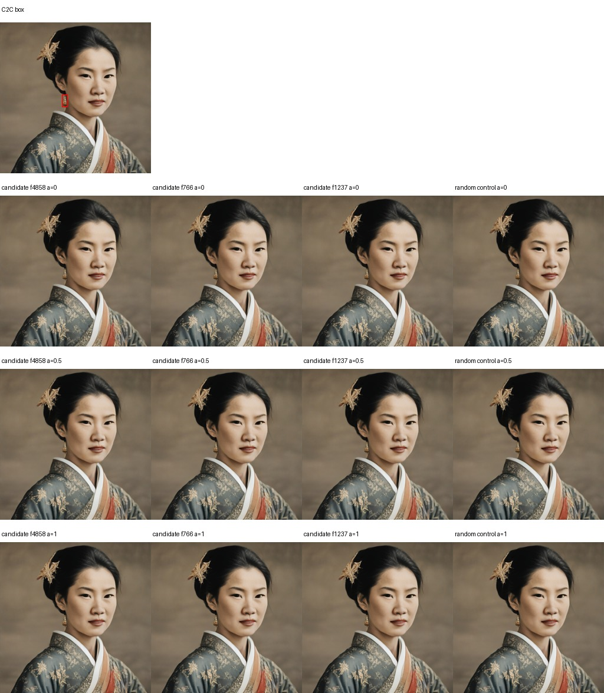
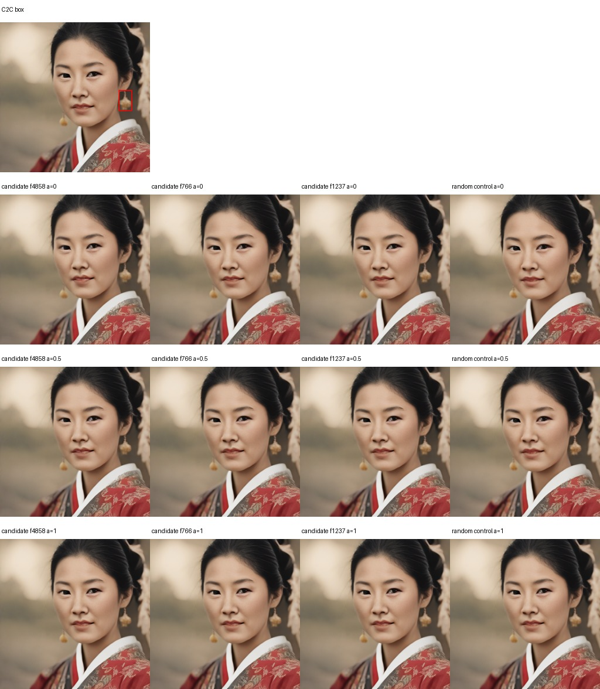
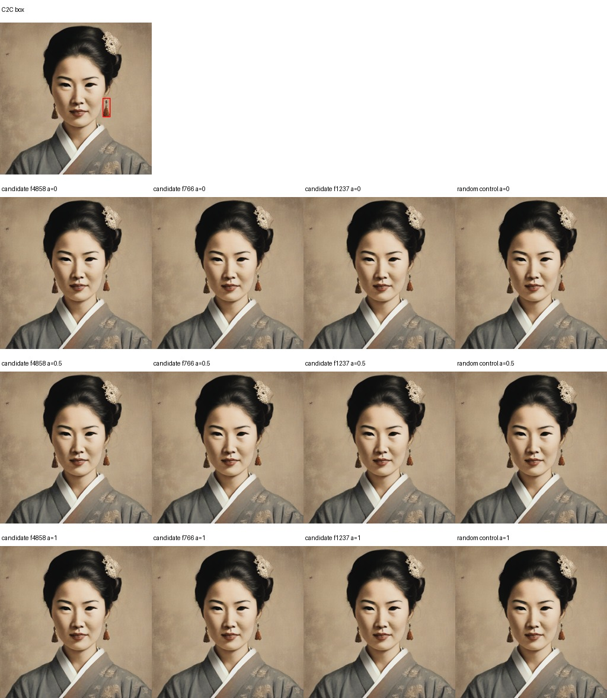
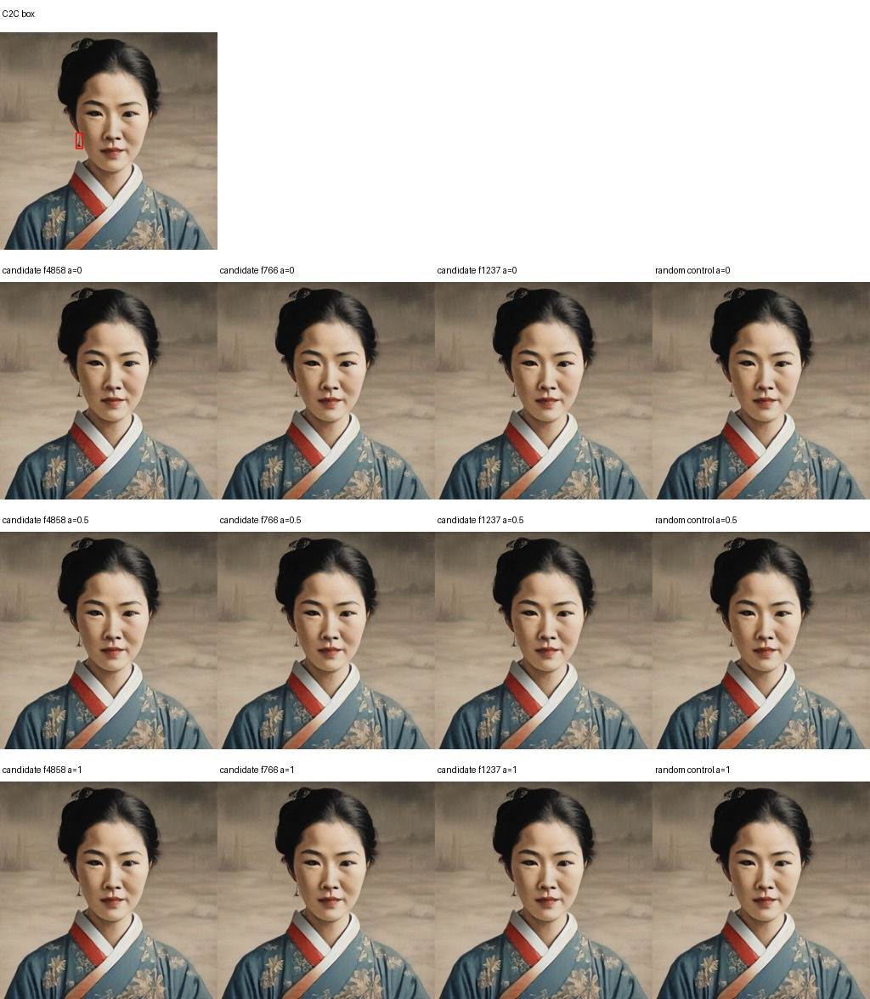
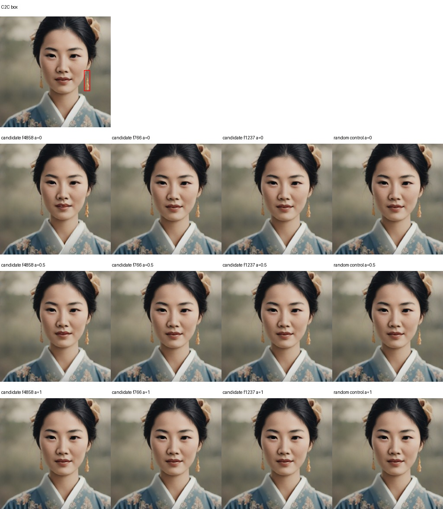
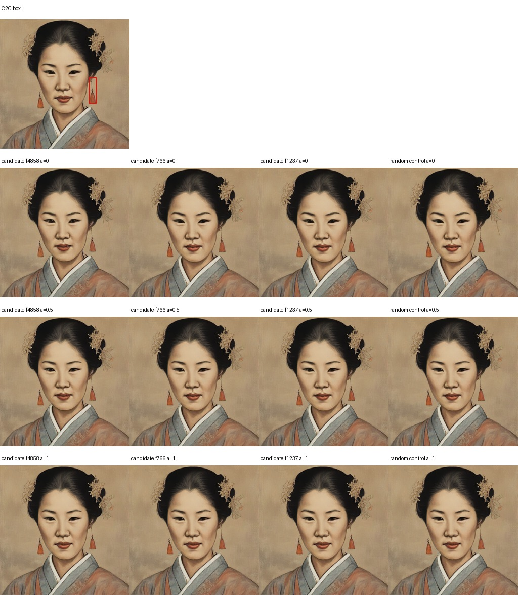
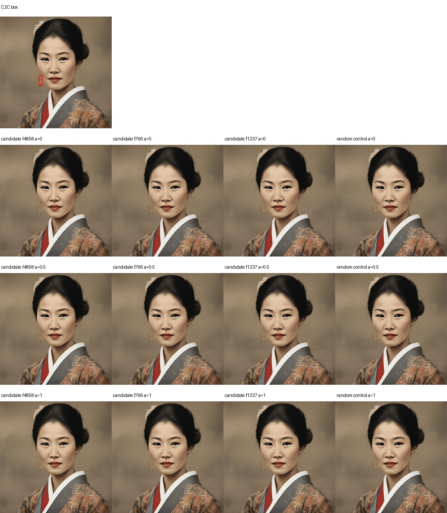

# Earring feature intervention using C2C boxes

Top three features were selected by train-only spatial ROI AUC, then intervened on validation-positive examples. The random control is feature 2940. All intervention is limited to the C2C earring boxes plus a one-cell activation-grid border.

| Sample | Candidate feature | Whole image MAE at 0 | Inside box MAE at 0 | Outside box MAE at 0 |
|---|---:|---:|---:|---:|
| east_asian_woman_seed012 | 4858 | 1.996 | 5.606 | 1.984 |
| east_asian_woman_seed012 | 766 | 0.000 | 0.000 | 0.000 |
| east_asian_woman_seed012 | 1237 | 0.000 | 0.000 | 0.000 |
| east_asian_woman_seed047 | 4858 | 2.216 | 5.472 | 2.205 |
| east_asian_woman_seed047 | 766 | 0.000 | 0.000 | 0.000 |
| east_asian_woman_seed047 | 1237 | 0.000 | 0.000 | 0.000 |
| east_asian_woman_seed051 | 4858 | 2.707 | 3.406 | 2.693 |
| east_asian_woman_seed051 | 766 | 0.326 | 0.341 | 0.326 |
| east_asian_woman_seed051 | 1237 | 0.611 | 1.089 | 0.601 |
| east_asian_woman_seed054 | 4858 | 1.706 | 4.493 | 1.687 |
| east_asian_woman_seed054 | 766 | 0.000 | 0.000 | 0.000 |
| east_asian_woman_seed054 | 1237 | 0.000 | 0.000 | 0.000 |
| east_asian_woman_seed061 | 4858 | 2.558 | 7.356 | 2.546 |
| east_asian_woman_seed061 | 766 | 0.000 | 0.000 | 0.000 |
| east_asian_woman_seed061 | 1237 | 0.000 | 0.000 | 0.000 |
| east_asian_woman_seed066 | 4858 | 4.713 | 7.471 | 4.659 |
| east_asian_woman_seed066 | 766 | 0.000 | 0.000 | 0.000 |
| east_asian_woman_seed066 | 1237 | 0.000 | 0.000 | 0.000 |
| east_asian_woman_seed083 | 4858 | 3.585 | 7.650 | 3.500 |
| east_asian_woman_seed083 | 766 | 0.000 | 0.000 | 0.000 |
| east_asian_woman_seed083 | 1237 | 0.000 | 0.000 | 0.000 |
| east_asian_woman_seed096 | 4858 | 1.229 | 1.986 | 1.227 |
| east_asian_woman_seed096 | 766 | 0.000 | 0.000 | 0.000 |
| east_asian_woman_seed096 | 1237 | 0.474 | 1.326 | 0.471 |

Pixel change is not object-removal evidence. Inspect the grids and manually judge whether the earrings disappear while the face and rest of the image remain intact.

The top-ranked feature, 4858, changed pixels in all eight examples but did not clearly remove the earrings in the inspected grids. Features 766 and 1237 were exact no-ops in most held-out images because they had little or no activation in the boxed region. The ranking therefore did not yield a reliable removal feature.

## east_asian_woman_seed012

## east_asian_woman_seed047

## east_asian_woman_seed051

## east_asian_woman_seed054

## east_asian_woman_seed061

## east_asian_woman_seed066

## east_asian_woman_seed083

## east_asian_woman_seed096

