# Turban, flower, and kimono feature intervention pilot

Same-prompt validation images replayed from their original prompts and seeds. Candidate SAE feature and matched random control are attenuated at alpha 0, 0.5, and 1. Alpha 1 is unchanged. Source detector labels are unreviewed; compare images directly.

Random controls selected by pooled activity on this small set: {'turban': 2430, 'flower': 2940, 'kimono': 4544}.

## Result

No candidate produced clear removal of its named object in the spot-checked grids. Turban feature 1526 made only a small change and the turban remained visible. Flower feature 2230 changed more pixels, but the hair flower remained visible while the face and clothing also shifted. Kimono feature 5046 changed the image about as much as its random control and did not clearly remove the garment. This is consistent with weak or mixed features, not reliable object control.

At alpha 0, mean image pixel MAE (0–255) for candidate versus random control was 0.721 vs 0.982 for turban, 5.205 vs 6.053 for flower, and 3.984 vs 4.178 for kimono. These are image-change measurements, not object-removal scores. The source detector labels are unreviewed. Kimono has just two positive and two negative examples from one prompt group because the original validation set has no larger same-prompt control set.

All 20 source images replayed with exact pixel identity, and all 40 alpha-1 outputs were exact no-ops. Visual spot checks: [turban](grids/middle_eastern_man_seed095.jpg), [flower](grids/east_asian_woman_seed041.jpg), and [kimono](grids/east_asian_man_seed022.jpg).

## turban: feature 1526, random control 2430

### middle_eastern_man_seed095 (detector_positive)

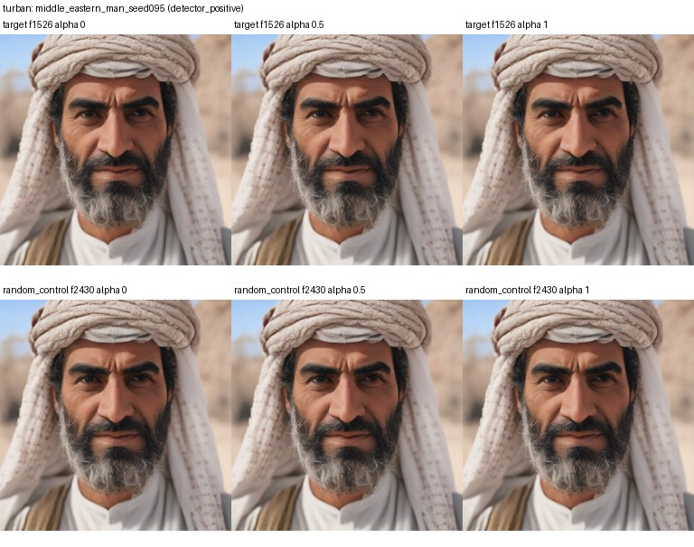

### middle_eastern_man_seed083 (detector_positive)

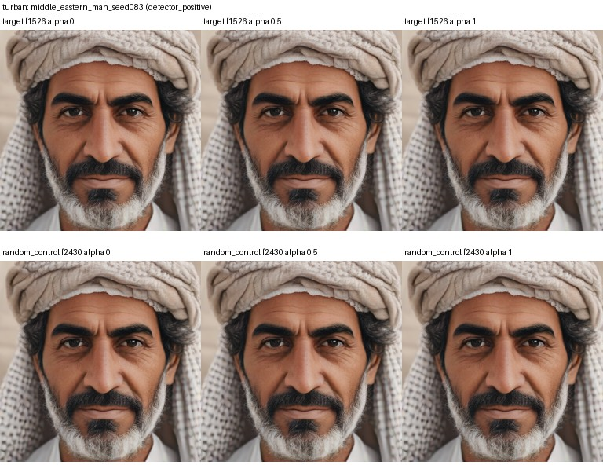

### middle_eastern_man_seed012 (detector_positive)

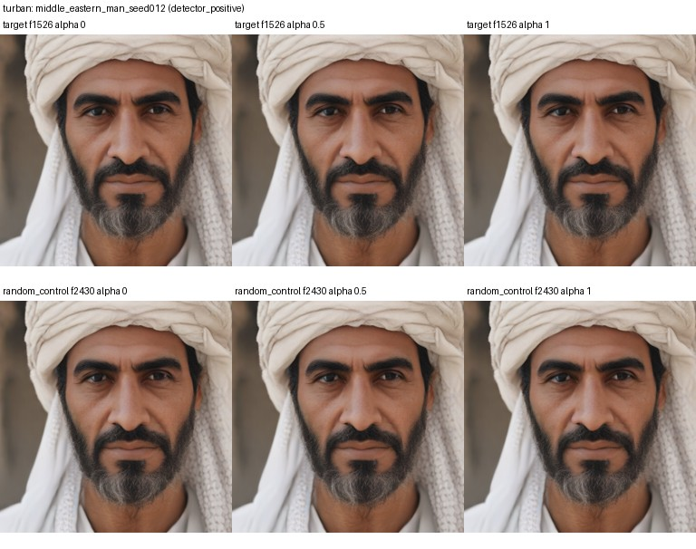

### middle_eastern_man_seed070 (detector_positive)

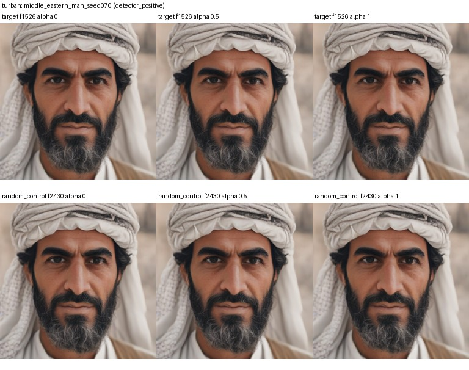

### middle_eastern_man_seed047 (detector_negative)

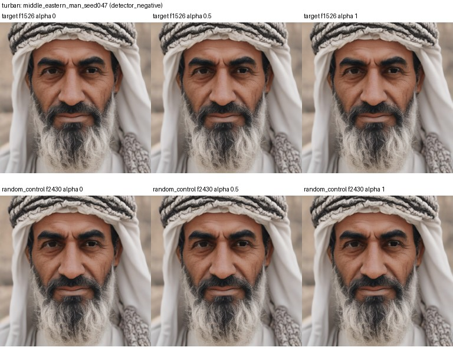

### middle_eastern_man_seed022 (detector_negative)

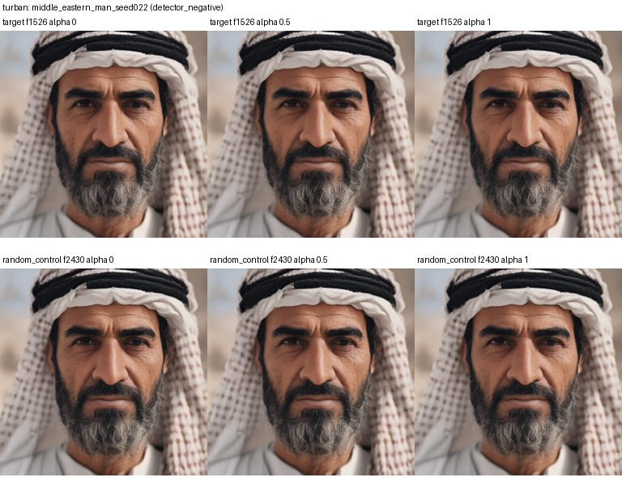

### middle_eastern_man_seed096 (detector_negative)

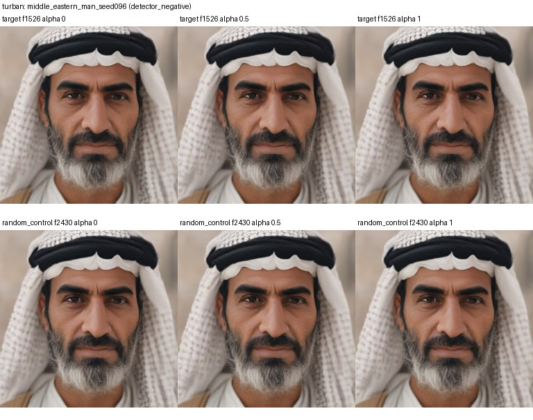

### middle_eastern_man_seed013 (detector_negative)

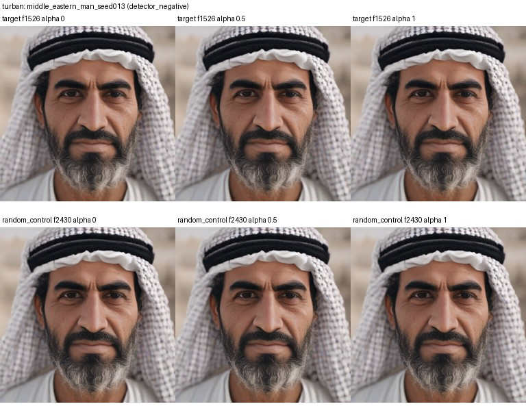

## flower: feature 2230, random control 2940

### east_asian_woman_seed083 (detector_positive)

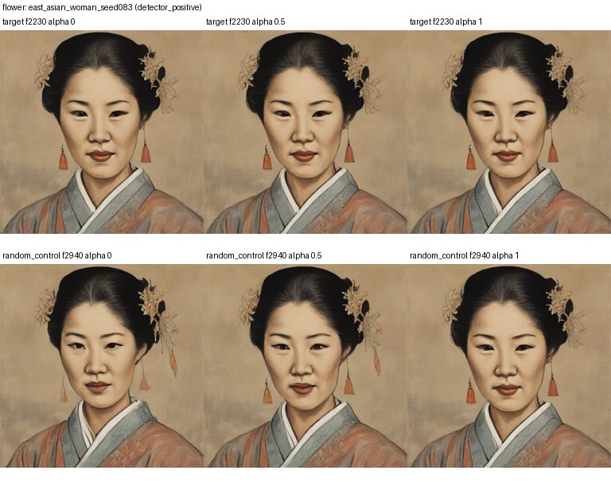

### east_asian_woman_seed002 (detector_positive)

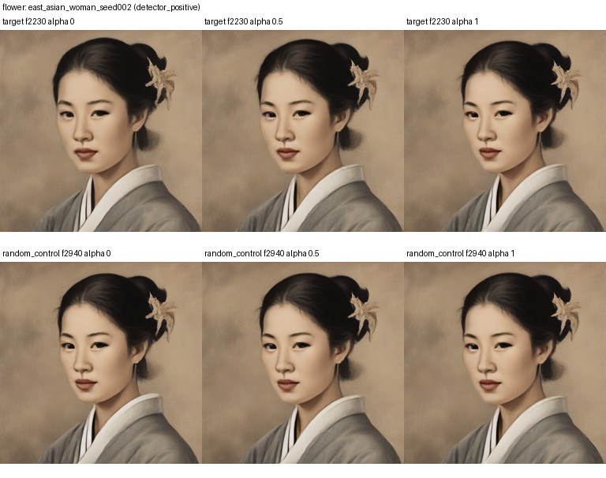

### east_asian_woman_seed041 (detector_positive)

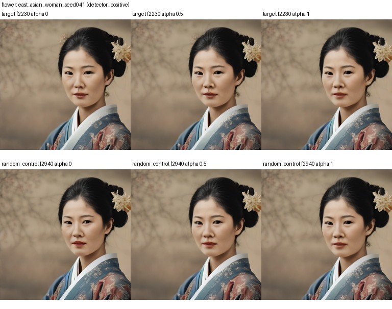

### east_asian_woman_seed042 (detector_positive)

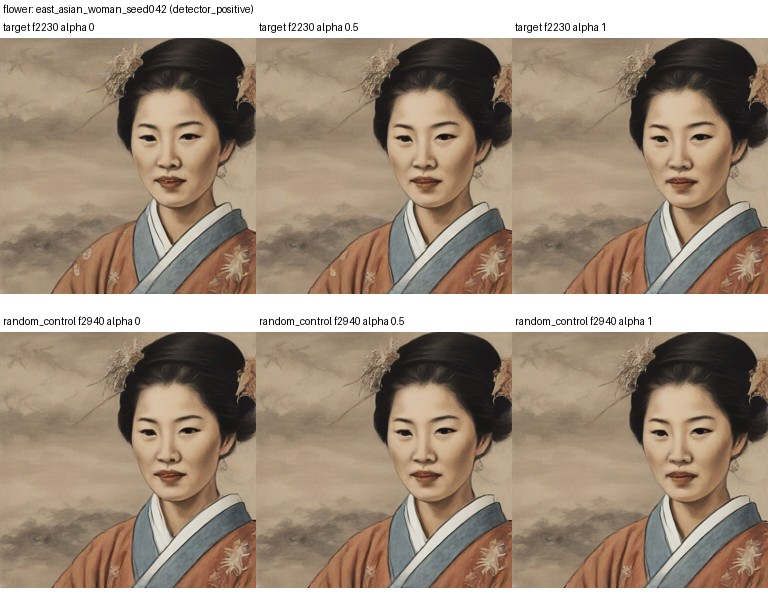

### east_asian_woman_seed053 (detector_negative)

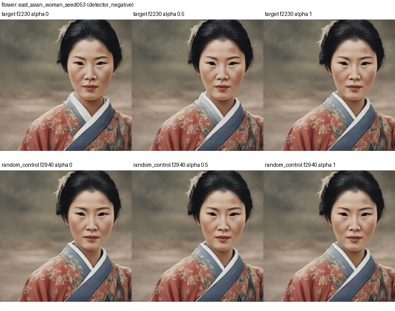

### east_asian_woman_seed066 (detector_negative)

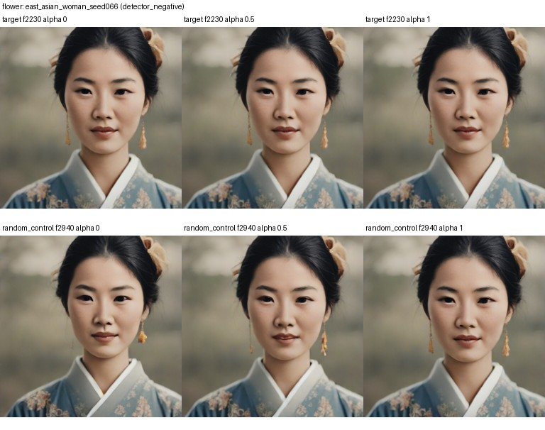

### east_asian_woman_seed096 (detector_negative)

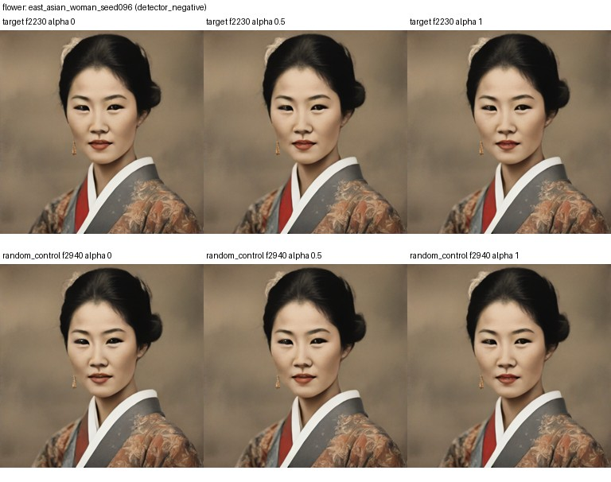

### east_asian_woman_seed051 (detector_negative)

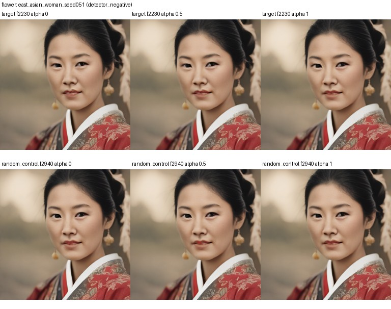

## kimono: feature 5046, random control 4544

### east_asian_man_seed022 (detector_positive)

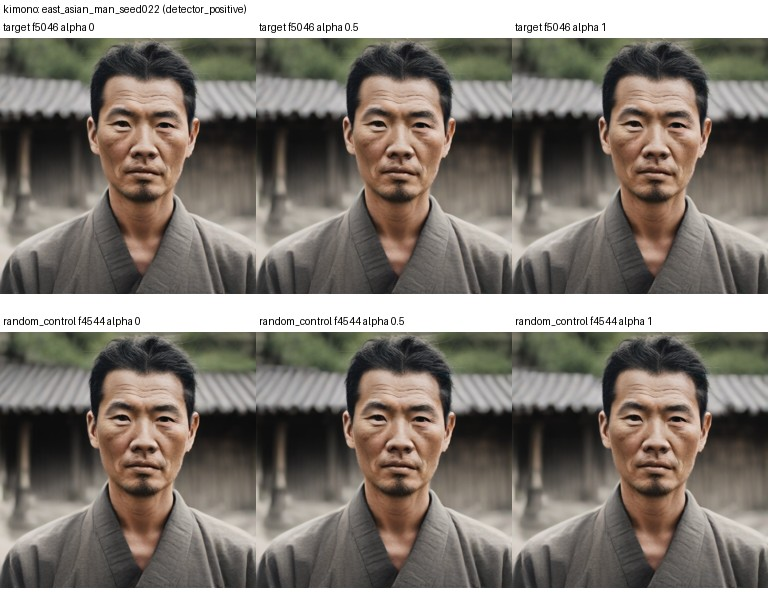

### east_asian_man_seed095 (detector_positive)

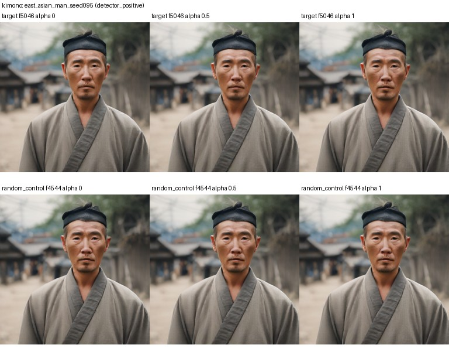

### east_asian_man_seed074 (detector_negative)

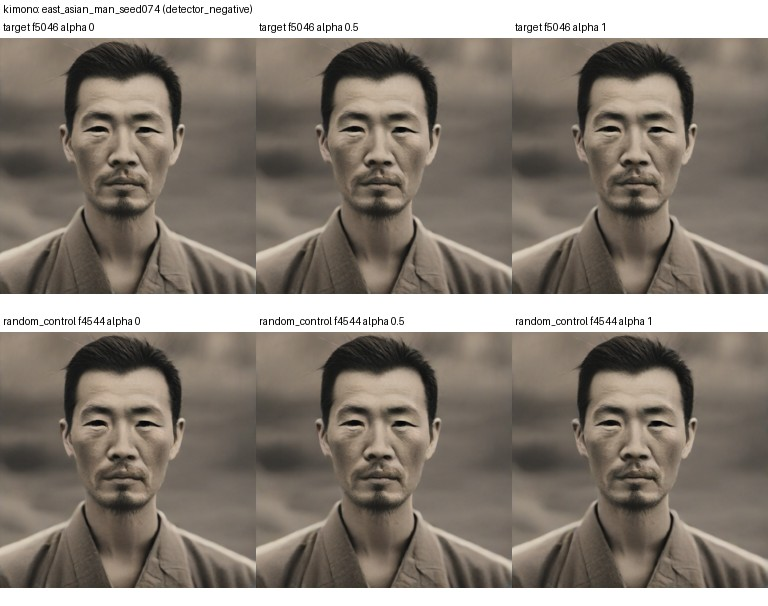

### east_asian_man_seed061 (detector_negative)

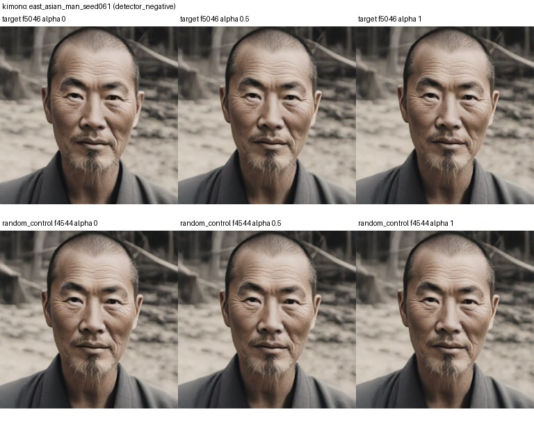
