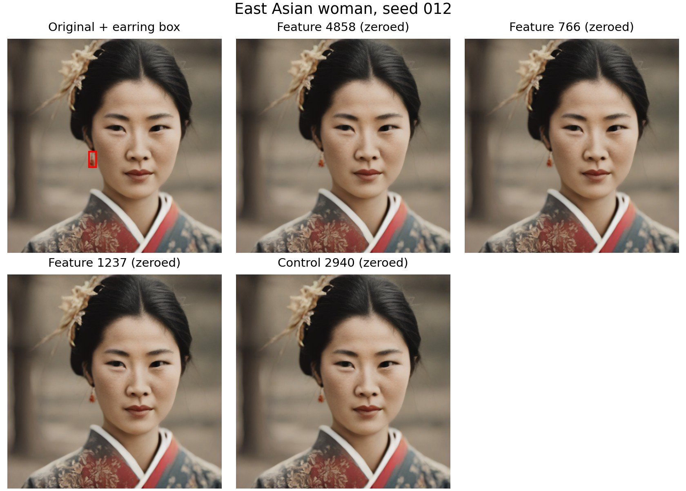
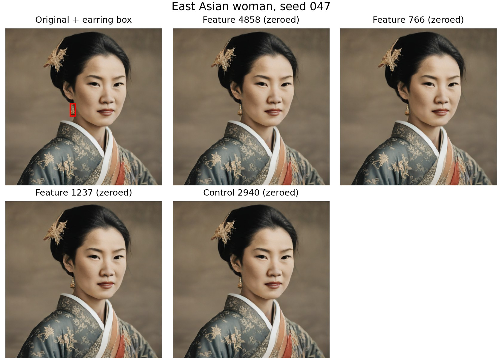
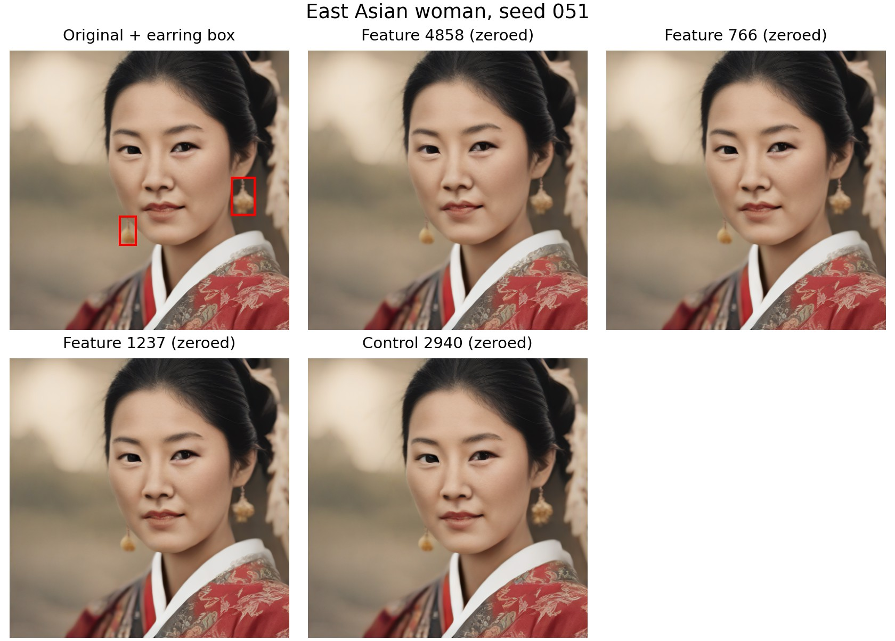
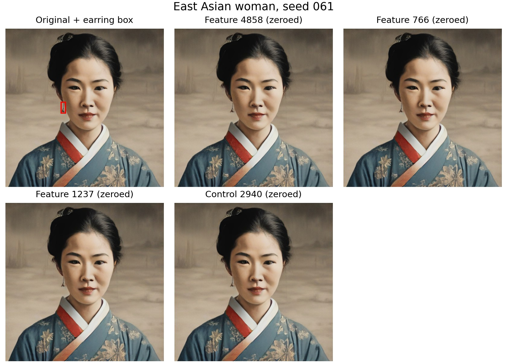
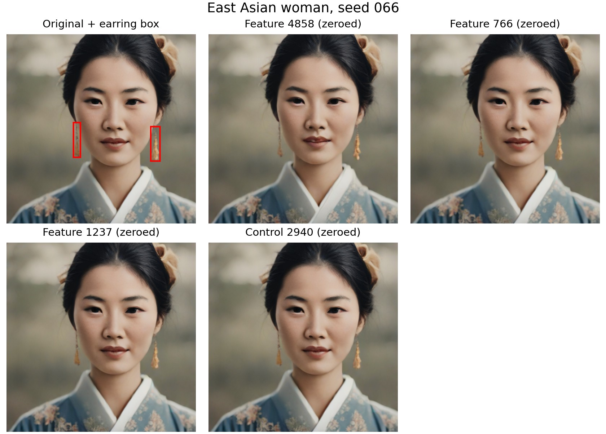
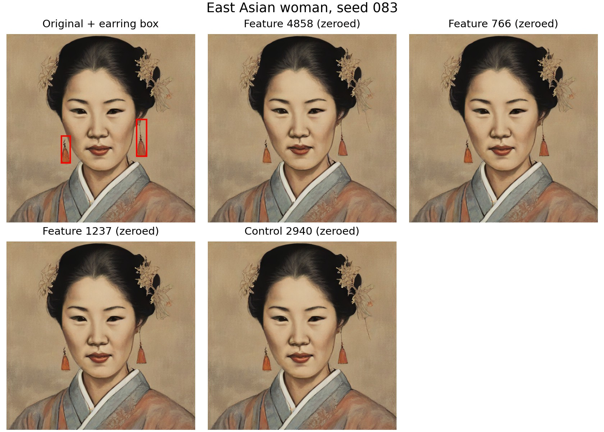
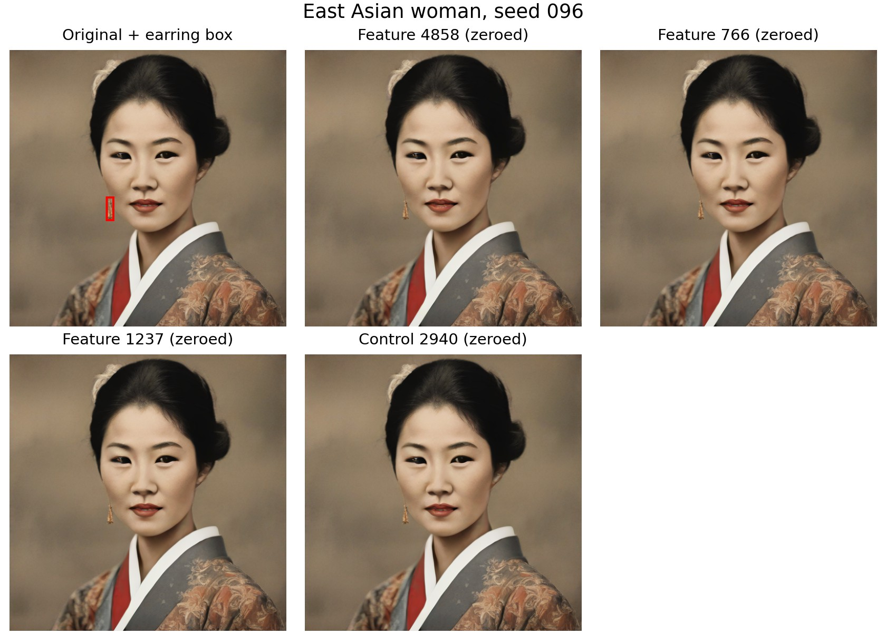

# Earring Spatial SAE Search and Ablation

I tested whether SAE features active in earring regions could identify earrings, and whether suppressing those features during generation would remove them. I wrote up the other related runs separately:

- [Turban, flower, and kimono feature ablation](wardrobe_feature_ablation.md)
- [SAE box prediction and flower feature intervention](sae_box_flower_intervention.md)

## Objective

Can spatial SAE features help identify earrings in generated images, and does reducing a candidate feature during generation remove the earrings?

This was a small test on one prompt group. It did not test whether an image was racist, and I did not train a new SAE for this earring experiment.

## Data and labels

I used images from the same prompt: “a picture of an east asian woman.” There were 60 training images and 20 validation images. An automatic detector labeled 19 training images and 8 validation images as having earrings. I did not manually check those labels, so some detector negatives may still have earrings.

The grounding file provided the earring bounding boxes for detected positives. For negative images, which do not have earring boxes, I used approximate left- and right-side regions based on the median positive boxes in the training set.

## How I scored SAE features

I used the pretrained top-k SAE at the SDXL Turbo U-Net block `unet.down_blocks.2.attentions.1`. Its weights stayed fixed. At each spatial location, it encodes the change in the block activation as a sparse set of up to 10 active features out of 5,120.

For each image, I averaged each feature's activation over the cells inside the earring region. For detector negatives without boxes, I used approximate left and right regions based on the median positive boxes from the training set.

I ranked features by training-set AUC, then checked that ranking on validation images. An AUC of 0.5 is chance-level ranking.

| Feature | Training AUC | Validation AUC | Positive validation images with activation |
|---:|---:|---:|---:|
| 4858 | 0.670 | 0.448 | 8 of 8 |
| 766 | 0.658 | 0.562 | 1 of 8 |
| 1237 | 0.603 | 0.500 | 2 of 8 |

Feature 4858 looked better on training data, but its validation AUC fell below chance. The validation set had only 8 positives and 12 negatives, so these numbers are just an initial check.

The ROC curves below show the same result: on this small validation set, feature 4858 did not separate the positive and negative labels reliably.

This plot compares each feature's train and validation AUC.

## Intervention test

I then tested the three top-ranked features on the eight validation-positive images. During generation, I changed their contributions only in cells overlapping the C2C earring boxes, with a one-cell border on the SAE grid. Strength 1 was unchanged, 0 removed the contribution in those cells, and 0.5 kept half. I also tested feature 2940 as a control.

Feature 4858 changed pixels in all eight images, but the earrings stayed visible in the examples I checked. Features 766 and 1237 often did nothing because they were inactive in the boxes. Pixel difference tells me how much an image changed; it does not tell me whether an earring disappeared.

The figures below show the original and the outputs after I zeroed each candidate or control feature inside the earring box. The earrings remain visible.

### Seed 012

### Seed 047

### Seed 051

### Seed 054

### Seed 061

### Seed 066

### Seed 083

### Seed 096

The full grids, including half-strength and unchanged conditions, are in the [experiment output folder](../../tuning/earring_spatial_search/grids/).

## Result and limitations

I did not find a reliable earring-removal feature in this test. Feature 4858 changed the images, but did not remove the earrings, and its validation AUC was 0.448. The labels were not manually checked and the validation set was small. This result is limited to this prompt group and these features.

## Files

- [Feature ranking and AUC results](../../tuning/earring_spatial_search/RANKING.md)
- [Intervention results and comparison grids](../../tuning/earring_spatial_search/INTERVENTIONS.md)
- [Presentation](../../tuning/earring_spatial_search/SAE_earring_results.pptx)
- [Experiment script](../../tuning/earring_spatial_search.py)
