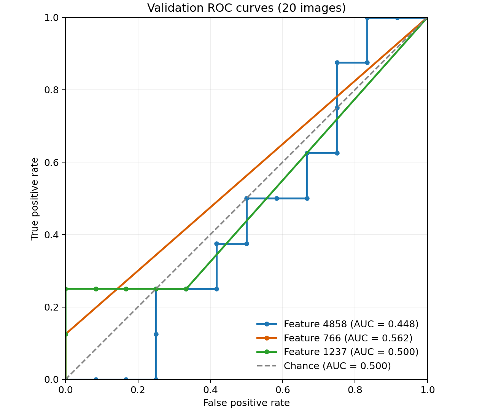
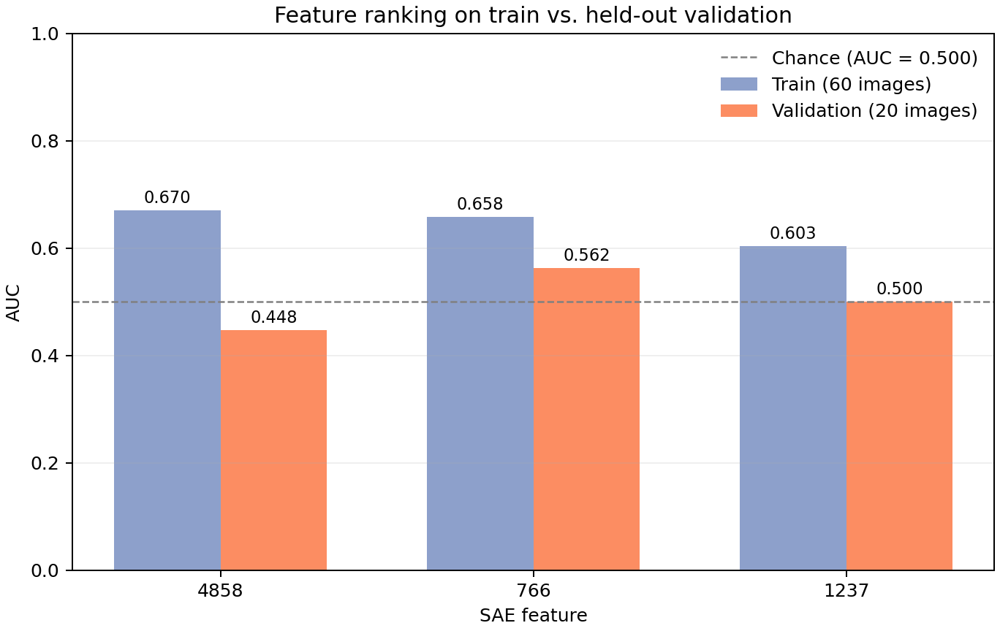
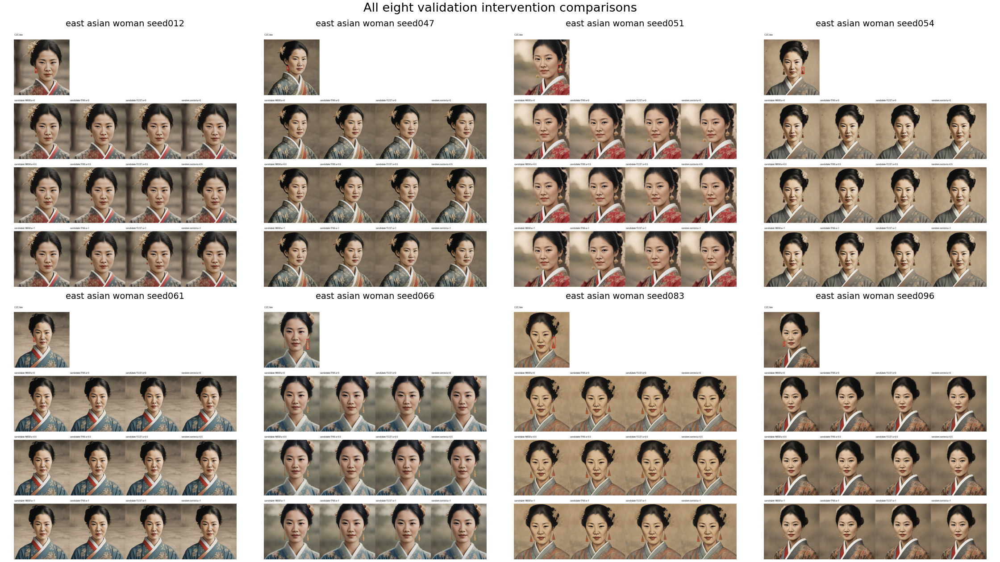

# First SAE feature experiment: earrings

## Question

Can spatial SAE features help identify earrings in generated images, and does reducing a candidate feature during generation remove the earrings?

This was an exploratory test using earrings as one target object. It did not test whether an image was racist, and it did not train a new SAE.

## Data and labels

I used images generated with the same prompt, “a picture of an east asian woman.” There were 60 training images and 20 validation images. Automatic concept predictions labeled 19 training images and 8 validation images as containing earrings. These labels were not manually reviewed. An image without an earring detection was treated as negative, but the detector could have missed earrings.

The grounding file provided the earring bounding boxes for detected positives. For negative images, which do not have earring boxes, I used approximate left- and right-side regions based on the median positive boxes in the training set.

## How I scored SAE features

I used a pretrained top-k SAE with 5,120 features at the SDXL Turbo UNet block `unet.down_blocks.2.attentions.1`. The SAE encoder and decoder weights stayed fixed. At each spatial location, the SAE encodes the change in the block activation. Its top 10 feature values can be active at that location; other values are zero.

For each image and feature, I summed the feature activations over the spatial cells inside the earring region and divided by the number of cells. This gave one average activation score per feature per image.

I calculated AUC by comparing positive-image scores with negative-image scores. AUC is the fraction of positive-negative pairs where the positive image has a higher score, with ties counted as half. An AUC of 0.5 is chance-level ranking. I ranked features using training AUC only and used validation AUC to check whether the ranking held up on held-out images.

| Feature | Training AUC | Validation AUC | Positive validation images with activation |
|---:|---:|---:|---:|
| 4858 | 0.670 | 0.448 | 8 of 8 |
| 766 | 0.658 | 0.562 | 1 of 8 |
| 1237 | 0.603 | 0.500 | 2 of 8 |

The top feature looked somewhat more promising on the training images, but did not separate the validation labels reliably. The validation set had only 8 positive and 12 negative images, so these scores are exploratory.

The ROC plot shows true-positive rate against false-positive rate as the score threshold changes. The dashed diagonal is chance-level ranking. The step-shaped curves are expected with only 20 validation images. AUC is the area under each curve; it does not require a plot, but the plot makes the ranking behavior easier to see.

This plot compares the same features on training and validation. Feature 4858 scored higher on training but fell below chance on validation.

## Intervention test

I tested the three highest-ranked features on the eight validation-positive images. During generation, I reduced each feature’s contribution inside the C2C earring box, with a one-cell border on the SAE activation grid. Strength 1 left the feature unchanged, 0 removed its contribution in the selected region, and 0.5 reduced it by half. I also tested feature 2940 as a control.

Feature 4858 changed pixels in all eight images, but visual inspection showed that the earrings remained. Features 766 and 1237 often made no change because they had little or no activation in the boxed region. The control was also tested. Pixel difference measures how much an image changed; it does not tell us whether an earring disappeared.

This montage shows the C2C box and the generated comparisons for all eight validation-positive images. Each panel compares the original with the three candidate features and the control at the tested strengths. The target remained visible after suppression.

Individual full-size comparison grids are available in the [experiment output folder](../../tuning/earring_spatial_search/grids/).

## Result and limitations

This experiment did not find a reliable SAE feature for earring removal. The candidate that changed the images did not clearly remove the target, and its validation AUC was below 0.5. The automatic labels were unreviewed, and the validation sample was small. This result applies to this prompt group and these candidate features; it does not show that every SAE feature or intervention will fail.

## Files

- [Feature ranking and AUC results](../../tuning/earring_spatial_search/RANKING.md)
- [Intervention results and comparison grids](../../tuning/earring_spatial_search/INTERVENTIONS.md)
- [Presentation](../../tuning/earring_spatial_search/SAE_earring_results.pptx)
- [Experiment script](../../tuning/earring_spatial_search.py)
